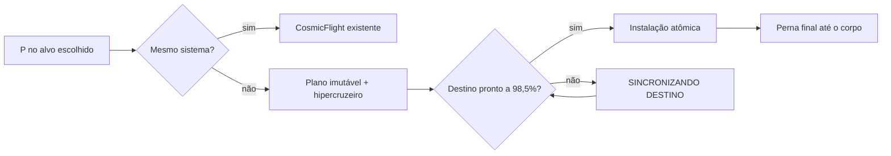

# ✨ feat | Universe Map: navegação universal, sistemas procedurais, galáxias e hipercruzeiro

> O jogador agora abre o mapa universal, escolhe qualquer destino — corpo, estrela, sistema ou galáxia — e viaja até lá em hipercruzeiro contínuo, chegando a sistemas procedurais jogáveis e à Andromeda sem sair da sessão.

**Escopo:** esta entrega leva o Dr. Manaus de uma base jogável (Manaus real, voo, destruição) até um universo navegável de ponta a ponta. Cobre a base espacial (núcleo WGS84, Sistema Solar com efemérides offline, planetas em cubo-esfera, luas, volume destrutível de superfície e crateras de impacto), a autoridade única de alvo universal (U0), sistemas estelares procedurais jogáveis com pouso (U1), runtime de galáxia ativa com Andromeda e buraco negro central (U2) e o hipercruzeiro universal com planejamento, cancelamento e chegada atômica (U3). Inclui também a base jogável anterior (personagem animado, cidade real de Manaus, destruição) e um portão permanente de regressão entre funcionalidades.

**História:** [Universo][Navegação e Viagem] Universe Map — U0 a U3 e portão permanente de regressão

**Branch:** `feat/universe-map` → `main`

| Commit | Entrega |
| --- | --- |
| [`3b8f671`](https://github.com/PauloSoaf/Dr-Manaus/commit/3b8f671) | Núcleo espacial WGS84 e Manaus ancorada a ele |
| [`8e3b047`](https://github.com/PauloSoaf/Dr-Manaus/commit/8e3b047) | Registro de providers e agendador global de streaming |
| [`4d6b599`](https://github.com/PauloSoaf/Dr-Manaus/commit/4d6b599) | Sistema Solar, efemérides offline e setores estelares |
| [`70a7fa7`](https://github.com/PauloSoaf/Dr-Manaus/commit/70a7fa7) | Globo WGS84 com costas reais e iluminação solar |
| [`0a3818a`](https://github.com/PauloSoaf/Dr-Manaus/commit/0a3818a) | Renderizadores do mapa universal (fases B e C) |
| [`e03f75d`](https://github.com/PauloSoaf/Dr-Manaus/commit/e03f75d) | Todos os corpos do Sistema Solar com proxies limitados e anéis de Saturno |
| [`595964b`](https://github.com/PauloSoaf/Dr-Manaus/commit/595964b) | Catálogo hierárquico de luas principais com frames síncronos |
| [`b098af1`](https://github.com/PauloSoaf/Dr-Manaus/commit/b098af1) | Chunks de volume residentes via agendador global |
| [`4804016`](https://github.com/PauloSoaf/Dr-Manaus/commit/4804016) | Malhas Marching Cubes indexadas por chunk |
| [`198ccc5`](https://github.com/PauloSoaf/Dr-Manaus/commit/198ccc5) | Trava celeste unificada e autopiloto de captura seguro |
| [`42a930a`](https://github.com/PauloSoaf/Dr-Manaus/commit/42a930a) | Tiers de voo, captura de pouso e prioridade de streaming de luas |
| [`513381c`](https://github.com/PauloSoaf/Dr-Manaus/commit/513381c) | Classificação e emissão de eventos de impacto celeste |
| [`14d96f6`](https://github.com/PauloSoaf/Dr-Manaus/commit/14d96f6) | Colisão contínua com volume de planeta |
| [`89f5b38`](https://github.com/PauloSoaf/Dr-Manaus/commit/89f5b38) | Impactos rochosos elegíveis viram edições autoritativas de esfera |
| [`0e77efe`](https://github.com/PauloSoaf/Dr-Manaus/commit/0e77efe) | Consumo de impactos e caminhada em piso de cratera publicado |
| [`2996024`](https://github.com/PauloSoaf/Dr-Manaus/commit/2996024) | Regiões coerentes de impacto em alta resolução |
| [`95de682`](https://github.com/PauloSoaf/Dr-Manaus/commit/95de682) | Fotosfera do Sol separada com apresentação procedural limitada |
| [`1b2bda5`](https://github.com/PauloSoaf/Dr-Manaus/commit/1b2bda5) | Cidade de Manaus e rio regional curvos durante a ascensão |
| [`4ba2150`](https://github.com/PauloSoaf/Dr-Manaus/commit/4ba2150) | U0: mapa, HUD e alvo Solar sob uma única autoridade de alvo |
| [`c651abb`](https://github.com/PauloSoaf/Dr-Manaus/commit/c651abb) | U0: fechamento do checkpoint |
| [`a28f2a0`](https://github.com/PauloSoaf/Dr-Manaus/commit/a28f2a0) | U1: estrelas e perfis de corpos procedurais consistentes |
| [`6f805ff`](https://github.com/PauloSoaf/Dr-Manaus/commit/6f805ff) | U1: apresentação e pouso em corpos de sistemas procedurais |
| [`9909091`](https://github.com/PauloSoaf/Dr-Manaus/commit/9909091) | U1: fechamento do checkpoint |
| [`4224d16`](https://github.com/PauloSoaf/Dr-Manaus/commit/4224d16) | U2: runtime de galáxia ativa e coordenadas de setor locais à galáxia |
| [`da59521`](https://github.com/PauloSoaf/Dr-Manaus/commit/da59521) | U2: preparação de sessões de galáxia e sistema com rollback |
| [`f338471`](https://github.com/PauloSoaf/Dr-Manaus/commit/f338471) | U2: fundo de galáxia, galáxias externas e buraco negro central |
| [`64eb021`](https://github.com/PauloSoaf/Dr-Manaus/commit/64eb021) | U2: fechamento do checkpoint |
| [`8e27488`](https://github.com/PauloSoaf/Dr-Manaus/commit/8e27488) | Portão permanente de regressão entre funcionalidades |
| [`8b21d79`](https://github.com/PauloSoaf/Dr-Manaus/commit/8b21d79) | U3: planejamento universal de trânsito e hipercruzeiro lógico |
| [`a25f0de`](https://github.com/PauloSoaf/Dr-Manaus/commit/a25f0de) | U3: materialização atômica de destinos de produção |
| [`4cc6b2f`](https://github.com/PauloSoaf/Dr-Manaus/commit/4cc6b2f) | U3: controles de hipercruzeiro e apresentação de trânsito limitada |
| [`b3156a2`](https://github.com/PauloSoaf/Dr-Manaus/commit/b3156a2) | U3: cancelamento robusto e seleção de destino de produção |
| [`6cb37fb`](https://github.com/PauloSoaf/Dr-Manaus/commit/6cb37fb) | Preserva a posição de trânsito após falha de ativação da chegada |
| [`68af476`](https://github.com/PauloSoaf/Dr-Manaus/commit/68af476) | P0: apresentação planetária, mapa 3D da Terra, rios, iluminação, voo e fotosfera solar |
| [`4c05785`](https://github.com/PauloSoaf/Dr-Manaus/commit/4c05785) | P0.2: rios independentes sem conexões artificiais, robustez WebGL com fallback 2D e teste E2E de pouso no Sol |
| [`8fa65d7`](https://github.com/PauloSoaf/Dr-Manaus/commit/8fa65d7) | P0.2 Hotfix: substituição de canvas DOM no fallback 2D WebGL e teste E2E solar puro via controladores |

**Depende de:** nenhuma outra branch. O diff é contra `main`; como a branch acumula o histórico desde a base jogável, ele é grande (1.222 arquivos, a maior parte dados de tiles em `public/geodata/real-city/tiles/`).

## 🚀 Summary

| Área | Alteração | Resultado na interface |
| --- | --- | --- |
| Navegação | Autoridade única de alvo universal, com identidade BigInt, compartilhada por mapa, HUD e alvo Solar | O alvo selecionado no mapa é o mesmo do HUD e persiste |
| Mapa universal | Renderizadores de sistema, galáxia e hierarquia ativa, com breadcrumbs interativos | Navegação por Sistema Solar, setores estelares e galáxias |
| Mapa 3D e rios | Globo 3D esférico interativo (yaw/pitch/zoom), rios continentais Natural Earth offline e marcadores | Visualização 3D da Terra e Rio Amazonas no mapa universal |
| Sistemas procedurais | Estrelas, planetas e luas gerados de forma determinística, com pouso | Chegar a uma estrela remota e pousar nos seus corpos |
| Galáxias | Runtime de galáxia ativa, Andromeda e buraco negro central | Viagem à Andromeda e retorno à Via Láctea |
| Hipercruzeiro | Plano de viagem imutável, fases de aceleração, cruzeiro e desaceleração, cancelamento com X | Telemetria de velocidade efetiva e estado SINCRONIZANDO DESTINO |
| Planetas e luas | Globo WGS84, cubo-esfera, luas principais, Saturno com anéis, iluminação solar e earthshine | Todos os corpos visíveis com dia/noite e lua iluminada |
| Fotosfera solar | Modo de pouso em fotosfera solar com plano tangente ENU (sem Marching Cubes/crateras) | Voo rasante e pouso na fotosfera sem colisão rochosa |
| Superfície destrutível | Volume Marching Cubes, colisão contínua e crateras de impacto | Meteoros e armas abrem crateras caminháveis em corpos rochosos |
| Manaus e LOD orbital | Cidade real georreferenciada e Tier C orbital com disco, brilho noturno e culling limpo | Transição fluida de 15km a 500km sem plano plano em órbita |
| Personagem e voo | Rig de 19 ossos, orientação 3D sem gimbal lock e pose aerodinâmica procedural | Voo fluido sem inversões no zênite com inclinação natural |
| Qualidade | Portão permanente de regressão em testes de unidade e navegador (610 unit, browser A-F) | Falha em qualquer contrato impede o fechamento de checkpoint |

## 📑 Description

### 1. Autoridade única de alvo universal (U0)

Antes, o mapa, o HUD e o alvo do Sistema Solar mantinham seleções separadas, o que permitia divergência entre o destino mostrado e o destino usado.

Agora há uma única autoridade de alvo, com identidade BigInt para setores e sistemas distantes, diagnósticos universais no F3 e persistência do alvo.

### 2. Sistemas estelares procedurais jogáveis (U1)

Estrelas e corpos eram apenas pontos de mapa. Agora cada sistema é gerado de forma determinística a partir do setor e instalado de forma preparada, com generalização dos frames intra-sistema. O jogador voa, aproxima-se e pousa nos corpos gerados e pode revisitar o sistema com o mesmo resultado.

### 3. Runtime de galáxia e Andromeda (U2)

O universo tinha uma única galáxia implícita. Agora existe uma galáxia ativa, com coordenadas de setor locais a ela, fundo de galáxia, galáxias externas e buraco negro central. Sessões de galáxia e sistema são preparadas e instaladas com rollback: em caso de falha, o runtime anterior é restaurado.

### 4. Hipercruzeiro universal (U3)

`UniversalTravelController` mantém um `UniversalTravelPlan` imutável e um estado de trânsito contínuo. Selecionar outro alvo durante a viagem não a redireciona.

| Tipo de viagem | Duração nominal |
| --- | --- |
| Interestelar | `clamp(5 + 4·log10(1 + d/4), 5, 25)` segundos |
| Intergaláctica | `clamp(17 + 5·log10(1 + d/1e6), 15, 30)` segundos |

| Fase | Condição | Apresentação |
| --- | --- | --- |
| Spool | Início da viagem | Aceleração sem progresso; X aborta na origem |
| Trânsito | 20% aceleração, 60% cruzeiro, 20% desaceleração | Velocidade efetiva em c/kc/Mc ou ly/s |
| Preparação | 65% de progresso | Frames, providers e visuais do destino preparados uma vez |
| Espera | Destino não pronto em 98,5% | SINCRONIZANDO DESTINO |
| Chegada | Destino pronto | Instalação atômica e perna final até o corpo |
| Coasting | X durante o trânsito | Desaceleração de emergência (cerca de 0,8 s) e parada em trânsito |

Detalhes da integração:

- A velocidade efetiva nunca entra em `PlayerController`, `PhysicsWorld`, Warp ou CCD.
- A instalação ativa todos os recursos em uma única transação síncrona; falhas restauram runtime, frames e origem de render.
- Falha na ativação final preserva o último progresso publicado, e P retoma sem retroceder.
- Resultados assíncronos obsoletos são descartados.
- Buracos negros, aglomerados, âncoras cosmológicas e o horizonte permanecem bloqueados nesta entrega.

**Transporte fictício:** o hipercruzeiro usa distâncias lógicas em escala real como transporte de jogabilidade, sem afirmar viabilidade física de FTL.

> Retargeting para um terceiro destino durante o coasting fica deliberadamente fora do escopo; são suportados retomar o destino original e voltar à origem.

### 5. Corpos, volume destrutível e impactos

Os planetas passaram a ter provedores genéricos (`RockyPlanetProvider`) e um volume de superfície com chunks residentes, malha Marching Cubes e colisão contínua. Impactos rochosos elegíveis geram edições autoritativas e crateras caminháveis, com regiões de alta resolução publicadas de forma coerente. O Sol ganhou fotosfera separada e apresentação procedural limitada na aproximação.

### 6. Manaus, personagem e mundo jogável

Cidade real georreferenciada (largo, Teatro Amazonas, rio, tráfego, destruição), curvatura durante a ascensão e transição para o espaço sem lacunas. O personagem usa rig humanoide com clipes autorais, câmeras frontal e traseira, voo animado e combate.

### 7. Portão permanente de regressão

`tests/regression/` registra diretamente as suítes de contrato existentes, mantendo suas asserções originais como autoridade. `scripts/regression-browser.mjs` executa em sequência os runners de Manaus, aerial, Solar/U1, U2 e U3.

## 🔌 Contratos de API envolvidos

Não se aplica: a entrega é totalmente local ao cliente, sem chamadas a endpoints externos de aplicação.

## 🛠️ Changes

### Mundo, viagem e universo

| Arquivo | Alteração |
| --- | --- |
| `src/world/travel/UniversalTravelController.ts`, `UniversalTravelPlan.ts` | Plano imutável e estado de trânsito contínuo do hipercruzeiro |
| `src/world/travel/UniversalTargetCatalog.ts`, `UniversalTargetResolver.ts`, `GalaxyEntryResolver.ts` | Catálogo e resolução de alvos universais; entradas de galáxia |
| `src/world/runtime/UniverseRuntime.ts`, `ProceduralSystemMaterializer.ts` | Localização em trânsito, instalação transacional de sistemas |
| `src/world/galaxy/*` | Coordenadas locais à galáxia, materialização e runtime de galáxia |
| `src/world/celestial/*` | Gerador de sistemas, setores estelares, perfis de corpos |
| `src/world/providers/*` | Providers de galáxia, buraco negro, setores e planetas rochosos |
| `src/world/streaming/*` | Agendador global de streaming e cache de tiles |
| `src/world/planet/volume/*` | Volume de planeta, chunks, malhas e colisão |

### Renderização e interface

| Arquivo | Alteração |
| --- | --- |
| `src/rendering/HypercruisePresentation.ts` | Apresentação limitada de trânsito |
| `src/rendering/celestial/*` | Camadas visuais de corpos, rótulos, Sol e apresentação |
| `src/ui/map/MapRenderers.ts`, `UniversalMapPanel.ts` | Mapa universal com hierarquia ativa |
| `src/ui/HypercruiseTelemetry.ts`, `HUD.ts`, `style.css` | Telemetria de hipercruzeiro e estados no HUD |
| `src/game/Game.ts` | Integração de viagem, controles e ciclo de jogo |

### Jogador e Manaus

| Arquivo | Alteração |
| --- | --- |
| `src/player/*` | Rig de 19 ossos, mistura de animação, câmeras, voo e combate |
| `public/geodata/real-city/tiles/*` | Tiles georreferenciados da cidade real |

### Scripts, CI e documentação

| Arquivo | Alteração |
| --- | --- |
| `scripts/hypercruise-browser.mjs`, `galaxy-runtime-browser.mjs`, `procedural-system-browser-checkpoint.mjs`, `regression-browser.mjs` | Runners de navegador por checkpoint e orquestrador de regressão |
| `.github/workflows/ci.yml`, `package.json` | Portão de regressão no CI e novos scripts de teste |
| `docs/world/26` a `29-status-*.md`, `REGRESSION-GATE.md`, `universal-map.md` | Registros de status U0–U3 e portão de regressão |
| `specs/U1`, `U2`, `U3`, `UNIVERSE-MAP-COMPLETION-EPIC.md` | Especificações dos checkpoints |

### Specs adicionados ou atualizados na branch

| Arquivo | Cobertura incluída |
| --- | --- |
| `tests/universal-navigation-target.test.ts` | Identidade BigInt e persistência do alvo universal |
| `tests/playable-procedural-systems.test.ts`, `procedural-system.test.ts` | Ciclo de vida, voo, pouso e revisita de sistemas procedurais |
| `tests/galaxy-runtime-andromeda.test.ts` | Posse da galáxia, distâncias e ida e volta à Andromeda |
| `tests/universal-hypercruise.test.ts` | Duração, fases, cancelamento e consistência em 30/60/120 FPS |
| `tests/planet-volume-*.test.ts`, `rocky-impact-*.test.ts` | Volume, malha, colisão, persistência e impactos |
| `tests/regression/*.test.ts` | Portão permanente de regressão entre funcionalidades |

## 🧪 How to Test

1. **Verificação automatizada:** executar `npm run typecheck`, `npm run test:regression`, `npm run check:impact-fidelity`, `npm test` e `npm run build`.
2. **Hipercruzeiro até a Andromeda:** no jogo, abrir o mapa universal, selecionar Andromeda, pressionar P e conferir fases, telemetria e chegada em `andromeda/200,0,0/1`.
3. **Cancelamento:** durante o trânsito, pressionar X e conferir desaceleração contínua e parada em coasting; pressionar P e conferir retomada do mesmo destino.
4. **Sistema procedural:** viajar a uma estrela remota, aproximar-se de um planeta e pousar; voltar e revisitar para conferir o mesmo sistema.
5. **Retorno:** selecionar a Via Láctea ou Sol e conferir chegada ao espaço seguro do Sistema Solar.
6. **Crateras:** em Lua ou Marte, provocar impacto e conferir cratera caminhável.
7. **Navegador:** com `$env:DR_BROWSER_GPU='1'`, executar `npm run test:browser:regression`.

## 📋 Test Scenarios Matrix

| # | Cenário | Resultado esperado |
| --- | --- | --- |
| 1 | Selecionar alvo no mapa e conferir o HUD | Mesmo alvo nos dois |
| 2 | Hipercruzeiro interestelar | Duração entre 5 e 25 s, sem salto de velocidade entre fases |
| 3 | Hipercruzeiro intergaláctico | Duração de cerca de 21 s, chegada atômica |
| 4 | Destino não pronto em 98,5% | SINCRONIZANDO DESTINO até a instalação |
| 5 | X durante o spool | Aborta na origem |
| 6 | X em movimento | Desaceleração em cerca de 0,8 s e coasting |
| 7 | Falha de preparação | Runtime de origem preservado e nova tentativa com P |
| 8 | Cinco idas e voltas de produção | Contagens reais de providers, frames e visuais estáveis |
| 9 | Impacto em corpo rochoso | Cratera publicada e caminhável |
| 10 | Subida a partir de Manaus | Cidade e rio permanecem curvos e coerentes |

## 📸 Evidências

| Antes | Depois |
| --- | --- |
| Pendente: captura do mapa sem destinos universais | Pendente: captura do mapa e do hipercruzeiro em trânsito |

## 🗒️ Notes

### Estado de validação

| Verificação | Situação |
| --- | --- |
| Validação funcional | Registrada em `docs/world/29-status-U3-UNIVERSAL-HYPERCRUISE.md`: 557 testes no portão de regressão e 1.337 na suíte completa no checkpoint U3 |
| Contratos de API | Não se aplica |
| CI | Conferir o resultado para o SHA `225e995` antes do merge |
| Navegador | Validação nativa com GPU é local e não conta como cobertura de CI |

### Pontos de atenção

| Tema | Observação |
| --- | --- |
| Tamanho do diff | Cerca de metade dos arquivos são tiles de geodados em `public/geodata/real-city/tiles/` |
| Escopo bloqueado | Buracos negros, aglomerados, âncoras cosmológicas e o horizonte seguem bloqueados (U4, BH0–BH2, U5, U6) |
| Retargeting | Redirecionar para um terceiro destino durante o coasting não é suportado |
| Aceite manual | A automação de navegador complementa, mas não substitui, o aceite manual de jogo e visual |

### Pendências

- Checkpoints U4, BH0–BH2, U5 e U6 do épico `UNIVERSE-MAP-COMPLETION-EPIC.md`.
- Capturas de evidência antes e depois.
- Retargeting a um terceiro destino durante o coasting.
