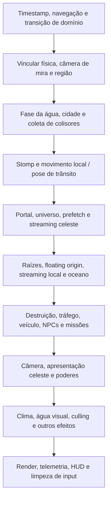

# FOUNDATION-01 — engine e runtime

Objetivo: estabilizar tempo, referência e autoridade física sem avançar o conteúdo. Depende do [baseline](FOUNDATION-00.md), dos contratos existentes de domínio, de streaming e da regressão permanente. Sessão [FOUNDATION-01-CODEX-001](../agent-reports/2026/2026-11-27-2023-codex-foundation-01.md). Implementação `3d70525`, checkout reproduzível `348e27b`.

## Ordem real de `Game.tick`

| Etapa | Leitura e autoridade de escrita | Relógio e referencial |
| --- | --- | --- |
| Domínio e mira | `TravelDomain` decide partida/retorno. `bindSurfacePhysics` instala o provedor e gravidade. A câmera prepara ângulos para o controle. | `dt`. ENU ativo ou referencial baricêntrico do sistema. |
| Água, cidade e colisores | Atualiza fase de água e dados de cidade. O seletor `activePhysicsColliders` separa geometria curva de Manaus e superfícies planetárias. | Água usa timestamp de frame. Cidade usa coordenadas legadas quando Manaus curva está ativa. |
| Jogador local | Lê os controles e integra em `PlayerController`. `PhysicsWorld.move` escreve posição e velocidade durante sweep, contato de terreno e correção. A animação escreve no modelo. Portal escreve pose após o movimento. | `dt` subdividido para caminhada e natação. ENU ativo, sem subtrair origem visual. |
| Universo e streaming | Universo lê posição/velocidade locais; em trânsito as integra fora do ENU. Prefetch e streaming celestial precedem o streaming local. | `dt` no universo local e voo no sistema. Trânsito universal recebe `rawDt`. |
| Origem e camadas | `UniverseRuntime`/`RenderSpaceService` mantêm referenciais. `Game` espelha origem inversa nas raízes, no líquido e na câmera. Cidade autoral fica ancorada à superfície terrestre. | ENU lógico em precisão dupla e offsets relativos para render. |
| Destruição e entidades | Rota de destruição usa distância efetivamente voada. Tráfego, barcos, veículo, destroços, população e missões usam tempo de mundo. Veículo ocupado ainda sobrescreve pose lógica depois da fase do jogador. | `dt` para destruição por voo, `worldDt` para entidades. Fase fluvial usa `performance.now()`. |
| Apresentação e poderes | Câmera atualiza `globalPosition` e a matriz antes da mira dos poderes. Poderes podem alterar posição por teleporte. Atmosfera, VFX, culling e HUD leem a pose derivada. | `dt` para câmera, `dt/worldDt` nos poderes, `rawDt` nas transições visuais e medição. |
| Render e input | Renderizador recebe cena e câmera. HUD publica estado, contatos e desempenho. `InputController.endFrame` limpa as bordas. | Uma execução por frame. |

## Relógios e decisão de integração

`lastTime` guarda a marca do callback de render. `rawDt` mede o intervalo do frame com piso de 1 ms. `dt` limita esse intervalo a 60 ms. `worldDt` aplica fator 0,14 enquanto o poder temporal está ativo. `armClockS` mede tempo integrado do jogador para o duplo toque de voo. A água usa uma fase compartilhada em segundos da marca de frame. `universe.time` representa época astronômica. `performance.now()` também mede orçamento e deadlines. `Date.now()` é tempo civil para metadados, separado da integração física.

O passo híbrido seleciona até quatro subpassos iguais de aproximadamente 60 Hz em terra ou água. É aplicada margem de 0,2 ms para timestamp irregular a 60 Hz. A simulação local descarta atraso acima de 60 ms, sem fila de recuperação. Voo, troca de voo e boost conservam o sweep de um passo por frame. Os subpassos usam `InputController.consume`, que remove a borda no primeiro consumo. Universo, streaming e câmera continuam uma vez por frame. Flutuação amostra a fase de cada subpasso e converge para a marca visual no último. Troca de voo e teleporte reutilizam a fase conhecida. A política de suspensão para trânsito universal segue pendente.

O limite de integração e o orçamento de recuperação seguem [Fix Your Timestep](https://gafferongames.com/post/fix_your_timestep/). A separação entre input, simulação e render segue [Game Loop, de Robert Nystrom](https://raw.githubusercontent.com/munificent/game-programming-patterns/master/book/game-loop.markdown). O descarte de materiais foi checado nos tipos locais da versão 0.186 e no [índice oficial de Three.js](https://threejs.org/docs/).

## Autoridade física e espacial

| Escrita | Proprietário atual e contrato |
| --- | --- |
| Posição, velocidade e estado em terra | `PlayerController.update` com solução de `PhysicsWorld`. Altura sólida vem do provedor ativo, incluindo terreno destruído e leito. Altura líquida só classifica natação/flutuação. A colisão atual usa volume conservador com sweep, altura do personagem e margem, além do provedor volumétrico quando ativo. |
| Spawn, teleporte e retorno | `PlayerController.teleport`, `Game.finishSurfaceReturn`, serviço de teleporte e handoff galáctico. São correções explícitas. Portal de jogador e veículo usa segmento do próprio passo para excluir saltos entre frames. |
| Exceções de autoridade | Stress route, saída de veículo e cópia do veículo ocupado gravam em `Game`. Ainda precisam de comando explícito e rastreabilidade. |
| Rebase | Conversão de `ReferenceFrameGraph` e `RenderSpaceService` preserva pose lógica. `renderOriginVec` publica o offset. Câmera e animação operam na apresentação. |

`celestialRoot` pertence à apresentação celeste. `planetaryRoot` agrupa os provedores de corpos. `manausAuthoredRoot` conserva a âncora terrestre. `activeProceduralSurfaceRoot` abriga chunks e oceano no ENU da região. `actorRoot` recebe jogadores e atores com origem inversa. `activePlanetaryLifeRoot` agrega vida no domínio ativo. Visibilidade não define o conjunto de colisores. Os testes de rebase já existentes cobrem transformação, ondas e separação de raízes. Falta integrar voo e natação ao teste multieixos com transições reais.

## Streaming e recursos

`WorldStreamer` separa solicitado, carregando, pronto, ativo e cache. Cobertura próxima para água exige, em cada célula que intersecta o disco de 384 m no centro do clipmap, chunk ativo da região certa, anexado à raiz e com malha oceânica. Culling momentâneo por câmera fica fora do cálculo de residência. Região parcial ou nova mantém o cap. Sobreposição transitória e a costura entre os anéis exigem inspeção gráfica.

Uma preparação iniciada antes de `clear()` falha quando a região é substituída. Respostas antigas não publicam chunks e rejeições antigas não contaminam o preparo atual. `setSolvent` descarta o material compartilhado anterior. `ChunkMeshes.dispose` agora libera os recursos do oceano de megawaves. Falta ensaio prolongado de workers, VRAM e alternância de domínio.

## Evidências e aceite

`tests/helpers/foundation-lab.ts` usa jogador, colisão e batimetria de produção. Cenários atuais: solo plano, parede, salto e áreas rasa/profunda. Nas seis cadências (30, 60, 120 e 144 FPS, variável e picos de 60 ms), distância em 1 s ficou entre 6,116 e 6,146 m, ápice entre 1,722 e 1,767 m, pouso entre 0,750 e 0,767 s e diferença vertical máxima de flutuação de 0,009 m. São métricas headless de movimento. O desempenho de frame, GPU e memória ainda não foi medido.

| Gate | Evidência atual |
| --- | --- |
| A–C: tempo, colisão, água | Laboratório cobre caminhada, parede, salto, wading e flutuação. Falta percurso físico contínuo de margem, rampa e escadas. |
| D–E: rebase e domínio | Testes espaciais existentes. Falta cenário cruzado com câmera e múltiplos rebases durante voo e natação. |
| F: deslocamento autorizado | Origem do sweep de portal corrigida. Falta rastreamento por passo, com causa de cada correção. |
| G: recursos | Cancelamento e reentrada validados no streamer. Falta medição prolongada. |
| H: cobertura | Teste real de preparo parcial, cobertura completa e região nova. Falta inspeção gráfica da costura. |
| I–J: regressão | Tipagem, 2.031 testes, 639 regressões e build passaram no checkout limpo, com CI aprovado no SHA `348e27b`. |

Veredito parcial: `VISUAL_VALIDATION_PENDING`. O checkpoint continua aberto. Testes automatizados de navegador omitidos pela política da fase. Homologação manual e o restante dos critérios precedem FOUNDATION-02. [CI do código validado](https://github.com/PauloSoaf/Dr-Manaus/actions/runs/46088496601).
