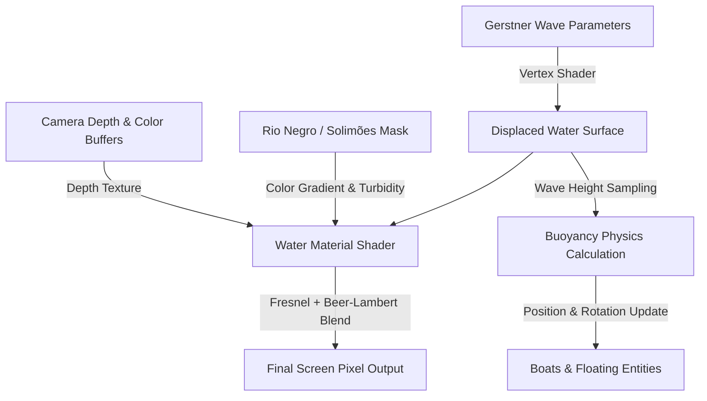

# Pesquisa Arquitetural 01: Renderização de Água Realista, Bonita e Leve (Rio Negro & Solimões)

## 1. Visão Geral Executiva & Contexto no DR-MANAUS
O sistema de corpos hídricos no **DR-MANAUS** representa uma das assinaturas visuais e geográficas mais críticas do jogo: o Encontro das Águas dos Rios Negro e Solimões. Enquanto o Rio Negro apresenta águas escuras, ricas em ácidos húmicos, com altíssima absorção de luz e reflexão quase especular de espelho d'água sob céu aberto, o Rio Solimões é barrento, turvo, denso em sedimentos em suspensão com alta taxa de retroespalhamento (backscattering) e ondas de gravidade mais visíveis.
Para renderizar esse ecossistema aquático em tempo real no navegador a 60 FPS estáveis, é mandatório abandonar abordagens ingênuas (como malhas gigantescas de alta densidade poligonal recalculadas por CPU) e adotar uma arquitetura híbrida WebGPU/WebGL com computação analítica em shader (TSL / GLSL), atenuando a profundidade opticamente via Lei de Beer-Lambert e simulando ondas trocoidais de Gerstner com projeção em anéis concêntricos centralizados na câmera.

A meta primária deste componente é entregar água visualmente deslumbrante, fluida e reativa a embarcações e poderes cinéticos, mantendo o consumo de CPU/GPU em patamar ultraleve no ecossistema Web.

---

## 2. Referências da Indústria & Jogos de Mundo Aberto
1. **Sea of Thieves (Rare / Unreal Engine 4)**:
   - *Técnica Chave*: Simulação hidrodinâmica via transformada rápida de Fourier (FFT) combinada com ondas de Gerstner locais nos vértices e sub-superfície (Subsurface Scattering - SSS).
   - *Aplicabilidade no DR-MANAUS*: Ondas de proa para os botes e lanchas regionais que trafegam pelo Rio Negro, e o efeito de borda de espuma dinâmica na orla da Ponta Negra.
2. **Assassin's Creed IV: Black Flag (Ubisoft Montreal)**:
   - *Técnica Chave*: Malha de água adaptativa projetada no espaço de tela (Screen-Space Projected Grid), desacoplando a contagem de polígonos da distância do mundo real.
   - *Aplicabilidade no DR-MANAUS*: Permite que a visão orbital ou em voo hipersônico não degrade a performance, pois o nível de detalhe (LOD) da água se ajusta conforme a proximidade da câmera do jogador.
3. **The Witcher 3: Wild Hunt (CD Projekt Red)**:
   - *Técnica Chave*: Interação de marolas e perturbação de fluxo por esteiras de barcos e objetos físicos, aliada a reflexões em espaço de tela (SSR).
   - *Aplicabilidade no DR-MANAUS*: Criação do vortex hidrodinâmico quando o Dr. Manaus mergulha em alta velocidade ou ativa habilidades cinéticas na superfície.
4. **Grand Theft Auto V (Rockstar Games)**:
   - *Técnica Chave*: Sistema de espuma cáustica costeira com mapeamento de fluxo vetorial (Flow Maps).
   - *Aplicabilidade no DR-MANAUS*: Simulação da correnteza bifurcada na orla fluvial do Educandos e do Porto de Manaus.

---

## 3. Repositórios Clonados & Arquivos de Origem Analisados

### 3.1. Repositório `references/beautiful-water`
- **Arquivo de Origem**: `references/beautiful-water/src/scene/webgpu-water-material.js`
  - *O que inspecionar*: Arquitetura de nós TSL (Three Shading Language) para WebGPU. Extração do cálculo de refração através de buffer de cor desacoplado e distorção por vetor normal.
- **Arquivo de Origem**: `references/beautiful-water/src/scene/webgpu-wave-nodes.js`
  - *O que inspecionar*: Implementação modular dos nós de ondas de Gerstner. Em vez de somar ondas via CPU, os nós calculam a translação horizontal e elevação vertical em GPU:
    `P(x, y, t) = [x + sum(Q * A * Dx * cos(theta)), y + sum(Q * A * Dy * cos(theta)), sum(A * sin(theta))]`
- **Arquivo de Origem**: `references/beautiful-water/src/shaders/water/fragment.js`
  - *O que inspecionar*: Equações de cálculo de Fresnel (Schlick approximation) e profundidade óptica:
    `F(R0, theta) = R0 + (1 - R0) * (1 - cos(theta))^5`
- **Arquivo de Origem**: `references/beautiful-water/src/scene/underwater-rays-webgpu.js`
  - *O que inspecionar*: Cáusticas volumétricas projetadas sob a superfície da água através de mapas de ruído em cascata.

### 3.2. Repositório `references/threejs-water-free`
- **Arquivo de Origem**: `references/threejs-water-free/src/material/waterMaterial.js`
  - *O que inspecionar*: Integração com `depthTexture` do Three.js para cálculo de distância entre o fundo do rio (leito batimétrico) e a superfície.
- **Arquivo de Origem**: `references/threejs-water-free/src/physics/buoyancy.js`
  - *O que inspecionar*: Algoritmo de empuxo hidrostático para embarcações e corpos flutuantes sem necessidade de motor de física externo pesado, testando 4 pontos de amostragem na altura da onda.
- **Arquivo de Origem**: `references/threejs-water-free/src/geometry/oceanPlane.js`
  - *O que inspecionar*: Geração de malha geométrica com subdivisão não-linear (mais densa próxima à origem da câmera e mais esparsa no horizonte).

---

## 4. Documentações Oficiais de Bibliotecas & Especificações
1. **Three.js WebGPU / TSL Documentation**:
   - [Three.js Node Material System](https://threejs.org/docs/#api/en/nodes/Nodes)
   - Uso de nós procedurais como `normalMap`, `screenUV`, `viewportSharedTexture` e `viewportDepthTexture`.
2. **GPU Gems 1, Capítulo 1 (NVIDIA)**:
   - [Effective Water Simulation from Physical Models](https://developer.nvidia.com/gpugems/gpugems/part-i-natural-effects/chapter-1-effective-water-simulation-physical-models)
   - Especificação matemática canônica das ondas de Gerstner para conservação de volume em cristas pontiagudas e vales suaves.
3. **WebGPU Specification (W3C)**:
   - [W3C WebGPU Working Draft](https://www.w3.org/TR/webgpu/)
   - Gerenciamento de buffers de renderização profunda e pipelines de computação assíncronos.
4. **Three.js CustomShaderMaterial (CSM)**:
   - Extensão para injeção de shaders em materiais nativos físicos mantendo iluminação PBR.

---

## 5. Requisitos do Sistema

### Requisitos Funcionais (RF)
- **RF-01-01**: O sistema deve renderizar simultaneamente o Rio Negro (água negra espelhada) e o Rio Solimões (água barrenta/ocre) com uma linha de transição procedural sem corte brusco.
- **RF-01-02**: A água deve apresentar reflexão especular de sol e céu, além de refração distorcida de objetos submersos.
- **RF-01-03**: A profundidade da água deve gerar atenuação exponencial da cor do fundo conforme a Lei de Beer-Lambert (`I = I0 * exp(-alpha * d)`).
- **RF-01-04**: Objetos e barcos devem flutuar de forma realista reagindo à altura das ondas no ponto correspondente.
- **RF-01-05**: Ao entrar na água, a câmera deve transicionar suavemente para um efeito subaquático com turbidez volumétrica e neblina específica.
- **RF-01-06**: O material deve suportar fluxo direcional contínuo simulando a correnteza fluvial em direção ao Oceano Atlântico.

### Requisitos Não Funcionais (RNF)
- **RNF-01-01 (Performance)**: A renderização dos rios não deve ultrapassar 1,8 ms de GPU por quadro a 1080p, garantindo 60 FPS contínuos no loop principal.
- **RNF-01-02 (Memória)**: A geometria base da água deve utilizar malha de anéis concêntricos com contagem poligonal máxima de 12.000 triângulos.
- **RNF-01-03 (Fallback)**: Caso o navegador não ofereça suporte a WebGPU ou extensões de profundidade, o shader deve degradar graciosamente para WebGL standard sem quebrar o jogo.
- **RNF-01-04 (Alocação Zero)**: As funções de amostragem de física de flutuação no loop principal não devem alocar objetos temporários na memória Heap durante o frame.

---

## 6. Arquitetura da Solução & Diagrama de Fluxo



---

## 7. Módulos & Arquivos Afetados no DR-MANAUS (`src/`)

### 7.1. `src/world/water/Water.ts`
- **Mudanças**:
  - Refatorar a classe para utilizar `CustomShaderMaterial` ou `MeshPhysicalNodeMaterial` com nós TSL.
  - Substituir a malha plana fixa por um sistema de malha com anéis concêntricos centralizados na câmera (radial concentric rings).
  - Integrar uniforms: `uTime`, `uNegroColor`, `uSolimoesColor`, `uMixMaskTexture`, `uWaveParams`, `uDepthTexture`.

### 7.2. `src/world/realcity/water.ts`
- **Mudanças**:
  - Incorporar dados batimétricos reais da confluência dos rios Negro e Solimões.
  - Gerar a textura de máscara de mistura dinâmica baseada nas coordenadas georreferenciadas da foz do Rio Negro.

### 7.3. `src/world/traffic/TrafficSystem.ts` & Embarcações Flutuantes
- **Mudanças**:
  - Implementar a função `sampleWaterHeight(x, z, time)` exportada de `Water.ts` para atualizar pitch, roll e elevação de barcos de passageiros e empurradores de balsa.

---

## 8. Código de Implementação e Extração Baseado em `references`

```typescript
// Trecho a ser integrado em src/world/water/Water.ts
// Baseado em references/beautiful-water/src/scene/webgpu-wave-nodes.js e waterMaterial.js

export interface GerstnerWave {
  direction: [number, number];
  amplitude: number;
  wavelength: number;
  speed: number;
  steepness: number;
}

export const DEFAULT_WAVES: GerstnerWave[] = [
  { direction: [1.0, 0.2], amplitude: 0.35, wavelength: 28.0, speed: 1.2, steepness: 0.5 },
  { direction: [-0.4, 0.9], amplitude: 0.20, wavelength: 14.0, speed: 1.5, steepness: 0.4 },
  { direction: [0.3, -0.8], amplitude: 0.12, wavelength: 7.0, speed: 2.1, steepness: 0.35 },
  { direction: [-0.8, -0.3], amplitude: 0.08, wavelength: 3.5, speed: 2.8, steepness: 0.3 }
];

export class ManausWaterSystem {
  private waveUniforms: {
    uTime: { value: number };
    uNegroColor: { value: [number, number, number] };
    uSolimoesColor: { value: [number, number, number] };
  };

  constructor() {
    this.waveUniforms = {
      uTime: { value: 0 },
      uNegroColor: { value: [0.015, 0.02, 0.025] },     // Rio Negro: Escuro profundo
      uSolimoesColor: { value: [0.45, 0.38, 0.22] }    // Rio Solimões: Ocre argiloso
    };
  }

  public computeDisplacement(
    x: number,
    z: number,
    time: number,
    outDisplacement: { x: number; y: number; z: number }
  ): void {
    let dx = 0;
    let dy = 0;
    let dz = 0;

    for (let i = 0; i < DEFAULT_WAVES.length; i++) {
      const w = DEFAULT_WAVES[i];
      const k = (2.0 * Math.PI) / w.wavelength;
      const c = Math.sqrt(9.81 / k);
      const len = Math.hypot(w.direction[0], w.direction[1]) || 1.0;
      const dirX = w.direction[0] / len;
      const dirZ = w.direction[1] / len;
      const dot = dirX * x + dirZ * z;
      const theta = k * dot - w.speed * c * time;

      const cosTheta = Math.cos(theta);
      const sinTheta = Math.sin(theta);
      const q = w.steepness / (k * w.amplitude * DEFAULT_WAVES.length);

      dx += q * w.amplitude * dirX * cosTheta;
      dy += w.amplitude * sinTheta;
      dz += q * w.amplitude * dirZ * cosTheta;
    }

    outDisplacement.x = dx;
    outDisplacement.y = dy;
    outDisplacement.z = dz;
  }
}
```

---

## 9. Plano de Testes & Casos de Teste (Unitários e de Regressão)

### Cenários de Teste Automatizados (`tests/water-system.test.ts`)
1. **CT-01-01 (Cálculo Analítico de Altura)**:
   - *Objetivo*: Validar se a função de deslocamento retorna amplitudes coerentes e nunca gera NaN ou infinitos para quaisquer coordenadas x, z no intervalo de [-1.000.000, 1.000.000] e tempo >= 0.
   - *Critério de Aceite*: Altura calculada estritamente contida dentro do envelope físico esperado (+/- somatório das amplitudes).
2. **CT-01-02 (Absorção de Luz Beer-Lambert)**:
   - *Objetivo*: Verificar se a transmissão de luz diminui estritamente com o aumento da profundidade batimétrica.
   - *Critério de Aceite*: Para profundidade 10m vs 1m, o fator de transmissão luminosa deve ser estritamente inferior a 5% da superfície no Rio Negro.
3. **CT-01-03 (Performance e Alocação no Frame Loop)**:
   - *Objetivo*: Executar 5.000 iterações do sampler de flutuação com vetor reutilizado e confirmar zero alocações de novos objetos no heap (garantia de garbage collector zero).
4. **CT-01-04 (Degradação Graciosa sem Depth Texture)**:
   - *Objetivo*: Simular ambiente sem suporte à extensão de buffer de profundidade.
   - *Critério de Aceite*: O shader renderiza a água utilizando cor de fallback e iluminação difusa sem emitir erros no console WebGL.
