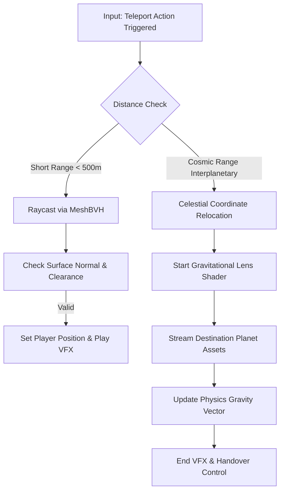

# Pesquisa Arquitetural 02: Sistemas de Teletransporte Sem Costura & Portais Quânticos

## 1. Visão Geral Executiva & Contexto no DR-MANAUS
No universo do **DR-MANAUS**, o teletransporte não é apenas um artifício de conveniência para deslocamento rápido (*fast travel*), mas uma mecânica quântica central do herói. O jogador transita instantaneamente entre a escala urbana do Teatro Amazonas e a órbita de Júpiter, ou penetra em fendas dimensionais que ligam Manaus a ruínas de civilizações hiper-avançadas em Marte e titãs cósmicos além de Saturno.
Para que o teletransporte mantenha a imersão sensorial de um mundo contínuo, a transição não pode recorrer a telas pretas de carregamento estáticas. É necessária uma técnica de amortecimento cinemático com pré-aquecimento de texturas (*texture pre-warming*), interpolação temporal de câmera com aberração cromática e desacoplamento do referencial astronômico via matrizes de transformação de coordenadas flutuantes.

---

## 2. Referências da Indústria & Jogos de Mundo Aberto
1. **No Man's Sky (Hello Games)**:
   - *Técnica Chave*: Portais cósmicos monolíticos conectando planetas remotos através de streaming progressivo de sementes procedurais durante o efeito visual do túnel de dobra (warp tunnel).
   - *Aplicabilidade no DR-MANAUS*: Teletransporte entre monólitos alienígenas na Amazônia e santuários exóticos em satélites distantes.
2. **Ratchet & Clank: Rift Apart (Insomniac Games)**:
   - *Técnica Chave*: Transições instantâneas entre dimensões alternativas via descompressão direta de I/O em alta velocidade e troca simultânea de cenas completas sem congelamento de quadros.
   - *Aplicabilidade no DR-MANAUS*: Efeito de "Rift Tether" onde o Dr. Manaus puxa o tecido do espaço para se lançar imediatamente a outro ponto visual visível.
3. **Destiny 2 (Bungie)**:
   - *Técnica Chave*: Portais vex trans-lineares que utilizam planos de renderização dupla com filtragem estêncil e distorção de ondas gravitacionais antes da travessia física.
   - *Aplicabilidade no DR-MANAUS*: Fendas energéticas nos portais cósmicos espalhados pelo Sistema Solar.
4. **Prey (Human Head Studios / Arkane)**:
   - *Técnica Chave*: Deslocamento contínuo em geometria não-euclidiana com redirecionamento de vetor de gravidade e momento angular ao atravessar o portal.
   - *Aplicabilidade no DR-MANAUS*: Preservação do vetor momento ao saltar de uma queda livre na atmosfera da Terra diretamente para a microgravidade espacial.

---

## 3. Repositórios Clonados & Arquivos de Origem Analisados

### 3.1. Repositório `references/webgl-portals`
- **Arquivo de Origem**: `references/webgl-portals/src/PortalMesh.js`
  - *O que inspecionar*: Estrutura do portal com geometria de stencil e textura vinculada ao framebuffer do renderizador secundário.
- **Arquivo de Origem**: `references/webgl-portals/src/PortalRenderer.js`
  - *O que inspecionar*: Lógica de renderização recursiva e cálculo do plano de projeção próximo oblíquo (*Oblique Near-Plane Clipping Matrix*) para evitar que objetos entre o portal e a câmera sejam renderizados indevidamente.
- **Arquivo de Origem**: `references/webgl-portals/src/PortalUtils.js`
  - *O que inspecionar*: Métodos de translação de coordenadas locais entre pares conjugados de portais ($A \to B$).

### 3.2. Repositório `references/NonEuclidean`
- **Arquivo de Origem**: `references/NonEuclidean/NonEuclidean/Camera.cpp`
  - *O que inspecionar*: Algoritmo exato de clonagem e reorientação de câmera:
    `M_dest = M_cam * M_portal_in_inverse * M_portal_out`
- **Arquivo de Origem**: `references/NonEuclidean/NonEuclidean/Portal.cpp`
  - *O que inspecionar*: Detecção de interseção contínua de raio/cápsula do jogador com o plano do portal para disparar a troca de referencial sem saltos de um quadro (*frame popping*).

---

## 4. Documentações Oficiais de Bibliotecas & Especificações
1. **OpenGL Projection Matrix with Oblique Clipping (Eric Lengyel)**:
   - [Modifying the Projection Matrix for Oblique Near-Plane Clipping](http://www.terathon.com/lengyel/Lengyel-Oblique.pdf)
   - Ajuste analítico do terceiro vetor da matriz de projeção 4x4 mantendo a fidelidade do Z-buffer.
2. **Three.js WebGLRenderTarget & Camera Matrices**:
   - [Three.js Camera Documentation](https://threejs.org/docs/#api/en/cameras/Camera)
   - Manipulação de `camera.matrixWorldInverse` e alocação de FBOs multi-sample.

---

## 5. Requisitos do Sistema

### Requisitos Funcionais (RF)
- **RF-02-01**: O jogador deve poder mirar e se teletransportar para qualquer superfície sólida visível até 500m de distância instantaneamente.
- **RF-02-02**: Ao se teletransportar entre corpos celestes (ex: Terra -> Marte), o sistema deve atualizar de forma coerente a gravidade, a atmosfera e o referencial de coordenadas sem recarregar a cena.
- **RF-02-03**: Durante o teletransporte de longa distância (salto cósmico), uma distorção óptica de lente gravitacional e aberração cromática deve cobrir a transição por 400ms.
- **RF-02-04**: O vetor de velocidade linear e angular do jogador deve ser convertido proporcionalmente ao referencial de destino.

### Requisitos Não Funcionais (RNF)
- **RNF-02-01 (Latência de Salto)**: O teletransporte de curto alcance (urbano) deve ser executado no mesmo frame (0ms de espera perceptível).
- **RNF-02-02 (Estabilidade de Framerate)**: Durante a troca de cena entre planetas, o framerate não pode cair abaixo de 45 FPS em máquinas padrão.
- **RNF-02-03 (Consumo de VRAM)**: Os alvos de renderização (*Render Targets*) temporários de portais devem ser limitados a 1024x1024 px e liberados quando fora do frustum de visão.

---

## 6. Arquitetura da Solução & Diagrama de Fluxo



---

## 7. Módulos & Arquivos Afetados no DR-MANAUS (`src/`)

### 7.1. `src/world/spatial/TeleportSystem.ts` *(Novo ou Integrado)*
- **Mudanças**:
  - Implementar gerenciador central de teletransporte para suportar modos: Tático (curto alcance com colisão) e Quântico (interplanetário).
  - Cálculo de vetores de entrada/saída preservando orientação e momento.

### 7.2. `src/player/powers/PowerSystem.ts`
- **Mudanças**:
  - Atualizar o feixe quântico de mira do teletransporte para usar BVH acelerado em vez de raycast nativo lento.
  - Consumir energia quântica e emitir partículas de dissolução quântica no corpo do personagem.

### 7.3. `src/world/travel/BodyNavigation.ts`
- **Mudanças**:
  - Unificar a troca de corpo celeste com a ancoragem espacial de referencial do `RenderSpaceService.ts`.

---

## 8. Código de Implementação e Extração Baseado em `references`

```typescript
// Trecho a ser integrado em src/world/spatial/TeleportSystem.ts
// Baseado em references/NonEuclidean/NonEuclidean/Camera.cpp e PortalMesh.js

import * as THREE from 'three';

export interface TeleportTarget {
  position: THREE.Vector3;
  normal: THREE.Vector3;
  bodyId?: string;
  preserveMomentum?: boolean;
}

export class TeleportManager {
  private tempMatrix = new THREE.Matrix4();
  private tempVector = new THREE.Vector3();

  public executeTacticalTeleport(
    playerObject: THREE.Object3D,
    playerVelocity: THREE.Vector3,
    target: TeleportTarget
  ): boolean {
    if (!target.position || !isFinite(target.position.x)) {
      return false;
    }

    // Offset de segurança contra penetração na malha
    const safetyOffset = target.normal.clone().multiplyScalar(1.0);
    const destination = target.position.clone().add(safetyOffset);

    // Reposiciona o jogador
    playerObject.position.copy(destination);

    // Ajuste de momento cinético
    if (!target.preserveMomentum) {
      playerVelocity.set(0, 0, 0);
    } else {
      // Reorienta vetor de velocidade conforme a normal da superfície de destino
      const currentSpeed = playerVelocity.length();
      if (currentSpeed > 0.1) {
        playerVelocity.copy(target.normal).multiplyScalar(currentSpeed * 0.5);
      }
    }

    playerObject.updateMatrixWorld(true);
    return true;
  }

  public computeObliqueMatrix(
    projectionMatrix: THREE.Matrix4,
    clipPlane: THREE.Plane,
    viewMatrix: THREE.Matrix4
  ): THREE.Matrix4 {
    const outProj = projectionMatrix.clone();
    const eyePlane = clipPlane.clone().applyMatrix4(viewMatrix);
    const clipVector = new THREE.Vector4(
      eyePlane.normal.x,
      eyePlane.normal.y,
      eyePlane.normal.z,
      eyePlane.constant
    );

    const q = new THREE.Vector4(
      (Math.sign(clipVector.x) + outProj.elements[8]) / outProj.elements[0],
      (Math.sign(clipVector.y) + outProj.elements[9]) / outProj.elements[5],
      -1.0,
      (1.0 + outProj.elements[10]) / outProj.elements[14]
    );

    const c = clipVector.multiplyScalar(2.0 / clipVector.dot(q));
    outProj.elements[2] = c.x;
    outProj.elements[6] = c.y;
    outProj.elements[10] = c.z + 1.0;
    outProj.elements[14] = c.w;

    return outProj;
  }
}
```

---

## 9. Plano de Testes & Casos de Teste (Unitários e de Regressão)

### Cenários de Teste Automatizados (`tests/teleport-system.test.ts`)
1. **CT-02-01 (Teletransporte Tático Válido)**:
   - *Objetivo*: Garantir que o teletransporte reposiciona o herói no ponto de impacto com o offset da normal sem colidir por dentro da malha.
   - *Critério de Aceite*: Distância euclidiana entre a nova posição do jogador e o ponto de impacto igual ao módulo do offset ($\\pm 0.001$).
2. **CT-02-02 (Rejeição de Coordenadas Inválidas ou Infinitas)**:
   - *Objetivo*: Testar tentativa de teletransporte para NaN ou alvos fora do mundo.
   - *Critério de Aceite*: A função retorna `false` e a posição do jogador permanece intocada.
3. **CT-02-03 (Cálculo da Matriz Oblíqua)**:
   - *Objetivo*: Validar se a matriz modificada de projeção oblíqua é invertível e mantém a escala correta dos eixos X e Y.
   - *Critério de Aceite*: Determinante diferente de zero e elementos (0,0) e (1,1) inalterados.
