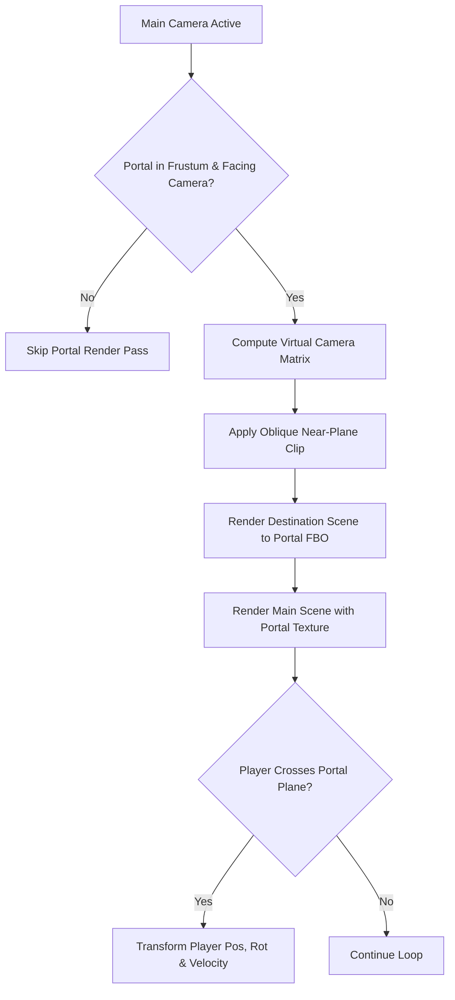

# Pesquisa Arquitetural 03: Portais Sem Costura e Geometria Não-Euclidiana

## 1. Visão Geral Executiva & Contexto no DR-MANAUS
No **DR-MANAUS**, os portais sem costura (*seamless portals*) conectam regiões geograficamente e cosmologicamente distantes em tempo real. O jogador pode olhar através de um arco de pedra na Praça São Sebastião em Manaus e enxergar a superfície avermelhada de Marte ou o vórtice tempestuoso da Grande Mancha Vermelha de Júpiter, com iluminação correta, movimento de partículas e travessia física contínua sem tela de carregamento ou corte de câmera.
A implementação técnica exige renderização recursiva de câmera virtual com stencil buffer ou renderização em textura (*Render-to-Texture*), combinada com ajuste de plano de corte oblíquo (*Oblique Near-Plane Clipping*) para evitar artefatos de fatiamento de objetos próximos, e preservação de momento linear e angular durante a transição da cápsula do jogador.

---

## 2. Referências da Indústria & Jogos de Mundo Aberto
1. **Portal & Portal 2 (Valve / Source Engine)**:
   - *Técnica Chave*: Renderização recursiva de câmeras acopladas via Stencil Buffer e matrizes de transformação de visão relativa. O frustum de visão é cortado exatamente no plano do portal.
   - *Aplicabilidade no DR-MANAUS*: Travessia fluida entre portais dimensionais urbanos e templos cósmicos mantendo momento angular.
2. **Splitgate (1047 Games / Unreal Engine 4)**:
   - *Técnica Chave*: Portais competitivos de alta fidelidade renderizados em tempo real via buffers desacoplados com interpolação de áudio espacial 3D e renderização de projéteis através do portal.
   - *Aplicabilidade no DR-MANAUS*: Projéteis e raios de energia disparados pelo herói atravessam os portais e atingem alvos no outro lado instantaneamente.
3. **Antichamber (Alexander Bruce / UDK)**:
   - *Técnica Chave*: Espaços não-euclidianos e corredores que mudam de destino dependendo da direção de aproximação e do ângulo da câmera.
   - *Aplicabilidade no DR-MANAUS*: Ruínas místicas no interior da Floresta Amazônica que guardam artefatos alienígenas em espaços geometricamente impossíveis.
4. **The Witness (Thekla, Inc.)**:
   - *Técnica Chave*: Continuidade visual extrema em transições de perspectivas e quebra-cabeças visuais perfeitamente alinhados à geometria do ambiente.
   - *Aplicabilidade no DR-MANAUS*: Alinhamento de monumentos históricos de Manaus com constelações astronômicas visíveis através de portais.

---

## 3. Repositórios Clonados & Arquivos de Origem Analisados

### 3.1. Repositório `references/webgl-portals`
- **Arquivo de Origem**: `references/webgl-portals/src/PortalRenderer.js`
  - *O que inspecionar*: O loop de renderização que gerencia a câmera virtual do portal, configurando o `WebGLRenderTarget` com as dimensões de tela e controlando o nível de recursão para evitar estouro de pilha.
- **Arquivo de Origem**: `references/webgl-portals/src/PortalMesh.js`
  - *O que inspecionar*: O emparelhamento de dois objetos `PortalMesh` (portal A e portal B), gerenciando referências mútuas, malha de moldura e plano de projeção.
- **Arquivo de Origem**: `references/webgl-portals/src/shaders/portal.frag`
  - *O que inspecionar*: Amostragem de tela projetiva utilizando coordenadas homogêneas normalizadas (`vUv = gl_FragCoord.xy / resolution`).

### 3.2. Repositório `references/NonEuclidean`
- **Arquivo de Origem**: `references/NonEuclidean/NonEuclidean/Portal.cpp`
  - *O que inspecionar*: Algoritmo de travessia do jogador através do plano do portal. O código calcula se o jogador cruzou o plano entre o frame anterior e o atual:
    `dot(P_atual - P_portal, N) * dot(P_anterior - P_portal, N) < 0`
- **Arquivo de Origem**: `references/NonEuclidean/NonEuclidean/Collider.cpp`
  - *O que inspecionar*: Resolução de colisão não-euclidiana, impedindo que o jogador colida com a parede de trás do portal no momento exato da travessia.

---

## 4. Documentações Oficiais de Bibliotecas & Especificações
1. **Three.js Stencil Buffer & RenderTarget Guide**:
   - [Three.js Stencil Operations](https://threejs.org/docs/#api/en/materials/Material.stencilWrite)
   - Uso de `stencilFunc`, `stencilRef`, `stencilZPass` para renderizar portais sem custo de alocação de texturas gigantescas.
2. **GPU Pro 4: Real-Time Seamless Portals**:
   - [Real-Time Rendering of Non-Euclidean Geometry](https://www.crcpress.com/GPU-Pro-4-Advanced-Rendering-Techniques/Engel/p/book/9781466567436)
   - Teoria das transformações de coordenadas e mitigação de aliasing na borda dos portais.
3. **WebGPU Compute & Render Pipelines**:
   - Coordenação de renderização secundária em múltiplos passes utilizando a mesma árvore de cena.

---

## 5. Requisitos do Sistema

### Requisitos Funcionais (RF)
- **RF-03-01**: O sistema deve suportar pares conjugados de portais (Entrada A <-> Saída B) bidirecionais.
- **RF-03-02**: A imagem vista através do portal deve corresponder exatamente à perspectiva correta da câmera do jogador caso ela estivesse na posição relativa do portal de destino.
- **RF-03-03**: Projéteis de combate e raios quânticos devem atravessar o plano do portal, mantendo velocidade e ângulo relativos.
- **RF-03-04**: O jogador deve poder caminhar ou voar através do portal sem solavancos visuais ou queda brusca de taxa de quadros.
- **RF-03-05**: Quando o portal de destino estiver desativado ou destruído, o portal de origem deve apresentar uma superfície opaca de névoa quântica instável.

### Requisitos Não Funcionais (RNF)
- **RNF-03-01 (Orçamento de Renderização)**: A renderização de um portal visível na tela não deve aumentar o tempo total de quadro em mais de 3,5ms de GPU.
- **RNF-03-02 (Culling Frustum)**: Se o portal estiver de costas para a câmera do jogador ou fora do frustum, a câmera secundária não deve ser renderizada (Custo 0 de GPU).
- **RNF-03-03 (Resolução Dinâmica)**: Em dispositivos com menor capacidade gráfica, o Render Target do portal deve reduzir a resolução automaticamente para metade da resolução nativa.

---

## 6. Arquitetura da Solução & Diagrama de Fluxo



---

## 7. Módulos & Arquivos Afetados no DR-MANAUS (`src/`)

### 7.1. `src/world/spatial/PortalSystem.ts` *(Novo Arquivo)*
- **Mudanças**:
  - Implementação da classe `PortalSystem` gerenciando registro de pares de portais, buffers FBO e câmeras virtuais.
  - Cálculo de transformações relativas e matrizes de corte oblíquo.

### 7.2. `src/game/Game.ts`
- **Mudanças**:
  - Injetar o passo de pré-renderização de portais antes da renderização da cena principal no loop `render()`.
  - Conectar verificação de travessia do herói ao loop de atualização de física.

### 7.3. `src/player/combat/CombatSystem.ts`
- **Mudanças**:
  - Permitir que raios de mira e esferas de energia detectem impacto com portais e sejam reemitidos no ponto conjugado.

---

## 8. Código de Implementação e Extração Baseado em `references`

```typescript
// Trecho a ser integrado em src/world/spatial/PortalSystem.ts
// Baseado em references/webgl-portals/src/PortalRenderer.js e PortalMesh.js

import * as THREE from 'three';

export interface PortalPair {
  id: string;
  portalA: THREE.Mesh;
  portalB: THREE.Mesh;
  renderTargetA: THREE.WebGLRenderTarget;
  renderTargetB: THREE.WebGLRenderTarget;
  virtualCamera: THREE.PerspectiveCamera;
  active: boolean;
}

export class PortalSystem {
  private portals: Map<string, PortalPair> = new Map();
  private tempMatrix = new THREE.Matrix4();
  private invMatrix = new THREE.Matrix4();

  public registerPair(
    id: string,
    meshA: THREE.Mesh,
    meshB: THREE.Mesh,
    width = 1024,
    height = 1024
  ): PortalPair {
    const renderTargetA = new THREE.WebGLRenderTarget(width, height, {
      minFilter: THREE.LinearFilter,
      magFilter: THREE.LinearFilter,
      format: THREE.RGBAFormat
    });

    const renderTargetB = renderTargetA.clone();
    const virtualCamera = new THREE.PerspectiveCamera(60, width / height, 0.1, 500000);

    const pair: PortalPair = {
      id,
      portalA: meshA,
      portalB: meshB,
      renderTargetA,
      renderTargetB,
      virtualCamera,
      active: true
    };

    this.portals.set(id, pair);
    return pair;
  }

  public updatePortalCamera(
    portalSource: THREE.Mesh,
    portalDest: THREE.Mesh,
    mainCamera: THREE.PerspectiveCamera,
    virtualCamera: THREE.PerspectiveCamera
  ): void {
    // Matriz de transformação relativa: Dest = Cam * Inv(Source) * DestWorld
    portalSource.updateMatrixWorld(true);
    portalDest.updateMatrixWorld(true);

    this.invMatrix.copy(portalSource.matrixWorld).invert();
    this.tempMatrix.copy(portalDest.matrixWorld).multiply(this.invMatrix);

    virtualCamera.matrix.copy(this.tempMatrix).multiply(mainCamera.matrixWorld);
    virtualCamera.matrix.decompose(virtualCamera.position, virtualCamera.quaternion, virtualCamera.scale);
    virtualCamera.fov = mainCamera.fov;
    virtualCamera.aspect = mainCamera.aspect;
    virtualCamera.updateMatrixWorld(true);
  }

  public checkPlayerTraversal(
    playerPos: THREE.Vector3,
    prevPlayerPos: THREE.Vector3,
    portal: THREE.Mesh
  ): boolean {
    const portalNormal = new THREE.Vector3(0, 0, 1).applyQuaternion(portal.quaternion);
    const plane = new THREE.Plane().setFromNormalAndCoplanarPoint(portalNormal, portal.position);

    const d1 = plane.distanceToPoint(prevPlayerPos);
    const d2 = plane.distanceToPoint(playerPos);

    // Se o sinal da distância mudou, o jogador cruzou o plano
    return (d1 > 0 && d2 <= 0) || (d1 < 0 && d2 >= 0);
  }
}
```

---

## 9. Plano de Testes & Casos de Teste (Unitários e de Regressão)

### Cenários de Teste Automatizados (`tests/portal-system.test.ts`)
1. **CT-03-01 (Transformação Relativa de Câmera)**:
   - *Objetivo*: Garantir que a câmera virtual posicionada através do portal A enxerga o cenário de B com ângulo correspondente.
   - *Critério de Aceite*: A rotação relativa entre a câmera principal e o portal A deve ser idêntica à rotação relativa entre a câmera virtual e o portal B.
2. **CT-03-02 (Detecção de Travessia do Plano)**:
   - *Objetivo*: Validar se a função `checkPlayerTraversal` detecta com precisão a passagem de um vetor de movimento pelo plano.
   - *Critério de Aceite*: Retornar `true` quando pontos anterior e atual estão em lados opostos e dentro do raio de abertura do portal.
3. **CT-03-03 (Frustum Culling do Portal)**:
   - *Objetivo*: Comprovar que portais posicionados atrás da câmera principal não disparam passos de renderização secundária.
   - *Critério de Aceite*: Nenhuma chamada para `renderer.render(scene, virtualCamera)` ocorre quando o portal está fora do cone de visão.
