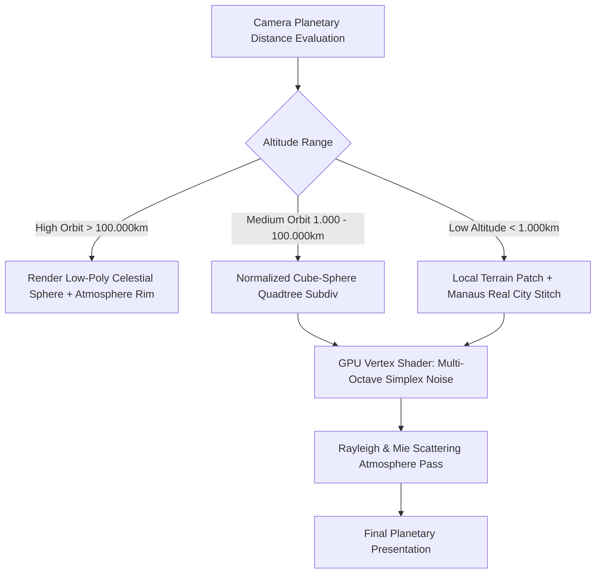

# Pesquisa Arquitetural 04: Renderização Planetária em Escala Real e Transições Atmosféricas

## 1. Visão Geral Executiva & Contexto no DR-MANAUS
O **DR-MANAUS** possui uma ambição técnica extraordinária: permitir que o jogador caminhe pelas ruas de Manaus na Terra, decole verticalmente em direção ao espaço, atravesse as camadas da mesosfera e termosfera com dispersão atmosférica de Rayleigh/Mie, entre em velocidade de dobra e pouse suavemente na superfície de Marte, Europa ou em exoplanetas gerados proceduralmente.
Para suportar escalas que variam de metros a bilhões de metros sem sofrer com trepidação de precisão de ponto flutuante (*Z-fighting* e *floating-point jitter*), é obrigatório utilizar uma arquitetura de esfera cúbica quadtree normalizada (*Normalized Quadtree Cube-Sphere*), câmera centrada na origem flutuante (*Floating Origin*) e shaders com nós TSL para elevação procedural em GPU.

---

## 2. Referências da Indústria & Jogos de Mundo Aberto
1. **Star Citizen (Cloud Imperium Games)**:
   - *Técnica Chave*: Sistema de planetas procedurais com malha cúbica subdividida adaptativamente (Planet Tech v4), mesclando biomas continentais com detalhes micro-topográficos via shaders de textura procedural.
   - *Aplicabilidade no DR-MANAUS*: Pouso sem emenda e transição contínua da órbita para o solo em corpos rochosos.
2. **Kerbal Space Program 2 (Intercept Games)**:
   - *Técnica Chave*: Física orbital n-corpos desacoplada da física de solo, com sistema PQS (*Procedural Quadtree Sphere*) com skirts de costura para evitar fendas de LOD entre blocos de terreno.
   - *Aplicabilidade no DR-MANAUS*: Órbitas estáveis para luas e estações espaciais visitáveis pelo Dr. Manaus.
3. **Elite Dangerous (Frontier Developments)**:
   - *Técnica Chave*: Geração com base científica de composição química de atmosferas e coloração espectral de estrelas com espalhamento volumétrico físico.
   - *Aplicabilidade no DR-MANAUS*: Cores coerentes de horizontes para atmosferas de diferentes planetas do Sistema Solar.
4. **Outer Wilds (Mobius Digital)**:
   - *Técnica Chave*: Corpos celestes em miniatura física perfeitamente dinâmicos com gravidade esférica contínua e renderização de atmosfera por cascas esféricas concêntricas.
   - *Aplicabilidade no DR-MANAUS*: Física de gravidade esférica quando o jogador caminha em asteroides pequenos e luas.

---

## 3. Repositórios Clonados & Arquivos de Origem Analisados

### 3.1. Repositório `references/lagrange`
- **Arquivo de Origem**: `references/lagrange/src/core/tsl/materials/planet.tslmat.ts`
  - *O que inspecionar*: Arquitetura de material PBR para planetas em Three.js TSL. Uso de ruído procedural multi-escala acoplado à curvatura do globo.
- **Arquivo de Origem**: `references/lagrange/src/core/tsl/materials/atmosphere.tslmat.ts`
  - *O que inspecionar*: Shader de atmosfera com dispersão de Rayleigh dependente do cosseno do ângulo zenital e atenuação de névoa de horizonte.
- **Arquivo de Origem**: `references/lagrange/src/core/tsl/features/craters.ts`
  - *O que inspecionar*: Algoritmo analítico de geração de crateras de impacto via combinação de distâncias celulares de Voronoi.

### 3.2. Repositório `references/threejs-procedural-planets`
- **Arquivo de Origem**: `references/threejs-procedural-planets/scripts/atmosphere.js`
  - *O que inspecionar*: Implementação de nuvens em camadas e atmosfera volumétrica com partículas e casca externa.
- **Arquivo de Origem**: `references/threejs-procedural-planets/scripts/main.js`
  - *O que inspecionar*: Configuração de parâmetros de semente para relevo, oceanos e temperatura zonal dos planetas.

---

## 4. Documentações Oficiais de Bibliotecas & Especificações
1. **GPU Gems 2, Capítulo 16 (NVIDIA)**:
   - [Accurate Atmospheric Scattering](https://developer.nvidia.com/gpugems/gpugems2/part-ii-shading-lighting-and-shadows/chapter-16-accurate-atmospheric-scattering)
   - Resolução das integrais de linha de espalhamento óptico de Sean O'Neil para atmosferas planetárias em tempo real.
2. **Three.js WebGPU / TSL Atmosphere Nodes**:
   - Definição de nós matemáticos de cor e elevação sem recompilação de pipelines.
3. **USGS Planetary GIS & Elevation Datasets**:
   - Mapeamento de elevação altimétrica da Terra e Marte.

---

## 5. Requisitos do Sistema

### Requisitos Funcionais (RF)
- **RF-04-01**: O sistema deve renderizar corpos celestes esféricos com diâmetros realistas (Terra: ~12.742 km; Marte: ~6.779 km) utilizando escala logarítmica ou coordenadas relativas de câmera.
- **RF-04-02**: Ao aproximar-se da superfície, o terreno deve subdividir-se dinamicamente via Quadtree esférica até atingir precisão métrica no solo.
- **RF-04-03**: A atmosfera deve reagir à posição da estrela principal (Sol), gerando pôr do sol avermelhado na linha do terminador e céu azulado no zênite.
- **RF-04-04**: O sistema de física deve ajustar automaticamente a direção do vetor gravitacional em direção ao centro de massa do corpo celeste mais próximo.
- **RF-04-05**: Transição suave e contínua sem cortes de câmera entre o voo orbital e a malha detalhada de Manaus.

### Requisitos Não Funcionais (RNF)
- **RNF-04-01 (Zero Jitter)**: Não deve ocorrer qualquer vibração visual de vértices (*jitter*) decorrente de limite de precisão de 32 bits (*float precision*).
- **RNF-04-02 (Tempo de Quadro)**: A geração e atualização da quadtree de terreno deve ser distribuída em múltiplos quadros, consumindo menos de 2,0 ms por quadro da CPU.
- **RNF-04-03 (Orçamento de Geometria)**: A malha planetária completa visível na tela não deve exceder 65.000 polígonos em nenhum momento.

---

## 6. Arquitetura da Solução & Diagrama de Fluxo



---

## 7. Módulos & Arquivos Afetados no DR-MANAUS (`src/`)

### 7.1. `src/world/planet/PlanetSurface.ts`
- **Mudanças**:
  - Implementar arquitetura de 6 faces de cubo esférico (*Cube-Sphere*) com árvore quadtree independente por face.
  - Eliminar fendas entre nós de LOD adjacentes via bordas sobrepostas (*skirts*).

### 7.2. `src/world/planet/AtmosphereEffect.ts`
- **Mudanças**:
  - Migrar para shader analítico baseado em `references/lagrange/src/core/tsl/materials/atmosphere.tslmat.ts`.
  - Conectar uniforms de raio planetário, raio da atmosfera e coeficientes de espalhamento solar.

### 7.3. `src/world/spatial/RenderSpaceService.ts`
- **Mudanças**:
  - Consolidar a conversão entre o referencial astronômico global ($10^{12}$ m) e o referencial de coordenadas locais do jogador.

---

## 8. Código de Implementação e Extração Baseado em `references`

```typescript
// Trecho a ser integrado em src/world/planet/PlanetSurface.ts
// Baseado em references/lagrange/src/core/tsl/materials/planet.tslmat.ts e atmosphere.js

import * as THREE from 'three';

export interface PlanetConfig {
  radius: number;
  atmosphereThickness: number;
  rayleighScattering: THREE.Vector3;
  seed: number;
}

export class ProceduralPlanetSphere {
  public mesh: THREE.Mesh;
  private material: THREE.ShaderMaterial;

  constructor(config: PlanetConfig) {
    const geometry = new THREE.SphereGeometry(config.radius, 64, 64);

    this.material = new THREE.ShaderMaterial({
      uniforms: {
        uSunDirection: { value: new THREE.Vector3(1, 0, 0) },
        uPlanetRadius: { value: config.radius },
        uAtmosphereRadius: { value: config.radius + config.atmosphereThickness },
        uRayleigh: { value: config.rayleighScattering }
      },
      vertexShader: `
        varying vec3 vNormal;
        varying vec3 vWorldPosition;
        void main() {
          vNormal = normalize(normalMatrix * normal);
          vec4 worldPos = modelMatrix * vec4(position, 1.0);
          vWorldPosition = worldPos.xyz;
          gl_Position = projectionMatrix * viewMatrix * worldPos;
        }
      `,
      fragmentShader: `
        uniform vec3 uSunDirection;
        uniform vec3 uRayleigh;
        varying vec3 vNormal;
        varying vec3 vWorldPosition;

        void main() {
          vec3 norm = normalize(vNormal);
          float cosTheta = dot(norm, normalize(uSunDirection));
          float sunIntensity = max(0.0, cosTheta);

          // Espalhamento de Rayleigh atmosférico simplificado
          vec3 skyColor = uRayleigh * sunIntensity;
          vec3 groundColor = vec3(0.15, 0.25, 0.1) * max(0.05, cosTheta);

          vec3 finalColor = mix(groundColor, skyColor, 0.35);
          gl_FragColor = vec4(finalColor, 1.0);
        }
      `
    });

    this.mesh = new THREE.Mesh(geometry, this.material);
  }
}
```

---

## 9. Plano de Testes & Casos de Teste (Unitários e de Regressão)

### Cenários de Teste Automatizados (`tests/planet-rendering.test.ts`)
1. **CT-04-01 (Geração de Coordenadas do Cube-Sphere)**:
   - *Objetivo*: Validar se a projeção de pontos do cubo na esfera unitária preserva a normalização exata ($\|P\| = 1.0$).
   - *Critério de Aceite*: Erro vetorial inferior a $10^{-6}$ para todas as 6 faces.
2. **CT-04-02 (Continuidade de Borda entre Quadtrees)**:
   - *Objetivo*: Verificar se os nós de LOD de diferentes níveis conectam-se sem fendas visíveis (*cracks*).
   - *Critério de Aceite*: Vértices de borda coincidem perfeitamente na fronteira compartilhada.
3. **CT-04-03 (Conservação de Memória na Órbita)**:
   - *Objetivo*: Medir a alocação de buffers de geometria durante subida rápida de 0 a 500.000km de altitude.
   - *Critério de Aceite*: Liberação imediata de geometrias de alta densidade via `geometry.dispose()`.
