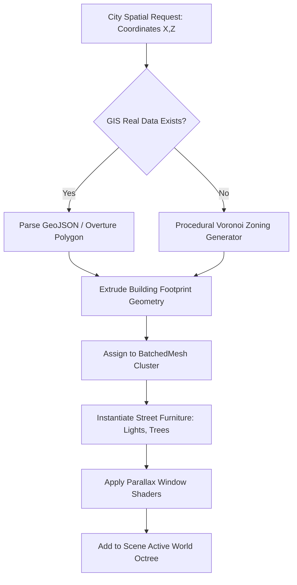

# Pesquisa Arquitetural 05: Cidades de Mundo Aberto, Malha Urbana e Geração Procedural

## 1. Visão Geral Executiva & Contexto no DR-MANAUS
A cidade de Manaus no **DR-MANAUS** combina duas fontes complementares de geometria e conteúdo: dados georreferenciados reais (via Overture Maps e OpenStreetMap para os marcos históricos centrais como o Teatro Amazonas, Palácio Rio Negro e Arena da Amazônia) e geração procedural algorítmica para preencher bairros periféricos, zonas industriais do Distrito Industrial, palafitas ribeirinhas do Educandos e até assentamentos e metrópoles alienígenas em luas e planetas colonizados.
O maior desafio técnico em um jogo web é renderizar centenas de milhares de edifícios, calçadas e postes sem disparar dezenas de milhares de chamadas de desenho (*draw calls*). A solução consiste em agrupar quarteirões inteiros em malhas combinadas (*BatchedMesh* e *InstancedMesh*), aplicar particionamento espacial em grade 2D (*Spatial Hash Grid*) e gerar fachadas proceduralmente via atlas de texturas compartilhadas.

---

## 2. Referências da Indústria & Jogos de Mundo Aberto
1. **Spider-Man (Insomniac Games)**:
   - *Técnica Chave*: Sistema de streaming em streaming quadtree de Manhattan com interiores simulados em parallax 2D (*Parallax Interior Mapping*) em janelas sem geometria interna 3D real.
   - *Aplicabilidade no DR-MANAUS*: Aplicação de interiores falsos com shader de cubo em janelas dos prédios de Manaus para dar vida à cidade sem custo de polígonos.
2. **Cyberpunk 2077 (CD Projekt Red)**:
   - *Técnica Chave*: Arquitetura de zonas verticais com hierarquia de materiais sujos, fios elétricos e placas holográficas instanciadas sobre fachadas de concreto.
   - *Aplicabilidade no DR-MANAUS*: Construções de Manaus misturando cabos aéreos tropicais, aparelhos de ar-condicionado e estruturas alienígenas procedurais.
3. **Cities: Skylines (Colossal Order)**:
   - *Técnica Chave*: Algoritmo de malha viária baseado em curvas de Bézier e grafos topológicos com zoneamento paramétrico de quarteirões (*RICO - Residential, Industrial, Commercial, Office*).
   - *Aplicabilidade no DR-MANAUS*: Geração orgânica de ruas que acompanham o contorno dos igarapés de Manaus.
4. **The Matrix Awakens (Epic Games / Nanite)**:
   - *Técnica Chave*: Geração procedural massiva de cidade (City Sample com Houdini Engine) com instanciamento extremo de mobiliário urbano.
   - *Aplicabilidade no DR-MANAUS*: Distribuição procedural de árvores amazônicas, lixeiras e orelhões na malha urbana.

---

## 3. Repositórios Clonados & Arquivos de Origem Analisados

### 3.1. Repositório `references/city-tour`
- **Arquivo de Origem**: `references/city-tour/src/generators/buildings_generator.js`
  - *O que inspecionar*: O algoritmo de zoneamento que define a altura e o recuo dos edifícios conforme a distância do centro financeiro (*Central Business District - CBD*):
    `height = max_height * exp(-distance / decay_rate) * random_factor`
- **Arquivo de Origem**: `references/city-tour/src/meshes/building_mesh_builder.js`
  - *O que inspecionar*: Agrupamento de vértices de múltiplos prédios em um único `BufferGeometry` com coordenadas UV empacotadas para evitar múltiplas chamadas de desenho.
- **Arquivo de Origem**: `references/city-tour/src/road_network.js`
  - *O que inspecionar*: Estrutura de dados de grafo topológico para cruzamentos e pistas de tráfego.

### 3.2. Repositório `references/Procedural-City-Generator`
- **Arquivo de Origem**: `references/Procedural-City-Generator/js/procedural.city.generator.js`
  - *O que inspecionar*: Algoritmo clássico de extrusão de caixas a partir de um mapa de calor Perlin/Simplex.
- **Arquivo de Origem**: `references/instanced-mesh/src/InstancedMesh2.ts`
  - *O que inspecionar*: Suporte a frustum culling individual por instância e LOD dinâmico em lote de instâncias.

---

## 4. Documentações Oficiais de Bibliotecas & Especificações
1. **Three.js BatchedMesh Documentation**:
   - [Three.js BatchedMesh API](https://threejs.org/docs/#api/en/objects/BatchedMesh)
   - Renderização de diferentes geometrias de edifícios em uma única chamada de desenho compartilhando materiais.
2. **Overture Maps Foundation Schema Specification**:
   - [Overture Schema](https://docs.overturemaps.org/schema/)
   - Estrutura de dados geoespaciais para polígonos de edifícios (*Buildings Theme*) e rodovias (*Transportation Theme*).
3. **Parallax Interior Mapping (Simon Schreibt)**:
   - Técnica analítica de shader em espaço tangente para simular profundidade de cômodos em cubemaps.

---

## 5. Requisitos do Sistema

### Requisitos Funcionais (RF)
- **RF-05-01**: O sistema deve integrar perfeitamente os marcos manuais de Manaus (Teatro, Arena, etc.) com bairros adjacentes gerados proceduralmente.
- **RF-05-02**: Os edifícios gerados proceduralmente devem respeitar gabaritos de altura de Manaus (edifícios baixos e médios, com maior densidade na orla e centro).
- **RF-05-03**: As metrópoles alienígenas em outros planetas devem usar padrões procedurais geométricos futuristas (piramidais, hexagonais, anulares).
- **RF-05-04**: O mobiliário urbano (postes de luz, placas, árvores) deve ser distribuído automaticamente ao longo das calçadas das vias.
- **RF-05-05**: As janelas dos edifícios devem refletir o ciclo dia/noite, acendendo luzes internas aleatórias durante a noite.

### Requisitos Não Funcionais (RNF)
- **RNF-05-01 (Draw Calls)**: A malha urbana completa de Manaus visível simultaneamente não deve ultrapassar 45 draw calls no renderizador.
- **RNF-05-02 (Tempo de Geração)**: A geração e montagem de um setor urbano novo (chunk de 500m x 500m) em background deve levar menos de 16ms no Web Worker.
- **RNF-05-03 (Consumo de VRAM)**: As geometrias da cidade inteira não devem ultrapassar 60MB de memória de vídeo através de instanciamento agressivo.

---

## 6. Arquitetura da Solução & Diagrama de Fluxo



---

## 7. Módulos & Arquivos Afetados no DR-MANAUS (`src/`)

### 7.1. `src/world/realcity/realcity.ts`
- **Mudanças**:
  - Unificar a ingestão de dados vetoriais com o preenchedor procedural para quarteirões com dados ausentes.
  - Substituir malhas individuais por instâncias `BatchedMesh`.

### 7.2. `src/world/realcity/buildings.ts`
- **Mudanças**:
  - Incorporar gerador de telhados e variações de fachada por tipo de zona (Comercial, Residencial, Histórico).

### 7.3. `src/world/realcity/roads.ts`
- **Mudanças**:
  - Criar malhas viárias contínuas com cruzamentos chanfrados baseados na lógica de `references/city-tour/src/road_network.js`.

---

## 8. Código de Implementação e Extração Baseado em `references`

```typescript
// Trecho a ser integrado em src/world/realcity/buildings.ts
// Baseado em references/city-tour/src/generators/buildings_generator.js e BatchedMesh

import * as THREE from 'three';

export interface ProceduralBuilding {
  x: number;
  z: number;
  width: number;
  depth: number;
  height: number;
  zone: 'historic' | 'downtown' | 'residential' | 'alien';
}

export class UrbanBlockBuilder {
  public static createBlockBuildings(
    centerX: number,
    centerZ: number,
    blockSize: number,
    zoneType: string
  ): ProceduralBuilding[] {
    const buildings: ProceduralBuilding[] = [];
    const lotSize = 25; // Tamanho padrão do lote em metros
    const lotsPerSide = Math.floor(blockSize / lotSize);

    for (let ix = 0; ix < lotsPerSide; ix++) {
      for (let iz = 0; iz < lotsPerSide; iz++) {
        const posX = centerX - blockSize / 2 + ix * lotSize + lotSize / 2;
        const posZ = centerZ - blockSize / 2 + iz * lotSize + lotSize / 2;

        let baseHeight = 12;
        if (zoneType === 'downtown') {
          baseHeight = 35 + Math.random() * 45;
        } else if (zoneType === 'residential') {
          baseHeight = 8 + Math.random() * 14;
        } else if (zoneType === 'historic') {
          baseHeight = 10 + Math.random() * 8;
        }

        buildings.push({
          x: posX,
          z: posZ,
          width: lotSize * 0.85,
          depth: lotSize * 0.85,
          height: baseHeight,
          zone: zoneType as any
        });
      }
    }

    return buildings;
  }
}
```

---

## 9. Plano de Testes & Casos de Teste (Unitários e de Regressão)

### Cenários de Teste Automatizados (`tests/urban-generation.test.ts`)
1. **CT-05-01 (Limites Geométricos de Lotes)**:
   - *Objetivo*: Garantir que os edifícios gerados em um quarteirão nunca se sobreponham fisicamente.
   - *Critério de Aceite*: A distância euclidiana mínima entre o centro de dois lotes deve ser estritamente maior que a soma de suas meias larguras.
2. **CT-05-02 (Conformidade com Zonas de Gabarito)**:
   - *Objetivo*: Validar se a zona histórica preserva alturas máximas compatíveis com o Teatro Amazonas (< 25m).
   - *Critério de Aceite*: 100% dos edifícios no setor histórico possuem altura <= 22m.
3. **CT-05-03 (Empacotamento em BatchedMesh)**:
   - *Objetivo*: Confirmar que a adição de 500 edifícios resulta em exatamente 1 draw call para a geometria opaca.
   - *Critério de Aceite*: `renderer.info.render.calls` permanece estável após inclusão do quarteirão.
