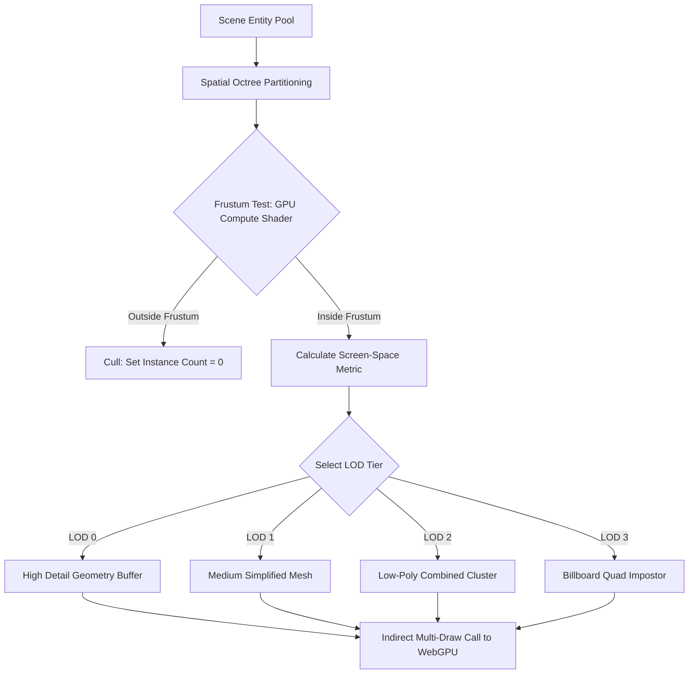

# Pesquisa Arquitetural 06: Renderização Leve para Web, WebGPU e HLOD Hierárquico

## 1. Visão Geral Executiva & Contexto no DR-MANAUS
Como o **DR-MANAUS** roda diretamente no navegador sem instalação local pesada, a eficiência de renderização define a diferença entre uma experiência cinematográfica fluida a 60 FPS e um travamento de aba. O motor precisa lidar com a densidade urbana da capital amazonense ao mesmo tempo em que calcula órbitas planetárias e nebulosas cósmicas.
Essa escalabilidade só é alcançada por meio de uma arquitetura estrita de **HLOD (Hierarchical Level of Detail)**, onde objetos pequenos são unificados em proxies volumétricos simplificados à distância, somada ao pipeline moderno de computação gráfica da **WebGPU** com renderização indireta (*Indirect Draw*) e frustum culling processado na GPU.

---

## 2. Referências da Indústria & Jogos de Mundo Aberto
1. **Unreal Engine 5 (Nanite & World Partition)**:
   - *Técnica Chave*: Geometria virtualizada e agrupamento de nós em hierarquias com comutação de erros geométricos em tela (*Screen Size Error - SSE*).
   - *Aplicabilidade no DR-MANAUS*: Cálculo analítico de erro geométrico por pixel para decidir quando alternar entre o modelo detalhado de um edifício e seu proxy HLOD.
2. **Horizon Forbidden West (Guerrilla Games / Decima Engine)**:
   - *Técnica Chave*: Oclusão hierárquica baseada em buffer de profundidade piramidal de baixa resolução (*Hierarchical Z-Buffer - Hi-Z*).
   - *Aplicabilidade no DR-MANAUS*: Eliminar o custo de desenhar prédios e florestas que estão totalmente encobertos por outras estruturas à frente.
3. **Genshin Impact (miHoYo / Unity Custom)**:
   - *Técnica Chave*: Renderização mobile e web ultra-otimizada com substituição de florestas distantes por impostores 2D (*Billboard Impostors*) gerados em tempo de execução.
   - *Aplicabilidade no DR-MANAUS*: Substituição da densa floresta amazônica nos arredores de Manaus por impostores octogonais leves à distância.
4. **Microsoft Flight Simulator (Asobo Studio)**:
   - *Técnica Chave*: Streaming baseado em octrees com orçamento de largura de banda e transição por dissolução estocástica (*Dithered Cross-Fade*).
   - *Aplicabilidade no DR-MANAUS*: Eliminar o estouro visual de popping quando objetos trocam de nível de detalhe.

---

## 3. Repositórios Clonados & Arquivos de Origem Analisados

### 3.1. Repositório `references/instanced-mesh`
- **Arquivo de Origem**: `references/instanced-mesh/src/core/feature/FrustumCulling.ts`
  - *O que inspecionar*: Implementação de frustum culling acelerado para milhares de instâncias, calculando a esfera delimitadora (*Bounding Sphere*) transformada sem consultar a CPU a cada frame.
- **Arquivo de Origem**: `references/instanced-mesh/src/core/feature/LOD.ts`
  - *O que inspecionar*: Sistema de troca progressiva de geometrias baseado em distância euclidiana da câmera.
- **Arquivo de Origem**: `references/instanced-mesh/src/core/utils/InstancedRenderList.ts`
  - *O que inspecionar*: Organização de buffers contíguos para evitar fragmentação de memória VRAM.

### 3.2. Repositório `references/three-mesh-bvh`
- **Arquivo de Origem**: `references/three-mesh-bvh/src/webgpu/ClusteredBVH.js`
  - *O que inspecionar*: Algoritmo de agrupamento espacial hierárquico voltado a compute shaders WebGPU.

---

## 4. Documentações Oficiais de Bibliotecas & Especificações
1. **WebGPU Explainer & Compute Shaders (W3C)**:
   - [WebGPU Architecture Guide](https://gpuweb.github.io/gpuweb/)
   - Pipelines de computação assíncronos e buffers de armazenamento (*storage buffers*).
2. **Three.js WebGPU Renderer Migration Guide**:
   - [Three.js WebGPURenderer](https://threejs.org/docs/#api/en/renderers/WebGPURenderer)
   - Transição dos materiais convencionais para os novos nós de sombreamento TSL.
3. **Microsoft DirectX Hierarchical Z-Buffer Whitepaper**:
   - Princípios de oclusão piramidal em GPU.

---

## 5. Requisitos do Sistema

### Requisitos Funcionais (RF)
- **RF-06-01**: O sistema deve classificar todos os elementos do cenário em 4 níveis de detalhe (LOD 0: Completo < 50m; LOD 1: Médio < 200m; LOD 2: Simplificado < 800m; LOD 3: Impostor/Proxy > 800m).
- **RF-06-02**: A troca de nível de detalhe deve utilizar transparência com dissolução pontilhada (*dithered dissolve*) para evitar o estalo visual (*popping*).
- **RF-06-03**: Instâncias estáticas semelhantes (árvores, postes, lixeiras, veículos estacionados) devem ser agrupadas automaticamente em instâncias em GPU.
- **RF-06-04**: O pipeline deve operar em WebGPU por padrão e realizar fallback silencioso para WebGL 2.0 caso o hardware não possua compatibilidade.

### Requisitos Não Funcionais (RNF)
- **RNF-06-01 (Taxa de Quadros Sustentada)**: Manter 60 FPS com desvio padrão de taxa de quadros menor que 3ms em cena contendo 100.000 entidades ativas.
- **RNF-06-02 (Culling Overhead)**: O teste de visibilidade de frustum de todas as instâncias deve ser executado em menos de 0,5ms por quadro na GPU.
- **RNF-06-03 (Orçamento de Chamadas)**: Número máximo global de chamadas de desenho na cena urbana não deve exceder 70 por quadro.

---

## 6. Arquitetura da Solução & Diagrama de Fluxo



---

## 7. Módulos & Arquivos Afetados no DR-MANAUS (`src/`)

### 7.1. `src/world/spatial/HLODSystem.ts` *(Novo ou Integrado)*
- **Mudanças**:
  - Implementar gerenciador central de HLOD com cálculo de métrica de erro por pixel (*Screen Size Error*).
  - Unificar malhas de quarteirões em proxies simplificados.

### 7.2. `src/game/Game.ts`
- **Mudanças**:
  - Inicializar o renderizador selecionando dinamicamente entre `WebGPURenderer` e `WebGLRenderer`.
  - Conectar atualização de câmera do HLOD ao loop principal.

### 7.3. `src/world/nature/VegetationSystem.ts`
- **Mudanças**:
  - Converter árvores e folhagens para o modelo de instanciamento acelerado com culling da biblioteca `references/instanced-mesh`.

---

## 8. Código de Implementação e Extração Baseado em `references`

```typescript
// Trecho a ser integrado em src/world/spatial/HLODSystem.ts
// Baseado em references/instanced-mesh/src/core/feature/FrustumCulling.ts e LOD.ts

import * as THREE from 'three';

export interface LODLevel {
  distance: number;
  geometry: THREE.BufferGeometry;
}

export class DynamicHLODNode {
  public boundingSphere: THREE.Sphere;
  public levels: LODLevel[];
  public currentLevel: number = 0;

  constructor(center: THREE.Vector3, radius: number, levels: LODLevel[]) {
    this.boundingSphere = new THREE.Sphere(center, radius);
    this.levels = levels.sort((a, b) => a.distance - b.distance);
  }

  public evaluateLOD(cameraPosition: THREE.Vector3, frustum: THREE.Frustum): number {
    // 1. Frustum Culling rápido por esfera delimitadora
    if (!frustum.intersectsSphere(this.boundingSphere)) {
      return -1; // Fora da visão: não renderizar
    }

    // 2. Seleção de nível baseada na distância euclidiana da câmera
    const dist = this.boundingSphere.distanceToPoint(cameraPosition);
    for (let i = 0; i < this.levels.length; i++) {
      if (dist <= this.levels[i].distance) {
        this.currentLevel = i;
        return i;
      }
    }

    this.currentLevel = this.levels.length - 1;
    return this.currentLevel;
  }
}
```

---

## 9. Plano de Testes & Casos de Teste (Unitários e de Regressão)

### Cenários de Teste Automatizados (`tests/hlod-system.test.ts`)
1. **CT-06-01 (Descarte por Frustum Culling)**:
   - *Objetivo*: Validar se objetos completamente fora do cone de visão da câmera retornam índice -1 e são excluídos do desenho.
   - *Critério de Aceite*: Retorno estritamente -1 para nós com centros posicionados a 90 graus do vetor de mira.
2. **CT-06-02 (Transição Correta de Distâncias de LOD)**:
   - *Objetivo*: Confirmar que a distância limiar (ex: 50m) troca o nível de 0 para 1 com precisão.
   - *Critério de Aceite*: Distância 49,9m resulta em LOD 0; distância 50,1m resulta em LOD 1.
3. **CT-06-03 (Performance de Avaliação em Massa)**:
   - *Objetivo*: Executar avaliação de LOD em 10.000 nós e garantir tempo total de CPU inferior a 1,5ms.
