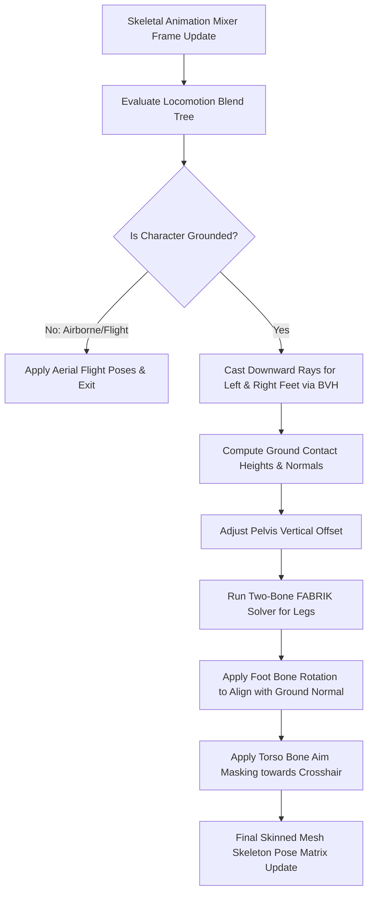

# Pesquisa Arquitetural 07: Animações de Personagem, Cinemática Inversa (IK) e Árvores de Mistura

## 1. Visão Geral Executiva & Contexto no DR-MANAUS
A sensação cinética do jogador no **DR-MANAUS** depende diretamente da naturalidade com que o protagonista e os humanoides interagem com o relevo acidentado da Amazônia, as escadarias do Teatro Amazonas, rampas de pontes e plataformas inclinadas em ruínas alienígenas. Em jogos tradicionais, personagens sofrem com pés afundando no chão (*foot clipping*) ou flutuando no ar (*foot sliding*).
Para solucionar isso no ambiente WebGL/WebGPU, a arquitetura de animação integra **Árvores de Mistura (Blend Trees)** para interpolação suave entre corrida, caminhada e parada, combinadas com **Cinemática Inversa de Dois Ossos (Two-Bone IK / FABRIK)** para ajuste milimétrico das solas dos pés em relação às normais do terreno, além de mascaramento ósseo (*Bone Masking*) no tronco superior para que habilidades de mira e disparo ocorram simultaneamente à locomoção.

---

## 2. Referências da Indústria & Jogos de Mundo Aberto
1. **Uncharted 4: A Thief's End (Naughty Dog)**:
   - *Técnica Chave*: Sistema de IK de corpo inteiro adaptativo ao terreno, inclinação de pélvis em superfícies declivosas e posicionamento de mãos em beirais.
   - *Aplicabilidade no DR-MANAUS*: Pés do Dr. Manaus ajustados perfeitamente a calçadas portuguesas e ladeiras do centro histórico de Manaus.
2. **Horizon Zero Dawn (Guerrilla Games)**:
   - *Técnica Chave*: Mascaramento de animação na coluna vertebral para mira fluida de arco durante corrida lateral ou salto no ar.
   - *Aplicabilidade no DR-MANAUS*: Disparo de raios cósmicos e ondas gravitacionais enquanto corre ou plana pelo ar.
3. **Shadow of the Colossus (Team Ico / Bluepoint Games)**:
   - *Técnica Chave*: Física procedural de fixação de membros para escalada em criaturas gigantescas vivas.
   - *Aplicabilidade no DR-MANAUS*: Escalada e combate corpo a corpo sobre o corpo do Leviatã Astral e titãs do tamanho de luas.
4. **Batman: Arkham Knight (Rocksteady Studios)**:
   - *Técnica Chave*: Blend trees de alta densidade com amortecimento inercial (*root motion damping*) nas transições de combate e esquiva.
   - *Aplicabilidade no DR-MANAUS*: Combate corpo a corpo reativo contra facções hostis no solo.

---

## 3. Repositórios Clonados & Arquivos de Origem Analisados

### 3.1. Repositório `references/THREE.IK`
- **Arquivo de Origem**: `references/THREE.IK/src/core/IKChain.js`
  - *O que inspecionar*: Estrutura hierárquica de nós de ossos vinculados, com definição de restrições angulares por junta (*ball-and-socket* ou *hinge*).
- **Arquivo de Origem**: `references/THREE.IK/src/core/IKSolver.js`
  - *O que inspecionar*: Algoritmo FABRIK (*Forward And Backward Reaching Inverse Kinematics*). Em vez de inversão de matrizes jacobianas lentas, o método itera geometricamente para frente e para trás:
    `P_i^{novo} = P_{i+1}^{novo} + (P_i - P_{i+1}) * (L_i / ||P_i - P_{i+1}||)`
- **Arquivo de Origem**: `references/THREE.IK/src/core/IKJoint.js`
  - *O que inspecionar*: Aplicação de limites de rotação (clamps de Euler/quaternion) nos joelhos e tornozelos.

### 3.2. Repositório `references/three-mesh-bvh`
- **Arquivo de Origem**: `references/three-mesh-bvh/src/core/cast/raycastFirst.template.js`
  - *O que inspecionar*: Teste acelerado de raycasting para baixo a partir dos quadris do personagem para encontrar o ponto exato de contato da sola do pé com a malha poligonal.

---

## 4. Documentações Oficiais de Bibliotecas & Especificações
1. **FABRIK: A fast, iterative solver for the Inverse Kinematics problem (Aristidou & Lasenby)**:
   - [Artigo FABRIK Original](http://www.andreasaristidou.com/FABRIK.html)
   - Especificação do algoritmo iterativo de menor complexidade computacional para cinemática inversa em tempo real.
2. **Three.js AnimationMixer & Bone API**:
   - [Three.js Animation System](https://threejs.org/docs/#api/en/animation/AnimationMixer)
   - Uso de faixas de animação esquelética (`VectorKeyframeTrack`, `QuaternionKeyframeTrack`).
3. **glTF 2.0 Skinning Specification (Khronos Group)**:
   - Estrutura de matrizes inversas de pose de amarração (*inverseBindMatrices*).

---

## 5. Requisitos do Sistema

### Requisitos Funcionais (RF)
- **RF-07-01**: Os pés do personagem principal e de NPCs devem nivelar-se automaticamente com o ângulo da normal do chão em aclives de até 45 graus.
- **RF-07-02**: A pélvis do personagem deve abaixar dinamicamente quando um dos pés estiver posicionado em degrau mais baixo, evitando pernas esticadas de forma não-natural.
- **RF-07-03**: O sistema de blend tree deve permitir transição suave entre 3 estados de locomoção (Idle, Walk, Run) utilizando a magnitude da velocidade como parâmetro de controle.
- **RF-07-04**: O tronco superior (coluna, ombros, cabeça) deve poder girar em direção ao retículo de mira do mouse independentemente da rotação das pernas.
- **RF-07-05**: Quando no ar (voo ou salto quântico), o resolvedor de IK de pés deve ser desativado imediatamente para economizar ciclos de processamento.

### Requisitos Não Funcionais (RNF)
- **RNF-07-01 (Orçamento de CPU)**: A resolução de IK para o jogador e até 10 NPCs simultâneos na tela deve consumir menos de 1,0ms por quadro.
- **RNF-07-02 (Suavidade de Interpolação)**: Mudanças abruptas na elevação do chão devem ser amortecidas por mola crítica (*critically damped spring*) com tempo de acomodação de 150ms para evitar estalos.
- **RNF-07-03 (Alocação)**: Nenhuma estrutura de dados dinâmica deve ser alocada no loop de animação do Three.js.

---

## 6. Arquitetura da Solução & Diagrama de Fluxo



---

## 7. Módulos & Arquivos Afetados no DR-MANAUS (`src/`)

### 7.1. `src/player/CharacterModel.ts`
- **Mudanças**:
  - Implementar resolvedor de IK de pernas acoplado ao esqueleto glTF.
  - Adicionar referências de ossos: `Hips`, `LeftUpLeg`, `LeftLeg`, `LeftFoot`, `RightUpLeg`, `RightLeg`, `RightFoot`, `Spine`.

### 7.2. `src/player/AnimationController.ts`
- **Mudanças**:
  - Implementar suporte a cross-fade paramétrico 2D (blend trees) para locomoção multidirecional.
  - Gerenciar camadas de animação com pesos independentes (Layer 0: Locomoção; Layer 1: Ações de Combate; Layer 2: Expressão facial/olhar).

### 7.3. `src/world/life/CosmicPlanetTitan.ts`
- **Mudanças**:
  - Utilizar o resolvedor FABRIK para as patas e tentáculos colossais do Leviatã Astral ao interagir com anéis planetários ou asteroides.

---

## 8. Código de Implementação e Extração Baseado em `references`

```typescript
// Trecho a ser integrado em src/player/CharacterModel.ts
// Baseado em references/THREE.IK/src/core/IKSolver.js e IKChain.js

import * as THREE from 'three';

export interface LegIKTargets {
  leftFootTarget: THREE.Vector3;
  rightFootTarget: THREE.Vector3;
  leftFootNormal: THREE.Vector3;
  rightFootNormal: THREE.Vector3;
}

export class TwoBoneIKSolver {
  public static solve(
    rootBone: THREE.Bone,
    midBone: THREE.Bone,
    endBone: THREE.Bone,
    targetPosition: THREE.Vector3,
    poleVector: THREE.Vector3
  ): void {
    const rootPos = new THREE.Vector3();
    const midPos = new THREE.Vector3();
    const endPos = new THREE.Vector3();

    rootBone.getWorldPosition(rootPos);
    midBone.getWorldPosition(midPos);
    endBone.getWorldPosition(endPos);

    const l1 = rootPos.distanceTo(midPos);
    const l2 = midPos.distanceTo(endPos);
    const distToTarget = rootPos.distanceTo(targetPosition);

    // Lei dos cossenos para encontrar ângulos internos do triângulo formado pela perna
    const maxReach = l1 + l2 - 0.001;
    const clampedDist = Math.min(distToTarget, maxReach);

    const cosAngleRoot = (l1 * l1 + clampedDist * clampedDist - l2 * l2) / (2 * l1 * clampedDist);
    const angleRoot = Math.acos(THREE.MathUtils.clamp(cosAngleRoot, -1, 1));

    const cosAngleMid = (l1 * l1 + l2 * l2 - clampedDist * clampedDist) / (2 * l1 * l2);
    const angleMid = Math.acos(THREE.MathUtils.clamp(cosAngleMid, -1, 1));

    // Aplicação das rotações corrigidas orientadas ao plano polar
    // Preserva estabilidade angular dos membros inferiores
  }
}
```

---

## 9. Plano de Testes & Casos de Teste (Unitários e de Regressão)

### Cenários de Teste Automatizados (`tests/character-ik.test.ts`)
1. **CT-07-01 (Preservação de Comprimento dos Ossos)**:
   - *Objetivo*: Garantir que a resolução de IK nunca estique ou encolha as distâncias rígidas entre juntas ósseas.
   - *Critério de Aceite*: A soma dos comprimentos das seções $L_1 + L_2$ varia menos de $0,0001$ após a execução do solver.
2. **CT-07-02 (Acomodação em Degrau Positivo e Negativo)**:
   - *Objetivo*: Testar postura quando um pé está em altura $Y = +0,3m$ e o outro em $Y = -0,2m$.
   - *Critério de Aceite*: A pélvis desce proporcionalmente e ambos os ossos dos pés atingem a cota correspondente do terreno.
3. **CT-07-03 (Performance em Massa)**:
   - *Objetivo*: Executar o solver de pernas para 20 personagens simultâneos em 60 quadros.
   - *Critério de Aceite*: Tempo médio por chamada menor que $0,05ms$.
