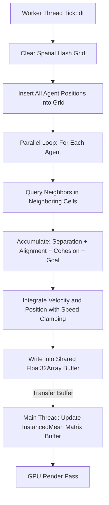

# Pesquisa Arquitetural 08: Multidões de NPCs, Tráfego Urbano e Simulação de Rebanhos (Boids)

## 1. Visão Geral Executiva & Contexto no DR-MANAUS
A cidade de Manaus e os ecossistemas exóticos do **DR-MANAUS** requerem uma sensação palpável de vida autônoma. No ambiente terrestre, isso inclui o trânsito intenso de carros e ônibus na Avenida Djalma Batista e Constantino Nery, barcos regionais e rabetas no Rio Negro, e pedestres caminhando no Largo de São Sebastião. No cosmos, bandos de criaturas astrais e frotas de espaçonaves de facções alienígenas navegam em padrões de enxame ao redor de titãs e luas.
Simular milhares de agentes individuais por meio de classes pesadas e raycasts individuais causaria colapso no motor JavaScript. A solução adotada baseia-se em **Estruturas SoA (Structure of Arrays)**, algoritmo de **Boids de Craig Reynolds em Grade Espacial (Spatial Hash Grid)** e instanciamento dinâmico de malhas via buffers contíguos.

---

## 2. Referências da Indústria & Jogos de Mundo Aberto
1. **Assassin's Creed Unity (Ubisoft Montreal)**:
   - *Técnica Chave*: Simulação de multidões com até 10.000 pessoas simultâneas em praças públicas através de autômatos celulares de baixa granularidade de IA e animações pré-assadas em texturas de vértices (*Vertex Animation Textures - VAT*).
   - *Aplicabilidade no DR-MANAUS*: Multidões densas no Festival de Parintins ou em eventos públicos em Manaus.
2. **Grand Theft Auto IV / V (Rockstar North)**:
   - *Técnica Chave*: IA de tráfego baseada em grafos viários com densidade adaptativa, gerenciamento de semáforos e desvio dinâmico de obstáculos estáticos e viaturas policiais.
   - *Aplicabilidade no DR-MANAUS*: Tráfego de veículos nas principais artérias viárias da cidade.
3. **Subnautica (Unknown Worlds Entertainment)**:
   - *Técnica Chave*: Comportamento de cardumes de peixes e predadores com algoritmo 3D de boids, detecção de ameaças e dispersão em pânico.
   - *Aplicabilidade no DR-MANAUS*: Fauna aquática do Rio Negro (botos, peixes-boi) e fauna espacial cósmica no vácuo.
4. **Days Gone (Bend Studio)**:
   - *Técnica Chave*: Hordas dinâmicas que alternam entre comportamento coletivo de fluido denso e combate individual quando próximas do jogador.
   - *Aplicabilidade no DR-MANAUS*: Enxames de drones hostis de facções alienígenas defendendo monólitos.

---

## 3. Repositórios Clonados & Arquivos de Origem Analisados

### 3.1. Repositório `references/boids-js`
- **Arquivo de Origem**: `references/boids-js/common/Grid.js`
  - *O que inspecionar*: Implementação eficiente de *Spatial Hash Grid* para particionamento espacial 2D/3D. Transforma a busca de vizinhos de complexidade $O(N^2)$ para $O(N)$ amortizado:
    `cellIndex = Math.floor(x / cellSize) + Math.floor(z / cellSize) * gridWidth`
- **Arquivo de Origem**: `references/boids-js/common/Entity.js`
  - *O que inspecionar*: As três forças canônicas de Reynolds: Separação, Alinhamento e Coesão vetorial, com ponderações ajustáveis.
- **Arquivo de Origem**: `references/boids-js/common/BoidsWorker.js`
  - *O que inspecionar*: Execução da simulação de enxame inteiramente dentro de um Web Worker dedicado via `ArrayBuffer` compartilhado (*SharedArrayBuffer* ou mensagens transferíveis).

### 3.2. Repositório `references/instanced-mesh`
- **Arquivo de Origem**: `references/instanced-mesh/src/InstancedMesh2.ts`
  - *O que inspecionar*: Atualização das matrizes de transformação de instâncias sem recriar os atributos do buffer WebGL.

---

## 4. Documentações Oficiais de Bibliotecas & Especificações
1. **Flocks, Herds and Schools: A Distributed Behavioral Model (Craig Reynolds)**:
   - [Paper Original dos Boids (SIGGRAPH '87)](https://www.red3d.com/cwr/boids/)
   - Teoria fundacional dos comportamentos emergentes em sistemas distribuídos de agentes.
2. **Spatial Hashing for Fast Proximity Queries (Matthias Teschner et al.)**:
   - Técnicas de indexação espacial para detecção rápida de colisões e vizinhança.
3. **Web Workers API (MDN)**:
   - Uso de transferência de posse de buffers contíguos de memória (*Transferable Objects*).

---

## 5. Requisitos do Sistema

### Requisitos Funcionais (RF)
- **RF-08-01**: O sistema deve simular simultaneamente até 1.000 veículos urbanos respeitando pistas, mãos de direção e semáforos.
- **RF-08-02**: Os pedestres devem caminhar em calçadas e praças, reagindo à presença do herói (afastando-se caso ele corra ou pouse com impacto).
- **RF-08-03**: Embarcações no Rio Negro e Solimões devem navegar seguindo rotas fluviais e desviar de obstáculos e margens.
- **RF-08-04**: Criaturas cósmicas e caças de patrulha devem mover-se em esquadrilhas 3D mantendo distância mínima de segurança.
- **RF-08-05**: Quando o jogador ativa poderes ou combate, agentes em um raio de 40m devem entrar em estado de alerta e fuga.

### Requisitos Não Funcionais (RNF)
- **RNF-08-01 (Budget de Simulação)**: O loop de física e atualização de todos os boids e agentes não deve ultrapassar 2,0ms de CPU por quadro.
- **RNF-08-02 (Concorrência)**: Toda a computação de vizinhos do Spatial Hash Grid deve rodar em Web Worker desacoplado do thread de renderização.
- **RNF-08-03 (Alocação)**: Proibida a alocação de objetos vetoriais temporários durante a soma de forças dos agentes.

---

## 6. Arquitetura da Solução & Diagrama de Fluxo



---

## 7. Módulos & Arquivos Afetados no DR-MANAUS (`src/`)

### 7.1. `src/world/traffic/TrafficSystem.ts`
- **Mudanças**:
  - Migrar gerenciamento de veículos para instâncias aceleradas por Spatial Hash Grid.
  - Implementar lógica de respeito aos nós de cruzamentos da malha viária de Manaus.

### 7.2. `src/entities/PopulationManager.ts`
- **Mudanças**:
  - Incorporar sistema de pedestres reativos com estados (Passeio, Espera, Pânico).

### 7.3. `src/world/life/AlienFaunaSystem.ts` *(ou Fauna Cósmica)*
- **Mudanças**:
  - Implementar enxames espaciais de 3 dimensões para criaturas que habitam atmosferas gasosas e nebulosas.

---

## 8. Código de Implementação e Extração Baseado em `references`

```typescript
// Trecho a ser integrado em src/world/traffic/TrafficSystem.ts
// Baseado em references/boids-js/common/Grid.js e Entity.js

export class FastSpatialGrid2D {
  private cellSize: number;
  private width: number;
  private height: number;
  private grid: Int32Array; // Contém índices dos agentes encadeados
  private next: Int32Array;

  constructor(worldSize: number, cellSize: number, maxEntities: number) {
    this.cellSize = cellSize;
    this.width = Math.ceil(worldSize / cellSize);
    this.height = this.width;
    this.grid = new Int32Array(this.width * this.height).fill(-1);
    this.next = new Int32Array(maxEntities).fill(-1);
  }

  public clear(): void {
    this.grid.fill(-1);
    this.next.fill(-1);
  }

  public insert(entityId: number, x: number, z: number): void {
    const cx = Math.max(0, Math.min(this.width - 1, Math.floor(x / this.cellSize)));
    const cz = Math.max(0, Math.min(this.height - 1, Math.floor(z / this.cellSize)));
    const cellIdx = cx + cz * this.width;

    this.next[entityId] = this.grid[cellIdx];
    this.grid[cellIdx] = entityId;
  }

  public forEachNeighbor(
    x: number,
    z: number,
    radius: number,
    callback: (neighborId: number) => void
  ): void {
    const rCells = Math.ceil(radius / this.cellSize);
    const cx = Math.floor(x / this.cellSize);
    const cz = Math.floor(z / this.cellSize);

    const minX = Math.max(0, cx - rCells);
    const maxX = Math.min(this.width - 1, cx + rCells);
    const minZ = Math.max(0, cz - rCells);
    const maxZ = Math.min(this.height - 1, cz + rCells);

    for (let iz = minZ; iz <= maxZ; iz++) {
      for (let ix = minX; ix <= maxX; ix++) {
        let curr = this.grid[ix + iz * this.width];
        while (curr !== -1) {
          callback(curr);
          curr = this.next[curr];
        }
      }
    }
  }
}
```

---

## 9. Plano de Testes & Casos de Teste (Unitários e de Regressão)

### Cenários de Teste Automatizados (`tests/boids-simulation.test.ts`)
1. **CT-08-01 (Distribuição Espacial Correta na Grade)**:
   - *Objetivo*: Garantir que todos os agentes inseridos na grade espacial são recuperados na consulta de vizinhos sem omissões.
   - *Critério de Aceite*: 100% dos agentes dentro do raio da célula são notificados pelo callback.
2. **CT-08-02 (Força de Repulsão entre Agentes)**:
   - *Objetivo*: Verificar se dois veículos muito próximos aplicam força de separação estritamente repulsiva.
   - *Critério de Aceite*: O produto escalar entre a força aplicada e o vetor de separação deve ser estritamente negativo.
3. **CT-08-03 (Performance com 5.000 Agentes)**:
   - *Objetivo*: Rodar 100 passos de simulação de grade espacial com 5.000 entidades.
   - *Critério de Aceite*: Tempo total de execução inferior a 250ms (média < 2,5ms por passo).
