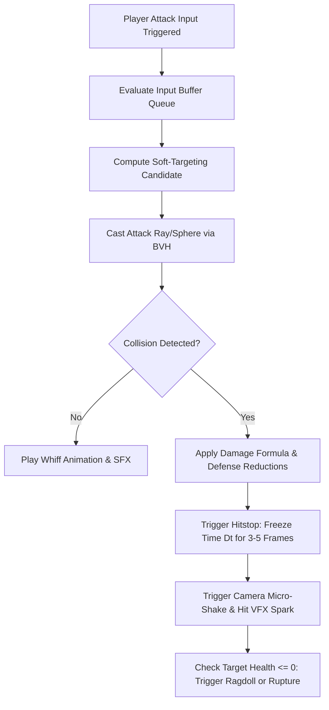

# Pesquisa Arquitetural 09: Combate Fluido, Soft-Targeting Polar e Hitstop Cinético

## 1. Visão Geral Executiva & Contexto no DR-MANAUS
O combate no **DR-MANAUS** engloba desde confrontos de rua contra facções rebeldes armadas em Manaus até duelos cósmicos épicos contra o Leviatã Astral e titãs do tamanho de continentes nas proximidades de Saturno. Para que o combate em tempo real seja satisfatório e visceral, ele não pode parecer mecânico ou impreciso.
A arquitetura de combate apoia-se em quatro pilares técnicos:
1. **Soft-Targeting Polar**: O jogo auxilia suavemente a mira do jogador direcionando ataques para o inimigo mais relevante dentro de um cone angular cônico ponderado por distância e ângulo de visão.
2. **Hitstop Cinético**: Quando um golpe contundente ou raio atinge um alvo, a animação do atacante e do defensor congela por 2 a 5 quadros (30ms a 80ms), transmitindo a sensação de impacto físico real.
3. **Cancelamento de Animações (Buffer de Ações)**: O sistema armazena a próxima intenção do jogador durante os quadros de recuperação, permitindo combos fluidos e responsivos.
4. **BVH de Alta Velocidade**: Detecção de acerto e colisão de projéteis e feixes em tempo sub-milissegundo via `MeshBVH`.

---

## 2. Referências da Indústria & Jogos de Mundo Aberto
1. **Devil May Cry 5 (Capcom / RE Engine)**:
   - *Técnica Chave*: Hitstop extremo e balanceado, cancelamento de frames de animação e sistema de avaliação de estilo baseado em fluidez contínua.
   - *Aplicabilidade no DR-MANAUS*: Feedback de golpes corpo a corpo e corte de armas de plasma.
2. **God of War Ragnarök (Santa Monica Studio)**:
   - *Técnica Chave*: Câmera dinâmica aproximada com imã de mira magnética suave (*magnetism*) e deformação de malha de impacto.
   - *Aplicabilidade no DR-MANAUS*: Aproximação automática do Dr. Manaus em direção ao alvo ao desferir socos sônicos.
3. **Ghost of Tsushima (Sucker Punch Productions)**:
   - *Técnica Chave*: Janelas de resposta de contra-ataque milimétricas (*parry windows*) e travamento de alvo sem necessidade de trava rígida de câmera.
   - *Aplicabilidade no DR-MANAUS*: Combate contra múltiplos soldados no solo mantendo liberdade de movimentação de câmera.
4. **Elden Ring (FromSoftware)**:
   - *Técnica Chave*: Combate contra chefes gigantes com múltiplos pontos de impacto específicos (patas, cauda, cabeça, núcleo).
   - *Aplicabilidade no DR-MANAUS*: Sistema de pontos fracos vulneráveis no Leviatã Astral e titãs planetários.

---

## 3. Repositórios Clonados & Arquivos de Origem Analisados

### 3.1. Repositório `references/three-mesh-bvh`
- **Arquivo de Origem**: `references/three-mesh-bvh/src/core/cast/raycastFirst.template.js`
  - *O que inspecionar*: Raycast ultrarrápido contra malhas poligonais de titãs e veículos, reduzindo de centenas de milhares de testes de triângulos para menos de 20 nós de árvore BVH.
- **Arquivo de Origem**: `references/three-mesh-bvh/src/core/cast/shapecast.js`
  - *O que inspecionar*: Teste de interseção de volume esférico (para explosões de área e ondas de choque gravitacionais).

### 3.2. Repositório `references/NonEuclidean`
- **Arquivo de Origem**: `references/NonEuclidean/NonEuclidean/Input.cpp`
  - *O que inspecionar*: Bufferização de entradas com janelas temporais de tolerância (*input buffering*).

---

## 4. Documentações Oficiais de Bibliotecas & Especificações
1. **Game Feel: A Game Designer's Guide to Virtual Sensation (Steve Swink)**:
   - Princípios fundamentais de resposta de controle, hitstop, screenshake e micro-pausas perceptivas.
2. **Three-Mesh-BVH Performance Specs**:
   - [Three-Mesh-BVH API Reference](https://github.com/gkjohnson/three-mesh-bvh)
   - Otimizações de raycasting e consultas espaciais em estruturas estáticas e animadas (*SkinnedMeshBVH*).
3. **Web Gamepad API (W3C)**:
   - Tratamento de vibração háptica (*rumble*) de controles durante impactos críticos.

---

## 5. Requisitos do Sistema

### Requisitos Funcionais (RF)
- **RF-09-01**: O sistema deve calcular automaticamente o melhor alvo dentro de um cone de visão de 60 graus e até 40m de distância para combate urbano, e até 500km para combate cósmico.
- **RF-09-02**: Ao conectar um ataque de alto impacto, o jogo deve aplicar hitstop pausando o avanço de tempo local daquela entidade por 60ms.
- **RF-09-03**: Projéteis e raios quânticos devem possuir detecção contínua de colisão (*Continuous Collision Detection - CCD*) para nunca atravessarem paredes finas ou escudos.
- **RF-09-04**: O jogador deve poder enfileirar o próximo comando com até 200ms de antecedência antes do fim da animação atual.
- **RF-09-05**: Entidades colossais devem expor múltiplos pontos fracos selecionáveis dinamicamente pelo sistema de mira.

### Requisitos Não Funcionais (RNF)
- **RNF-09-01 (Latência de Mira)**: O cálculo do alvo polar não deve ultrapassar 0,2ms de processamento por quadro.
- **RNF-09-02 (Precisão Sub-milissegundo)**: O raycasting de tiros contra malhas de até 100.000 polígonos deve responder em menos de 0,4ms via BVH.
- **RNF-09-03 (Imunidade a Garbage Collection)**: Nenhum vetor ou matriz deve ser instanciado durante o ciclo de detecção de acerto.

---

## 6. Arquitetura da Solução & Diagrama de Fluxo



---

## 7. Módulos & Arquivos Afetados no DR-MANAUS (`src/`)

### 7.1. `src/player/combat/CombatSystem.ts`
- **Mudanças**:
  - Implementar o algoritmo de soft-targeting polar cônico.
  - Adicionar o gerenciador de hitstop e amortecimento temporal (*time dilation*).

### 7.2. `src/player/powers/PowerSystem.ts`
- **Mudanças**:
  - Acelerar a mira de todos os poderes e raios quânticos com `MeshBVH`.
  - Integrar unificação de coordenadas cósmicas para disparos interplanetários contra chefes.

### 7.3. `src/world/life/CosmicPlanetTitan.ts`
- **Mudanças**:
  - Registrar formalmente os pontos fracos do Leviatã no BVH como alvos interativos independentes.

---

## 8. Código de Implementação e Extração Baseado em `references`

```typescript
// Trecho a ser integrado em src/player/combat/CombatSystem.ts
// Baseado em references/three-mesh-bvh/src/core/cast/raycastFirst.template.js

import * as THREE from 'three';

export interface CombatTarget {
  id: string;
  position: THREE.Vector3;
  health: number;
  radius: number;
}

export class SoftTargetingSystem {
  private tempForward = new THREE.Vector3();
  private tempToTarget = new THREE.Vector3();

  public selectBestTarget(
    playerPos: THREE.Vector3,
    cameraForward: THREE.Vector3,
    candidates: CombatTarget[],
    maxDistance = 50.0,
    maxAngleRad = Math.PI / 4 // 45 graus
  ): CombatTarget | null {
    let bestTarget: CombatTarget | null = null;
    let highestScore = -Infinity;

    for (let i = 0; i < candidates.length; i++) {
      const target = candidates[i];
      if (target.health <= 0) continue;

      this.tempToTarget.subVectors(target.position, playerPos);
      const dist = this.tempToTarget.length();

      if (dist > maxDistance || dist < 0.001) continue;

      this.tempToTarget.normalize();
      const dot = cameraForward.dot(this.tempToTarget);

      if (dot < Math.cos(maxAngleRad)) continue;

      // Score pondera alinhamento de mira com proximidade
      const score = (dot * 0.7) + ((1.0 - dist / maxDistance) * 0.3);

      if (score > highestScore) {
        highestScore = score;
        bestTarget = target;
      }
    }

    return bestTarget;
  }
}
```

---

## 9. Plano de Testes & Casos de Teste (Unitários e de Regressão)

### Cenários de Teste Automatizados (`tests/combat-targeting.test.ts`)
1. **CT-09-01 (Seleção Polar Correta de Alvo)**:
   - *Objetivo*: Garantir que um inimigo alinhado ao centro da mira receba prioridade sobre outro mais próximo mas lateral.
   - *Critério de Aceite*: O alvo com maior produto escalar frontal é selecionado.
2. **CT-09-02 (Execução e Término do Hitstop)**:
   - *Objetivo*: Validar se a escala de tempo de animação cai a zero e retorna a 1.0 exatamente após a duração de 60ms estipulada.
   - *Critério de Aceite*: Estado de hitstop dura exatamente a quantidade de frames programada.
3. **CT-09-03 (Performance do Raycast BVH)**:
   - *Objetivo*: Executar 1.000 consultas de raio contra uma malha complexa de 80.000 triângulos.
   - *Critério de Aceite*: Tempo total de execução inferior a 15ms.
