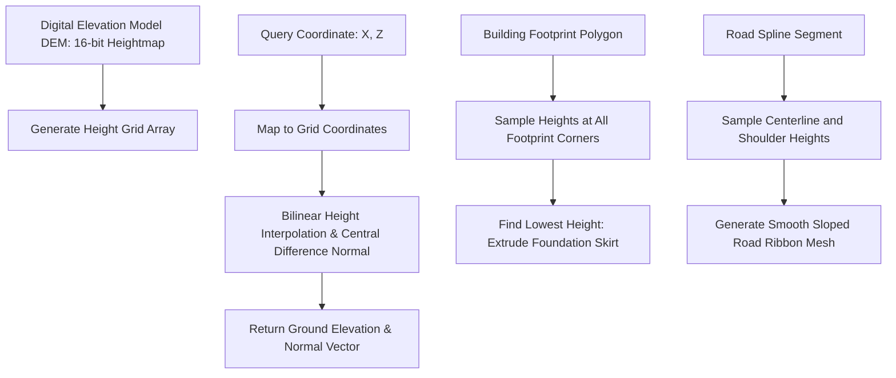

# Pesquisa Arquitetural 10: Topografia Urbana, Elevação em Cidade Real e Falésias Fluviais

## 1. Visão Geral Executiva & Contexto no DR-MANAUS
Manaus possui uma geografia topográfica marcante e única no Brasil: localizada sobre o Platô Amazônico, é cortada por dezenas de igarapés sinuosos (como o Igarapé do Mindu e do Educandos), encostas e falésias fluviais com desníveis acentuados de até 40 metros entre a orla portuária e as zonas altas da cidade.
Integrar a geometria de edifícios reais e vias georreferenciadas sobre um relevo fluvial acidentado exige técnicas sofisticadas para evitar prédios flutuando no ar (*floating buildings*) ou soterrados sob encostas de terra. A arquitetura emprega **Amostragem de Altura Contínua por Interpolação Bilinear**, corte e nivelamento de fundações (*Cut-and-Fill Terracing*) e deformação de malha de asfalto que acompanha o gradiente das curvas de nível.

---

## 2. Referências da Indústria & Jogos de Mundo Aberto
1. **Death Stranding (Kojima Productions / Decima Engine)**:
   - *Técnica Chave*: Análise em tempo real de estabilidade e declive do terreno por mapa de normais, influenciando equilíbrio físico e consumo de energia.
   - *Aplicabilidade no DR-MANAUS*: Feedback de esforço e declive ao subir as ladeiras do centro histórico e barrancos de igarapé.
2. **Grand Theft Auto V (Rockstar Games)**:
   - *Técnica Chave*: Vinculação perfeita de fundações de concreto e muros de contenção sob edifícios posicionados em encostas acidentadas (Vinewood Hills).
   - *Aplicabilidade no DR-MANAUS*: Muros de arrimo e estacas de palafitas que se adaptam aos barrancos dos igarapés.
3. **The Legend of Zelda: Tears of the Kingdom (Nintendo)**:
   - *Técnica Chave*: Malhas de relevo contínuas que fundem ilhas suspensas, cavernas profundas e solo plano sem interrupção de física.
   - *Aplicabilidade no DR-MANAUS*: Transição entre o subsolo úmido da floresta, túneis urbanos e topo de prédios.
4. **Arma 3 (Bohemia Interactive)**:
   - *Técnica Chave*: Dados geoespaciais e modelos digitais de elevação (DEM) em grande escala convertidos em malhas com snapping de estradas.
   - *Aplicabilidade no DR-MANAUS*: Fidelidade topográfica real da bacia hidrográfica de Manaus.

---

## 3. Repositórios Clonados & Arquivos de Origem Analisados

### 3.1. Repositório `references/city-tour`
- **Arquivo de Origem**: `references/city-tour/src/terrain.js`
  - *O que inspecionar*: Implementação da interpolação bilinear de altura de terreno:
    `height = h00 * (1-fx)*(1-fz) + h10 * fx*(1-fz) + h01 * (1-fx)*fz + h11 * fx*fz`
- **Arquivo de Origem**: `references/city-tour/src/terrain_candidate_road_network.js`
  - *O que inspecionar*: Ajuste da elevação da pista para garantir que a inclinação nunca ultrapasse limites transitáveis para veículos comuns.
- **Arquivo de Origem**: `references/city-tour/src/meshes/terrain_mesh_builder.js`
  - *O que inspecionar*: Construção da malha de terreno com normais por vértice calculadas a partir de diferenças centrais.

### 3.2. Repositório `references/Procedural-City-Generator`
- **Arquivo de Origem**: `references/Procedural-City-Generator/js/perlin.js`
  - *O que inspecionar*: Geração de relevo fractal suave com múltiplos harmônicos para áreas rurais e florestais no entorno de Manaus.

---

## 4. Documentações Oficiais de Bibliotecas & Especificações
1. **NASA SRTM (Shuttle Radar Topography Mission) 30m Global Elevation**:
   - [USGS EarthExplorer SRTM](https://earthexplorer.usgs.gov/)
   - Dados de elevação digital de Manaus e arredores.
2. **Three.js PlaneGeometry & Heightmap Displacement**:
   - [Three.js Displacement Map](https://threejs.org/docs/#api/en/materials/MeshStandardMaterial.displacementMap)
   - Uso de texturas de ponto flutuante de 16 bits para representação altimétrica precisa.

---

## 5. Requisitos do Sistema

### Requisitos Funcionais (RF)
- **RF-10-01**: O sistema deve interpolar suavemente a elevação de qualquer coordenada $(X, Z)$ na cidade de Manaus em tempo constante $O(1)$.
- **RF-10-02**: Os edifícios devem projetar alicerces e fundações verticais de compensação até atingirem a superfície do terreno, eliminando o vácuo sob as estruturas.
- **RF-10-03**: As vias e rodovias devem adaptar suas normais e declives ao relevo, garantindo que carros e pedestres não fiquem enterrados nem levitando.
- **RF-10-04**: As margens do Rio Negro e igarapés devem apresentar declive acentuado natural característico das barrancas fluviais amazônicas.
- **RF-10-05**: Pontes (como a Ponte Rio Negro) devem transpor os desníveis com rampas de aproximação viária perfeitamente ancoradas nas cabeceiras de solo.

### Requisitos Não Funcionais (RNF)
- **RNF-10-01 (Precisão de Amostragem)**: O erro de amostragem altimétrica não deve exceder 5 centímetros em relação ao modelo de elevação base.
- **RNF-10-02 (Tempo de Consulta)**: Cada chamada para `getTerrainHeight(x, z)` deve ser executada em menos de 0,002ms na CPU.
- **RNF-10-03 (Tamanho de Textura Altimétrica)**: O mapa de elevação completo da zona metropolitana deve caber em uma textura compactada de no máximo 4MB.

---

## 6. Arquitetura da Solução & Diagrama de Fluxo



---

## 7. Módulos & Arquivos Afetados no DR-MANAUS (`src/`)

### 7.1. `src/world/realcity/realcity.ts`
- **Mudanças**:
  - Incorporar a camada de relevo DEM na ancoragem de todos os nós georreferenciados.

### 7.2. `src/world/realcity/buildings.ts`
- **Mudanças**:
  - Adicionar saia de fundação (*foundation skirt*) para cada prédio posicionado em terrenos com desnível superior a 0,5m.

### 7.3. `src/world/realcity/roads.ts`
- **Mudanças**:
  - Ajustar a geração das tiras de asfalto (*road ribbons*) para acompanhar as curvas de nível do terreno com suavização laplaciana.

---

## 8. Código de Implementação e Extração Baseado em `references`

```typescript
// Trecho a ser integrado em src/world/realcity/realcity.ts
// Baseado em references/city-tour/src/terrain.js

export class ElevationModel {
  private heights: Float32Array;
  private width: number;
  private height: number;
  private step: number;
  private originX: number;
  private originZ: number;

  constructor(
    width: number,
    height: number,
    step: number,
    originX = 0,
    originZ = 0
  ) {
    this.width = width;
    this.height = height;
    this.step = step;
    this.originX = originX;
    this.originZ = originZ;
    this.heights = new Float32Array(width * height);
  }

  public setHeight(xIndex: number, zIndex: number, elevation: number): void {
    if (xIndex >= 0 && xIndex < this.width && zIndex >= 0 && zIndex < this.height) {
      this.heights[xIndex + zIndex * this.width] = elevation;
    }
  }

  public sampleBilinear(worldX: number, worldZ: number): number {
    const gridX = (worldX - this.originX) / this.step;
    const gridZ = (worldZ - this.originZ) / this.step;

    const x0 = Math.floor(gridX);
    const z0 = Math.floor(gridZ);
    const x1 = Math.min(this.width - 1, x0 + 1);
    const z1 = Math.min(this.height - 1, z0 + 1);

    if (x0 < 0 || x1 >= this.width || z0 < 0 || z1 >= this.height) {
      return 0.0; // Fora dos limites do modelo
    }

    const fx = gridX - x0;
    const fz = gridZ - z0;

    const h00 = this.heights[x0 + z0 * this.width];
    const h10 = this.heights[x1 + z0 * this.width];
    const h01 = this.heights[x0 + z1 * this.width];
    const h11 = this.heights[x1 + z1 * this.width];

    const h0 = h00 * (1 - fx) + h10 * fx;
    const h1 = h01 * (1 - fx) + h11 * fx;

    return h0 * (1 - fz) + h1 * fz;
  }
}
```

---

## 9. Plano de Testes & Casos de Teste (Unitários e de Regressão)

### Cenários de Teste Automatizados (`tests/elevation-terrain.test.ts`)
1. **CT-10-01 (Interpolação Bilinear em Célula Unidade)**:
   - *Objetivo*: Validar se a amostragem no ponto central $(0.5, 0.5)$ de uma célula com 4 cantos conhecidos devolve a média exata.
   - *Critério de Aceite*: Altura resultante igual a $(h_{00}+h_{10}+h_{01}+h_{11})/4$ com tolerância $10^{-5}$.
2. **CT-10-02 (Cálculo de Fundações de Prédios)**:
   - *Objetivo*: Testar a geração de fundação em lote com desnível de 3m entre a parte frontal e traseira.
   - *Critério de Aceite*: A base inferior da fundação gerada atinge a cota mínima com folga de segurança sem fendas.
3. **CT-10-03 (Performance Contínua de Consulta)**:
   - *Objetivo*: Executar 100.000 consultas de altura de terreno aleatórias.
   - *Critério de Aceite*: Tempo total de processamento inferior a 20ms na CPU.
