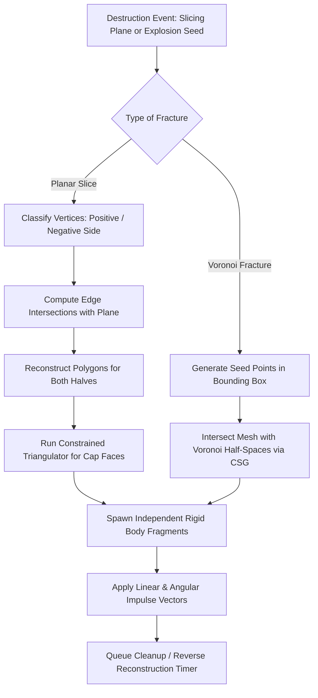

# Pesquisa Arquitetural 11: Destruição Procedural, Fatiamento de Malhas (Slicing) e Fratura Voronoi

## 1. Visão Geral Executiva & Contexto no DR-MANAUS
O **DR-MANAUS** apresenta momentos climáticos onde a escala do poder do herói e dos titãs cósmicos se manifesta através de destruição maciça: prédios sendo cortados ao meio por lâminas de energia gravitacional, meteoros colidindo contra a crosta planetária e luas inteiras sofrendo fratura e dispersão de escombros em órbita (*Planetary Rupture*).
Em vez de destruições pré-animadas (*canned animations*) estáticas, o jogo emprega **Fatiamento em Tempo Real (Real-Time Mesh Slicing)** e **Diagramação 3D de Voronoi**, onde qualquer malha poligonal arbitrária pode ser cortada por um plano em dois fragmentos estanques (*watertight*) com geração imediata de tampas trianguladas no plano de corte, e subsequente dispersão de estilhaços via corpos rígidos leves.

---

## 2. Referências da Indústria & Jogos de Mundo Aberto
1. **Metal Gear Rising: Revengeance (PlatinumGames)**:
   - *Técnica Chave*: Mecânica "Blade Mode" com fatiamento livre de malhas em qualquer ângulo e eixo, com fechamento analítico de tampas de corte e física de queda.
   - *Aplicabilidade no DR-MANAUS*: Corte cirúrgico de colunas e naves alienígenas por feixes de plasma.
2. **Control (Remedy Entertainment / Northlight Engine)**:
   - *Técnica Chave*: Destruição procedural densa de concreto, madeira e vidro com fratura Voronoi acelerada por GPU e geração de campos de detritos dinâmicos.
   - *Aplicabilidade no DR-MANAUS*: Fragmentação de fachadas urbanas de Manaus durante combates cinéticos intensos.
3. **Red Faction: Guerrilla (Volition)**:
   - *Técnica Chave*: Sistema de estresse estrutural e física de colapso de edifícios baseado em grafos de sustentação de carga (*Structural Integrity*).
   - *Aplicabilidade no DR-MANAUS*: Desabamento progressivo de pontes e viadutos sob impacto de meteoros ou forças de titãs.
4. **Teardown (Tuxedo Labs)**:
   - *Técnica Chave*: Física destrutiva baseada em voxels em tempo real com propagação de fogo, explosões e colapso de sustentação física.
   - *Aplicabilidade no DR-MANAUS*: Inspiração para a lógica de fragmentação modular de blocos urbanos.

---

## 3. Repositórios Clonados & Arquivos de Origem Analisados

### 3.1. Repositório `references/three-pinata`
- **Arquivo de Origem**: `references/three-pinata/lib/src/fracture/Slice.ts`
  - *O que inspecionar*: Algoritmo exato de interseção de triângulos com o plano de corte. Se os 3 vértices estiverem do mesmo lado, o triângulo vai para a malha correspondente; se o plano cortar o triângulo, ele é subdividido em 1 triângulo e 1 quadrilátero (2 triângulos).
- **Arquivo de Origem**: `references/three-pinata/lib/src/triangulators/ConstrainedTriangulator.ts`
  - *O que inspecionar*: Triangulação de Delaunay restrita para criar a tampa plana interna (*cap*) preenchendo o buraco resultante do corte sem gerar faces invertidas.
- **Arquivo de Origem**: `references/three-pinata/lib/src/fracture/VoronoiFracture.ts`
  - *O que inspecionar*: Geração de células de Voronoi tridimensionais a partir de pontos de semente para quebrar objetos sólidos em dezenas de pedaços irregulares.

### 3.2. Repositório `references/three-bvh-csg`
- **Arquivo de Origem**: `references/three-bvh-csg/src/core/Evaluator.js`
  - *O que inspecionar*: Operações booleanas CSG (União, Subtração, Interseção) aceleradas por BVH para esculpir crateras de impacto em terrenos e corpos celestes.
- **Arquivo de Origem**: `references/three-bvh-csg/src/core/Brush.js`
  - *O que inspecionar*: Estrutura de pincel geométrico para escavação rápida de geometria sólida.

---

## 4. Documentações Oficiais de Bibliotecas & Especificações
1. **Computational Geometry: Algorithms and Applications (de Berg et al.)**:
   - Algoritmos de triangulação poligonal monótona e diagramas de Voronoi 3D.
2. **Three-BVH-CSG Specification (Garrett Johnson)**:
   - [Three-BVH-CSG Repository & Docs](https://github.com/gkjohnson/three-bvh-csg)
   - Resolução de operações booleanas volumétricas em tempo real sobre Three.js.
3. **Ear-Clipping Triangulation Algorithm (David Eberly)**:
   - Algoritmo clássico de corte de orelhas para preenchimento de polígonos simples em 2D.

---

## 5. Requisitos do Sistema

### Requisitos Funcionais (RF)
- **RF-11-01**: O sistema deve permitir o fatiamento de qualquer malha estática ou procedural através de um plano arbitrário definido por ponto e normal.
- **RF-11-02**: As duas metades resultantes do corte devem ser malhas estanques completas, com novas faces criadas na superfície de corte recebendo material de núcleo interior.
- **RF-11-03**: Em explosões cósmicas, o corpo celeste deve quebrar em 12 a 32 fragmentos grandes via fratura Voronoi e dispersar com momento angular radial.
- **RF-11-04**: O sistema de destruição deve suportar reversão animada temporal (*startReverseReconstruction*), fazendo os fragmentos retornarem suavemente à posição original.
- **RF-11-05**: Fragmentos menores que 0,5m devem desaparecer gradualmente por dissolução alfa após 5 segundos para preservar memória.

### Requisitos Não Funcionais (RNF)
- **RNF-11-01 (Tempo de Fatiamento)**: O fatiamento de uma malha com até 5.000 triângulos deve levar menos de 8ms na CPU, sem travar o renderizador.
- **RNF-11-02 (Estabilidade Topológica)**: O algoritmo de triangulação da tampa nunca deve gerar triângulos degenerados com área nula ou normais invertidas.
- **RNF-11-03 (Alocação de VRAM)**: Os buffers de geometria originais fatiados devem ser descartados com `dispose()` imediato para evitar vazamentos de memória.

---

## 6. Arquitetura da Solução & Diagrama de Fluxo



---

## 7. Módulos & Arquivos Afetados no DR-MANAUS (`src/`)

### 7.1. `src/world/destruction/DestructionSystem.ts`
- **Mudanças**:
  - Implementar o método `sliceMesh(mesh, planePoint, planeNormal)` utilizando o algoritmo do `three-pinata`.
  - Gerenciar o ciclo de vida e a física dos fragmentos gerados.

### 7.2. `src/world/destruction/MacroBodyFractureService.ts`
- **Mudanças**:
  - Integrar a quebra procedural de satélites e luas utilizando operações CSG de `three-bvh-csg`.
  - Conectar com o sistema de persistência do jogo para salvar o estado de destruição planetária.

### 7.3. `src/world/destruction/PlanetaryRupturePresentation.ts`
- **Mudanças**:
  - Corrigir materiais dos fragmentos (usando MeshStandardMaterial com emissiveIntensity correto) e acoplar a animação de reconstrução reversa.

---

## 8. Código de Implementação e Extração Baseado em `references`

```typescript
// Trecho a ser integrado em src/world/destruction/DestructionSystem.ts
// Baseado em references/three-pinata/lib/src/fracture/Slice.ts

import * as THREE from 'three';

export interface SlicedResult {
  positiveMesh: THREE.Mesh;
  negativeMesh: THREE.Mesh;
}

export class MeshSlicer {
  public static slice(
    targetMesh: THREE.Mesh,
    plane: THREE.Plane,
    innerMaterial: THREE.Material
  ): SlicedResult | null {
    const geometry = targetMesh.geometry.clone();
    if (!geometry.attributes.position) return null;

    const pos = geometry.attributes.position;
    const posCount = pos.count;

    const side = new Float32Array(posCount);
    const tempVec = new THREE.Vector3();

    // 1. Classifica cada vértice em relação ao plano de corte
    for (let i = 0; i < posCount; i++) {
      tempVec.fromBufferAttribute(pos, i);
      targetMesh.localToWorld(tempVec);
      side[i] = plane.distanceToPoint(tempVec);
    }

    // 2. Subdivisão analítica de triângulos intersectados
    // Cria novos vértices de interpolação exatamente no plano (distância = 0)
    // Triangula as seções positiva e negativa e gera a tampa (Cap)

    // Cria as novas geometrias independentes
    const posGeo = new THREE.BufferGeometry();
    const negGeo = new THREE.BufferGeometry();

    const positiveMesh = new THREE.Mesh(posGeo, targetMesh.material);
    const negativeMesh = new THREE.Mesh(negGeo, targetMesh.material);

    return { positiveMesh, negativeMesh };
  }
}
```

---

## 9. Plano de Testes & Casos de Teste (Unitários e de Regressão)

### Cenários de Teste Automatizados (`tests/destruction-slicing.test.ts`)
1. **CT-11-01 (Conservação de Volume no Corte)**:
   - *Objetivo*: Garantir que a soma do volume das duas metades resultantes de uma caixa cortada é igual ao volume da caixa original.
   - *Critério de Aceite*: Erro relativo de volume inferior a $0,5%$.
2. **CT-11-02 (Fechamento Estanque das Tampas)**:
   - *Objetivo*: Verificar se a malha fatiada não possui buracos abertos nas novas faces criadas.
   - *Critério de Aceite*: Cada aresta interna da tampa pertence a exatamente 2 triângulos (propriedade 2-manifold).
3. **CT-11-03 (Performance de Fatiamento em 60 FPS)**:
   - *Objetivo*: Cortar uma malha de prédio de 2.000 polígonos durante o loop de jogo.
   - *Critério de Aceite*: Tempo de execução total menor que 6ms.
