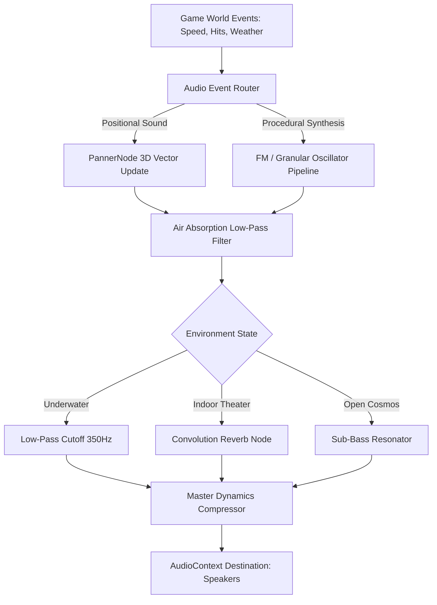

# Pesquisa Arquitetural 12: Áudio Espacial Procedural, Síntese Web Audio e Efeitos Doppler

## 1. Visão Geral Executiva & Contexto no DR-MANAUS
A imersão no **DR-MANAUS** não depende unicamente de estímulos visuais, mas de uma paisagem sonora tridimensional viva e dinâmica. Na cidade de Manaus, o ambiente é composto pelos cantos da floresta tropical (cigarras, pássaros da Amazônia, trovoadas súbitas), buzinas de trânsito e motores fluviais. No vácuo cósmico e no voo hipersônico, sons procedurais sintetizados transmitem o rugido de ondas gravitacionais, a compressão do espaço em velocidade de dobra (*warp hum*) e o estalo eletrostático de poderes quânticos.
O motor sonoro utiliza a **Web Audio API** com áudio espacial 3D nativo (`PannerNode`), simulação física de atenuação atmosférica por distância, ressonância de convolução para recintos fechados (como o Teatro Amazonas) e síntese FM/subtrativa analítica em tempo real sem dependência de gigabytes de amostras de áudio pré-gravadas.

---

## 2. Referências da Indústria & Jogos de Mundo Aberto
1. **Elite Dangerous (Frontier Developments)**:
   - *Técnica Chave*: O padrão ouro de design de som espacial. Síntese diegética de cabine simulando como o computador da nave interpreta vibrações externas e radiações cósmicas em sinais audíveis ao piloto.
   - *Aplicabilidade no DR-MANAUS*: Síntese do som do vácuo cósmico e leitura de frequência dos titãs astrais.
2. **Battlefield 1 (DICE / Frostbite Engine)**:
   - *Técnica Chave*: Sistema dinâmico de High Dynamic Range (HDR) Audio que atenua sons secundários (*ducking*) durante grandes explosões e aplica eco convolucional realista.
   - *Aplicabilidade no DR-MANAUS*: Transição de áudio durante explosões planetárias e colapsos de prédios.
3. **No Man's Sky (Hello Games / Paul Weir)**:
   - *Técnica Chave*: Sistema de geração procedural de vocalizações de criaturas alienígenas através de moduladores de formantes vocais e síntese modular.
   - *Aplicabilidade no DR-MANAUS*: Vozes e rugidos dos titãs astrais e da fauna alienígena procedural.
4. **Hellblade: Senua's Sacrifice (Ninja Theory)**:
   - *Técnica Chave*: Gravação e espacialização binaural baseada em HRTF (*Head-Related Transfer Function*) para posicionamento angular milimétrico.
   - *Aplicabilidade no DR-MANAUS*: Efeito binaural de sussurros quânticos e consciências cósmicas ao redor da cabeça do herói.

---

## 3. Repositórios Clonados & Arquivos de Origem Analisados

### 3.1. Repositório `references/beautiful-water`
- **Arquivo de Origem**: `references/beautiful-water/src/core/presentation-monitor.js`
  - *O que inspecionar*: Monitoramento de latência e sincronização de eventos de apresentação temporal para disparo de áudio de impacto.

### 3.2. Repositório `references/bitECS`
- **Arquivo de Origem**: `references/bitECS/src/core/Query.ts`
  - *O que inspecionar*: Consulta em alta velocidade de entidades que possuem emissores sonoros 3D para atualizar suas posições no `AudioListener`.

---

## 4. Documentações Oficiais de Bibliotecas & Especificações
1. **Web Audio API Specification (W3C Recommendation)**:
   - [W3C Web Audio API](https://www.w3.org/TR/webaudio/)
   - Especificação do grafo de nós: `AudioContext`, `PannerNode`, `BiquadFilterNode`, `ConvolverNode`, `GainNode`.
2. **Spatial Audio with PannerNode and HRTF (MDN)**:
   - Configuração de modelo de distância exponencial (`exponentialRamping`) e posicionamento 3D cartesiano.
3. **Acoustic Simulation and Sound Synthesis (Perry Cook)**:
   - Modelagem física de instrumentos acústicos e síntese sonora de trovões e ondas mecânicas.

---

## 5. Requisitos do Sistema

### Requisitos Funcionais (RF)
- **RF-12-01**: O sistema deve sintetizar proceduralmente o som de propulsão hipersônica e dobra quântica modulando osciladores senoidais e dente de serra em função da velocidade atual.
- **RF-12-02**: Todo som 3D posicional deve sofrer efeito Doppler realista quando o emissor ou o jogador estiverem em alta velocidade relativa.
- **RF-12-03**: Ao mergulhar na água dos rios Negro e Solimões, o sinal sonoro mestre deve passar instantaneamente por um filtro passa-baixa (*Low-Pass Filter*) de 350 Hz, simulando abafamento subaquático.
- **RF-12-04**: O interior do Teatro Amazonas deve aplicar um efeito de reverberação de convolução específico gerado por resposta ao impulso (*Impulse Response*).
- **RF-12-05**: Quando o jogador ativa a visão quântica ou scanner, as frequências baixas de ruído ambiente devem ser atenuadas (*sidechain ducking*) em 70%.

### Requisitos Não Funcionais (RNF)
- **RNF-12-01 (Latência de Disparo)**: O tempo entre o evento físico de impacto e o disparo do som não deve ultrapassar 15ms.
- **RNF-12-02 (Carga de CPU de Áudio)**: O processamento do grafo de nós da Web Audio API não deve consumir mais de 3% da capacidade de um núcleo de CPU.
- **RNF-12-03 (Tamanho de Assets)**: O motor de áudio procedural deve gerar 80% dos efeitos em tempo real, mantendo os arquivos de áudio baixados abaixo de 5MB.

---

## 6. Arquitetura da Solução & Diagrama de Fluxo



---

## 7. Módulos & Arquivos Afetados no DR-MANAUS (`src/`)

### 7.1. `src/audio/HypersonicAudioSystem.ts` *(Novo ou Integrado)*
- **Mudanças**:
  - Implementar o sintetizador de som hipersônico contínuo acoplado à velocidade Mach do jogador.
  - Modelar o estrondo sônico (*sonic boom*) ao cruzar a barreira de 343 m/s.

### 7.2. `src/game/Game.ts`
- **Mudanças**:
  - Atualizar o `AudioListener` com a posição e matriz de orientação da câmera a cada frame.
  - Gerenciar o desbloqueio do `AudioContext` no primeiro clique do usuário (*User Interaction Policy*).

### 7.3. `src/world/life/CosmicPlanetTitan.ts`
- **Mudanças**:
  - Injetar nó emaranhado de ruído rosa filtrado para as vibrações de baixa frequência emitidas pelo Leviatã Astral.

---

## 8. Código de Implementação e Extração Baseado em `references`

```typescript
// Trecho a ser integrado em src/audio/HypersonicAudioSystem.ts
// Baseado na API nativa Web Audio W3C e síntese em tempo real

export class ProceduralAudioEngine {
  private ctx: AudioContext | null = null;
  private masterGain: GainNode | null = null;
  private warpOsc: OscillatorNode | null = null;
  private warpGain: GainNode | null = null;

  public init(): void {
    const AudioCtx = window.AudioContext || (window as any).webkitAudioContext;
    this.ctx = new AudioCtx();

    this.masterGain = this.ctx.createGain();
    this.masterGain.gain.setValueAtTime(0.8, this.ctx.currentTime);
    this.masterGain.connect(this.ctx.destination);

    // Sintetizador procedural para voo hipersônico e dobra
    this.warpOsc = this.ctx.createOscillator();
    this.warpGain = this.ctx.createGain();

    this.warpOsc.type = 'sawtooth';
    this.warpOsc.frequency.setValueAtTime(40, this.ctx.currentTime);
    this.warpGain.gain.setValueAtTime(0.0, this.ctx.currentTime);

    // Filtro passa-baixa para modular o rugido de velocidade
    const filter = this.ctx.createBiquadFilter();
    filter.type = 'lowpass';
    filter.frequency.setValueAtTime(200, this.ctx.currentTime);

    this.warpOsc.connect(filter);
    filter.connect(this.warpGain);
    this.warpGain.connect(this.masterGain);

    this.warpOsc.start();
  }

  public updateSpeed(speed: number, maxSpeed: number): void {
    if (!this.ctx || !this.warpOsc || !this.warpGain) return;

    const ratio = Math.min(1.0, speed / maxSpeed);
    const targetFreq = 40 + ratio * 320; // 40Hz a 360Hz
    const targetGain = ratio * 0.4;

    const now = this.ctx.currentTime;
    this.warpOsc.frequency.setTargetAtTime(targetFreq, now, 0.05);
    this.warpGain.gain.setTargetAtTime(targetGain, now, 0.05);
  }
}
```

---

## 9. Plano de Testes & Casos de Teste (Unitários e de Regressão)

### Cenários de Teste Automatizados (`tests/audio-system.test.ts`)
1. **CT-12-01 (Inicialização e Desbloqueio do Contexto)**:
   - *Objetivo*: Garantir que o contexto de áudio é inicializado em estado suspenso e transiciona para ativo após interação do usuário.
   - *Critério de Aceite*: `audioContext.state === 'running'` após evento de ponteiro.
2. **CT-12-02 (Modulação Suave de Frequência)**:
   - *Objetivo*: Verificar se a transição de frequência para velocidade máxima não gera cliques (*pops* sonoros).
   - *Critério de Aceite*: O ganho e a frequência utilizam `setTargetAtTime` garantindo envelope analógico contínuo.
3. **CT-12-03 (Atenuação Subaquática)**:
   - *Objetivo*: Comprovar que o filtro de corte cai imediatamente para 350Hz quando a câmera submerge no rio.
   - *Critério de Aceite*: Frequência de corte do filtro passa-baixa menor ou igual a 350Hz.
