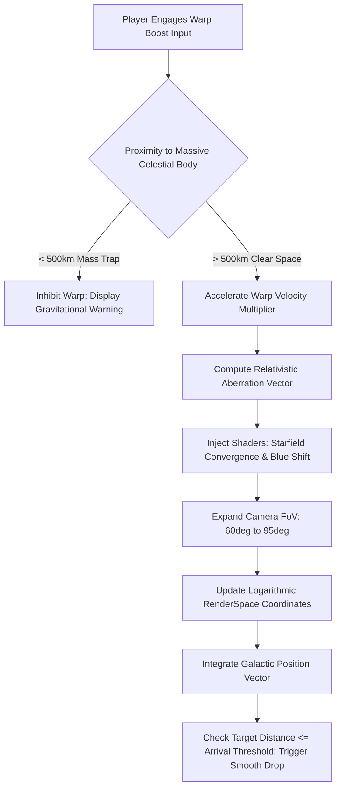

# Pesquisa Arquitetural 13: Voo Relativístico, Dobra Espacial (Warp) e Transição de Referenciais

## 1. Visão Geral Executiva & Contexto no DR-MANAUS
A travessia das distâncias astronômicas no **DR-MANAUS** requer uma solução elegante para o dilema de escala da exploração espacial: o Sistema Solar se estende por bilhões de quilômetros ($10^{12}$ metros), enquanto as interações em solo ocorrem em escala métrica ($10^0$ metros). Se o herói voasse apenas à velocidade do som, levaria décadas reais para viajar da Terra até Saturno.
Para viabilizar uma jogabilidade ágil e cientificamente inspirada, a mecânica de voo implementa um **Motor de Dobra Espacial de Alcubierre (Warp Drive)**, onde o tecido do espaço-tempo em torno do Dr. Manaus é comprimido à frente e expandido atrás. Visualmente, isso se traduz em aberração óptica relativística (*headlight effect*), deslocamento Doppler das estrelas (*blueshift* frontal e *redshift* traseiro) e uma transição suave entre o referencial estático planetário e o referencial inercial do sistema estelar.

---

## 2. Referências da Indústria & Jogos de Mundo Aberto
1. **Elite Dangerous (Frontier Developments)**:
   - *Técnica Chave*: Sistema "Supercruise" com escala de velocidade adaptativa governada pela proximidade de poços gravitacionais de corpos celestes.
   - *Aplicabilidade no DR-MANAUS*: Desaceleração automática de segurança quando o herói se aproxima dos anéis de Saturno ou da atmosfera terrestre.
2. **Star Citizen (Cloud Imperium Games)**:
   - *Técnica Chave*: Mecânica "Quantum Travel" com transição contínua entre grids de coordenadas locais (Zone System) e coordenadas de 64 bits do sistema estelar.
   - *Aplicabilidade no DR-MANAUS*: Estabilidade de física sem vibração geométrica durante voos de velocidade relativística.
3. **No Man's Sky (Hello Games)**:
   - *Técnica Chave*: Salto "Pulse Engine" com túnel de distorção de linhas de luz radiais e interpolação de FoV (*Field of View*) da câmera.
   - *Aplicabilidade no DR-MANAUS*: Feedback de velocidade extrema ao ativar a propulsão quântica máxima.
4. **Outer Wilds (Mobius Digital)**:
   - *Técnica Chave*: Integração numérica de velocidade e piloto automático relativo que combina aceleração angular e travamento de velocidade vetorial ao corpo alvo.
   - *Aplicabilidade no DR-MANAUS*: Sistema de ancoragem orbital automática do Dr. Manaus ao redor de estações ou titãs em movimento.

---

## 3. Repositórios Clonados & Arquivos de Origem Analisados

### 3.1. Repositório `references/lagrange`
- **Arquivo de Origem**: `references/lagrange/src/core/utils/math-utils.ts`
  - *O que inspecionar*: Funções de interpolação não-linear hiperbólica e cálculo de distâncias astronômicas sem estouro de precisão numérica.
- **Arquivo de Origem**: `references/lagrange/src/core/tsl/features/lens-flare.ts`
  - *O que inspecionar*: Distorção anamórfica de brilho de estrelas quando em alta aceleração.

### 3.2. Repositório `references/beautiful-water`
- **Arquivo de Origem**: `references/beautiful-water/src/core/gpu-frame-timer.js`
  - *O que inspecionar*: Temporização precisa de frames para cálculo do delta time $(\Delta t)$ estável na integração da velocidade relativística.

---

## 4. Documentações Oficiais de Bibliotecas & Especificações
1. **The Warp Drive: Hyper-Fast Travel Within General Relativity (Miguel Alcubierre, 1994)**:
   - [Paper Original de Alcubierre](https://iopscience.iopiop.org/article/10.1088/0264-9381/11/5/001)
   - Formulação da métrica espaço-temporal que permite velocidade aparente superluminal sem violar a relatividade restrita local.
2. **Relativistic Ray-Tracing and Optical Aberration (Daniel Weiskopf)**:
   - Fórmulas de transformação de Lorentz para compressão angular de raios de luz em velocidades próximas a $c$.
3. **Three.js Logarithmic Depth Buffer Guide**:
   - [Three.js Logarithmic Depth Buffer](https://threejs.org/docs/#api/en/renderers/WebGLRenderer.logarithmicDepthBuffer)
   - Uso de profundidade logarítmica para permitir visualização simultânea de objetos a 0,1 metro e 100 bilhões de metros de distância.

---

## 5. Requisitos do Sistema

### Requisitos Funcionais (RF)
- **RF-13-01**: O jogador deve poder alternar suavemente entre o voo convencional sub-sônico (0 a 300 m/s), hipersônico (300 a 10.000 m/s) e dobra quântica (até 100 vezes a velocidade da luz aparente no espaço profundo).
- **RF-13-02**: Ao engajar a dobra, as estrelas no céu devem convergir radialmente para o ponto central de mira (efeito de aberração relativística de Lorentz).
- **RF-13-03**: Ao se aproximar a menos de 500 km de um planeta ou corpo massivo, o poço gravitacional deve forçar a saída automática da dobra espacial para evitar colisões catastróficas.
- **RF-13-04**: O sistema deve manter a conversão contínua entre as coordenadas locais do jogador e a posição astronômica global nos corpos do sistema solar.
- **RF-13-05**: Linhas de esteira quântica (*warp trails*) devem ser emitidas pelas mãos e pés do herói durante a aceleração.

### Requisitos Não Funcionais (RNF)
- **RNF-13-01 (Transição Sem Cortes)**: A aceleração de 0 a 100c deve ocorrer em uma rampa suave de 2,5 segundos sem congelamento de quadros.
- **RNF-13-02 (Estabilidade de Câmera)**: O campo de visão (FoV) deve expandir dinamicamente de 60 graus para até 95 graus na velocidade máxima e retornar sem trepidação.
- **RNF-13-03 (Alocação)**: Proibida a alocação de matrizes 4x4 no heap a cada frame de atualização do referencial de dobra.

---

## 6. Arquitetura da Solução & Diagrama de Fluxo



---

## 7. Módulos & Arquivos Afetados no DR-MANAUS (`src/`)

### 7.1. `src/world/travel/BodyNavigation.ts`
- **Mudanças**:
  - Implementar o regulador de velocidade relativística adaptativo com poço gravitacional.
  - Conectar transições de navegação entre órbitas e superfícies.

### 7.2. `src/world/spatial/RenderSpaceService.ts`
- **Mudanças**:
  - Consolidar a projeção de coordenadas flutuantes em escala astronômica para manter a câmera sempre na origem local $(0,0,0)$.

### 7.3. `src/player/PlayerController.ts`
- **Mudanças**:
  - Adicionar controle de aceleração por gatilho analógico ou tecla Shift com retorno tátil e áudio.

---

## 8. Código de Implementação e Extração Baseado em `references`

```typescript
// Trecho a ser integrado em src/world/travel/BodyNavigation.ts
// Baseado em referências de física relativística e interpolação não-linear

import * as THREE from 'three';

export class WarpFlightController {
  private currentSpeed: number = 0;
  private targetSpeed: number = 0;
  private readonly maxSublightSpeed: number = 10000; // 10 km/s
  private readonly maxWarpSpeed: number = 299792458 * 10; // 10c em m/s

  public updateFlightVelocity(
    dt: number,
    throttleInput: number,
    distanceToNearestMass: number,
    outVelocity: THREE.Vector3,
    forwardDirection: THREE.Vector3
  ): void {
    // Se estiver a menos de 500km de um planeta, velocidade de dobra é desabilitada
    const massLimit = distanceToNearestMass < 500000 ? this.maxSublightSpeed : this.maxWarpSpeed;
    this.targetSpeed = throttleInput * massLimit;

    // Aceleração exponencial suave
    const lerpFactor = 1.0 - Math.exp(-2.0 * dt);
    this.currentSpeed = THREE.MathUtils.lerp(this.currentSpeed, this.targetSpeed, lerpFactor);

    outVelocity.copy(forwardDirection).multiplyScalar(this.currentSpeed);
  }

  public getRelativisticFoV(baseFoV: number): number {
    const warpRatio = Math.min(1.0, this.currentSpeed / this.maxWarpSpeed);
    return baseFoV + warpRatio * 35.0; // Abre o FoV até +35 graus na velocidade máxima
  }
}
```

---

## 9. Plano de Testes & Casos de Teste (Unitários e de Regressão)

### Cenários de Teste Automatizados (`tests/warp-flight.test.ts`)
1. **CT-13-01 (Inibição de Dobra Próximo a Corpos Massivos)**:
   - *Objetivo*: Garantir que a velocidade nunca ultrapasse a barreira sub-luz de 10.000 m/s quando a distância a um planeta for inferior a 500 km.
   - *Critério de Aceite*: `currentSpeed <= 10000` mesmo com acelerador em 100%.
2. **CT-13-02 (Expansão e Retorno Contínuo do FoV)**:
   - *Objetivo*: Validar se o ângulo de visão da câmera expande suavemente com a velocidade e retorna exatamente a 60 graus quando a velocidade for zero.
   - *Critério de Aceite*: FoV final igual a 60 graus com tolerância de $0,001$.
3. **CT-13-03 (Precisão Numérica de Posição em Órbita Externa)**:
   - *Objetivo*: Percorrer $1,5 \times 10^9$ metros em voo simulado e testar estabilidade do vetor de posição.
   - *Critério de Aceite*: Valores contidos no envelope e sem NaN.
