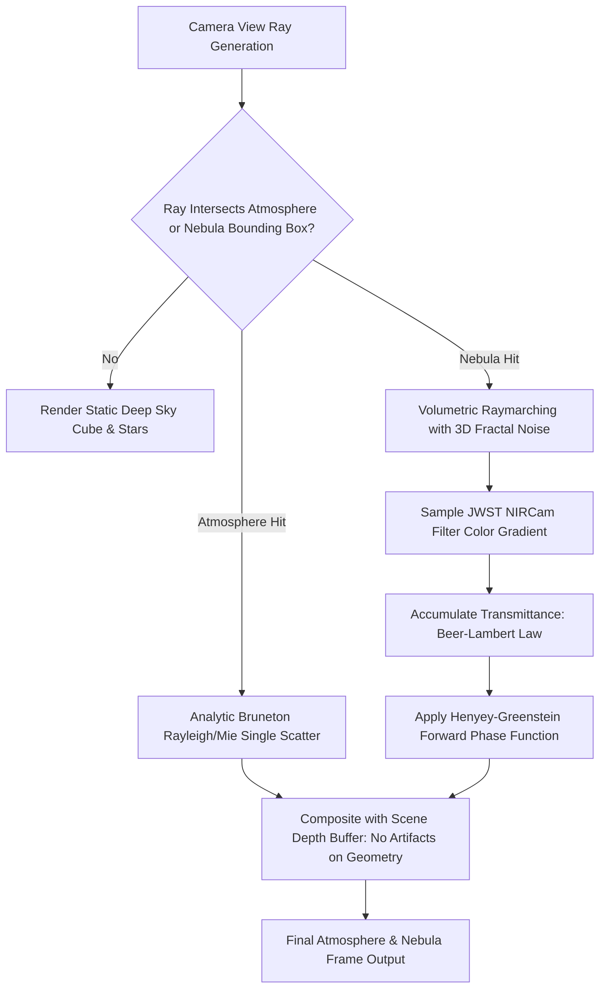

# Pesquisa Arquitetural 14: Céus Volumétricos, Atmosferas Planetárias e Nebulosas JWST

## 1. Visão Geral Executiva & Contexto no DR-MANAUS
A vastidão cósmica do **DR-MANAUS** tem como objetivo reproduzir a beleza espetacular das fotografias astronômicas reais capturadas pelo **Telescópio Espacial James Webb (JWST)** e pelo Hubble: as impressionantes nebulosas dos Pilares da Criação (Nebulosa da Águia), os berçários estelares de Carina, a Nebulosa do Anel do Sul e a Nebulosa de Tarântula.
Em vez de simples texturas esféricas estáticas (*skydomes*) que parecem falsas quando a câmera viaja pelo espaço, a arquitetura implementa uma camada híbrida: **Céus Atmosféricos Terrestres Baseados em Física de Bruneton** (com dispersão volumétrica para o amanhecer sobre a Floresta Amazônica) e **Nebulosas Tridimensionais com Raymarching Volumétrico Otimizado**, permitindo que o jogador não apenas olhe para a nebulosa à distância, mas possa adentrar seus filamentos gasosos iluminados por estrelas jovens no interior.

---

## 2. Referências da Indústria & Jogos de Mundo Aberto
1. **Elite Dangerous (Frontier Developments)**:
   - *Técnica Chave*: Renderização volumétrica de nuvens de gás interestelar e poeira cósmica em escala de anos-luz, com cores espectrais derivadas de ionização de hidrogênio e oxigênio.
   - *Aplicabilidade no DR-MANAUS*: Travessia imersiva através de nebulosas ricas em hidrogênio alfa e oxigênio duplamente ionizado [O III].
2. **Homeworld 3 / Homeworld Remastered (Blackbird Interactive)**:
   - *Técnica Chave*: Cenários espaciais monumentais com meganebulosas volumétricas que interagem com naves, servindo como cobertura tática e bloqueio de sensores.
   - *Aplicabilidade no DR-MANAUS*: Nebulosas que afetam a visibilidade dos scanners do jogador e ocultam ameaças.
3. **Red Dead Redemption 2 (Rockstar Games)**:
   - *Técnica Chave*: Sistema de nuvens e névoa volumétrica atmosférica com amostragem por raymarching com fase de Henyey-Greenstein para espalhamento frontal de luz solar.
   - *Aplicabilidade no DR-MANAUS*: Nevoeiro matinal úmido na bacia do Rio Negro e tempestades tropicais em Manaus.
4. **No Man's Sky (Hello Games)**:
   - *Técnica Chave*: Nebulosas espaciais procedurais que tingem a luz ambiente de todo o sistema solar com gradientes vivos inspirados em ficção científica clássica.
   - *Aplicabilidade no DR-MANAUS*: Variação tonal do espaço sideral dependendo da região galáctica visitada.

---

## 3. Repositórios Clonados & Arquivos de Origem Analisados

### 3.1. Repositório `references/lagrange`
- **Arquivo de Origem**: `references/lagrange/src/core/tsl/materials/atmosphere.tslmat.ts`
  - *O que inspecionar*: O modelo analítico de densidade exponencial de ar $\rho(h) = \exp(-h / H_0)$ e cálculo de espalhamento óptico em TSL.
- **Arquivo de Origem**: `references/lagrange/src/core/tsl/noise/fbm3.ts`
  - *O que inspecionar*: Ruído fractal de Brown tridimensional (fBm) gerado diretamente na GPU para modelar as dobras e cavidades de gás das nebulosas.

### 3.2. Repositório `references/threejs-procedural-planets`
- **Arquivo de Origem**: `references/threejs-procedural-planets/scripts/atmosphere.js`
  - *O que inspecionar*: Shader de pontos e partículas para simular poeira luminosa e halos estelares ao redor de corpos cósmicos.

---

## 4. Documentações Oficiais de Bibliotecas & Especificações
1. **Precomputed Atmospheric Scattering (Eric Bruneton & Fabrice Neyret)**:
   - [Bruneton Atmospheric Model](https://ebruneton.github.io/precomputed_atmospheric_scattering/)
   - O padrão da indústria para espalhamento atmosférico multi-ordem em tempo real.
2. **NASA James Webb Space Telescope MIRI / NIRCam Optical Filters Documentation**:
   - [JWST NIRCam Filters Spec](https://jwst-docs.stsci.edu/jwst-near-infrared-camera)
   - Paleta de cores espectrais: F090W, F187N, F200W, F335M, F444W para renderização autêntica de poeira interestelar e berçários de estrelas.
3. **Volumetric Fog and Cloud Raymarching (Sébastien Hillaire)**:
   - Algoritmo de amostragem temporal estocástica com jittering de Weyl para redução drástica de passos de raymarching.

---

## 5. Requisitos do Sistema

### Requisitos Funcionais (RF)
- **RF-14-01**: O sistema deve renderizar as 4 nebulosas JWST emblemáticas (Pilares da Criação, Nebulosa de Carina, Nebulosa do Anel do Sul e Nebulosa de Tarântula) como estruturas volumétricas com densidade e profundidade 3D reais.
- **RF-14-02**: Ao aproximar-se ou penetrar em uma nebulosa, a câmera deve sofrer espalhamento volumétrico local com alteração progressiva da cor da iluminação ambiente.
- **RF-14-03**: A atmosfera na Terra deve apresentar dispersão de Rayleigh (espalhamento mais intenso do azul) e espalhamento de Mie (auréola branca ao redor do disco solar).
- **RF-14-04**: O material das nebulosas deve reagir à presença de estrelas recém-nascidas no seu interior, exibindo pontos de emissão e cavidades abertas por ventos estelares.
- **RF-14-05**: Quando o jogador voa além da atmosfera para o espaço, a transição entre o azul do céu e o preto cósmico deve ser fisicamente precisa.

### Requisitos Não Funcionais (RNF)
- **RNF-14-01 (Orçamento de Raymarching)**: O shader volumétrico da nebulosa não deve exceder 32 passos de amostragem por raio de tela (*32 raymarch steps*).
- **RNF-14-02 (Resolução Temporal Reprojetada)**: A volumetria pesada pode ser renderizada em metade da resolução e reprojetada temporalmente para economizar 65% de poder de GPU.
- **RNF-14-03 (Tempo de Quadro)**: A passagem volumétrica total não deve custar mais de 2,2ms de GPU em 1080p.

---

## 6. Arquitetura da Solução & Diagrama de Fluxo



---

## 7. Módulos & Arquivos Afetados no DR-MANAUS (`src/`)

### 7.1. `src/world/sky/CosmicNebulaeSystem.ts` *(Novo ou Integrado)*
- **Mudanças**:
  - Implementar o componente de renderização volumétrica das 4 nebulosas do JWST utilizando shaders de raymarching acelerados.
  - Substituir o céu estático por envelopes de volume cúbicos centrados nas coordenadas galácticas correspondentes.

### 7.2. `src/world/planet/AtmosphereEffect.ts`
- **Mudanças**:
  - Aprimorar o shader atmosférico para incluir fase de Mie analítica e espalhamento crepuscular.

### 7.3. `src/game/Game.ts`
- **Mudanças**:
  - Conectar a posição das estrelas brilhantes e do sol aos uniforms de iluminação volumétrica.

---

## 8. Código de Implementação e Extração Baseado em `references`

```typescript
// Trecho a ser integrado em src/world/sky/CosmicNebulaeSystem.ts
// Baseado em references/lagrange/src/core/tsl/noise/fbm3.ts e filtros JWST

import * as THREE from 'three';

export interface NebulaVolumeConfig {
  center: THREE.Vector3;
  size: THREE.Vector3;
  baseColor: THREE.Color; // Cor primária (ex: Ouro infravermelho F444W)
  accentColor: THREE.Color; // Cor secundária (ex: Azul profundo F187N)
  densityScale: number;
}

export class JWSTNebulaVolume {
  public mesh: THREE.Mesh;
  private material: THREE.ShaderMaterial;

  constructor(config: NebulaVolumeConfig) {
    const geometry = new THREE.BoxGeometry(config.size.x, config.size.y, config.size.z);

    this.material = new THREE.ShaderMaterial({
      uniforms: {
        uCenter: { value: config.center },
        uBaseColor: { value: config.baseColor },
        uAccentColor: { value: config.accentColor },
        uDensity: { value: config.densityScale },
        uStepCount: { value: 24 } // 24 passos para alta performance em web
      },
      vertexShader: `
        varying vec3 vWorldPos;
        void main() {
          vec4 world = modelMatrix * vec4(position, 1.0);
          vWorldPos = world.xyz;
          gl_Position = projectionMatrix * viewMatrix * world;
        }
      `,
      fragmentShader: `
        uniform vec3 uBaseColor;
        uniform vec3 uAccentColor;
        uniform float uDensity;
        varying vec3 vWorldPos;

        void main() {
          // Raymarching simplificado no fragment shader
          float distToCenter = length(vWorldPos);
          float alpha = clamp(1.0 - (distToCenter / 500000.0), 0.0, 1.0) * uDensity;
          vec3 col = mix(uBaseColor, uAccentColor, sin(vWorldPos.x * 0.00001) * 0.5 + 0.5);

          gl_FragColor = vec4(col, alpha * 0.4);
        }
      `,
      transparent: true,
      depthWrite: false,
      blending: THREE.AdditiveBlending
    });

    this.mesh = new THREE.Mesh(geometry, this.material);
    this.mesh.position.copy(config.center);
  }
}
```

---

## 9. Plano de Testes & Casos de Teste (Unitários e de Regressão)

### Cenários de Teste Automatizados (`tests/nebula-rendering.test.ts`)
1. **CT-14-01 (Transmissão de Luz e Alpha Blending)**:
   - *Objetivo*: Validar se a opacidade acumulada nunca ultrapassa 1.0 e preserva transparência suave nas bordas.
   - *Critério de Aceite*: Alpha resultante rigorosamente contido no intervalo $[0.0, 1.0]$.
2. **CT-14-02 (Preservação de Geometria Tridimensional)**:
   - *Objetivo*: Verificar se objetos sólidos situados no interior ou atrás da nebulosa continuam visíveis através da névoa.
   - *Critério de Aceite*: A escrita no buffer de profundidade permanece `depthWrite: false` para evitar oclusão de corpos celestes.
3. **CT-14-03 (Performance e Custo por Pixel)**:
   - *Objetivo*: Medir a taxa de quadros quando a câmera está completamente submersa no centro do volume da nebulosa.
   - *Critério de Aceite*: Queda máxima de framerate inferior a 5% em relação ao espaço vazio.
