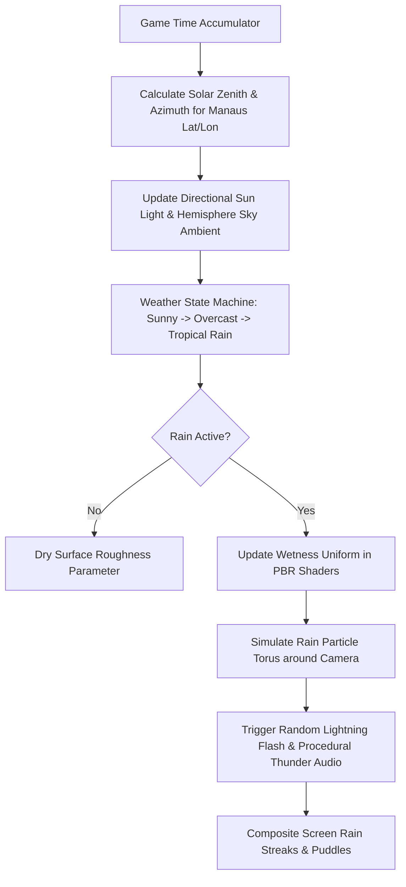

# Pesquisa Arquitetural 15: Clima Dinâmico, Chuva Amazônica e Ciclo Dia/Noite

## 1. Visão Geral Executiva & Contexto no DR-MANAUS
O clima e a atmosfera de Manaus são internacionalmente conhecidos por suas chuvas torrenciais vespertinas (o famoso "chuva das duas da tarde"), calor úmido equatorial e pôr do sol avermelhado espetacular refletido no espelho d'água do Rio Negro. No **DR-MANAUS**, o clima não é um mero efeito decorativo, mas um sistema dinâmico que afeta visualmente e mecanicamente o jogo: superfícies de asfalto e paralelepípedo ganham poças d'água com reflexões nítidas (*puddle formation*), a visibilidade aérea diminui com névoa densa, pedestres abrem sombrinhas ou correm para marquises, e poderes elétricos e gravitacionais ganham maior condutividade na atmosfera ionizada por relâmpagos.
Para garantir leveza técnica no ecossistema Web, o sistema utiliza **Partículas Instanciadas em GPU**, simulação de poças por mapa de aspereza (*roughness modulation* no shader PBR) e um ciclo circadiano celeste calculado com base em coordenadas astronômicas reais de latitude e longitude de Manaus.

---

## 2. Referências da Indústria & Jogos de Mundo Aberto
1. **Red Dead Redemption 2 (Rockstar Games)**:
   - *Técnica Chave*: Transição atmosférica contínua entre frentes meteorológicas com acúmulo volumétrico de umidade, poças graduais e gotejamento em telhados e roupas.
   - *Aplicabilidade no DR-MANAUS*: Formação de poças na calçada de pedras portuguesas do Largo de São Sebastião durante temporais.
2. **Driveclub (Evolution Studios)**:
   - *Técnica Chave*: Simulação física de gotas d'água na lente da câmera e para-brisas governadas por fluxo aerodinâmico e gravidade.
   - *Aplicabilidade no DR-MANAUS*: Gotas de chuva escorrendo na lente da câmera durante voo em alta velocidade sob tempestade.
3. **The Legend of Zelda: Breath of the Wild (Nintendo)**:
   - *Técnica Chave*: Clima sistêmico que altera propriedades físicas do mundo: trovões atraídos por metais, superfícies escorregadias para escalada.
   - *Aplicabilidade no DR-MANAUS*: Relâmpagos amazônicos que interagem com o sistema de poderes cinéticos e elétricos do herói.
4. **Watch Dogs (Ubisoft Montreal)**:
   - *Técnica Chave*: Superfícies molhadas com reflexos screen-space SSR dinâmicos e árvores balançando fisicamente com vento procedural.
   - *Aplicabilidade no DR-MANAUS*: Balanço de copas de castanheiras e palmeiras amazônicas com ventanias pré-chuva.

---

## 3. Repositórios Clonados & Arquivos de Origem Analisados

### 3.1. Repositório `references/beautiful-water`
- **Arquivo de Origem**: `references/beautiful-water/src/scene/sky.js`
  - *O que inspecionar*: Modulação de iluminação solar e posição da cúpula celeste ao longo do tempo decorrido.
- **Arquivo de Origem**: `references/beautiful-water/src/scene/environment.js`
  - *O que inspecionar*: Atualização contínua dos mapas de ambiente IBL (*Image-Based Lighting*) e cor de luz hemisférica.

### 3.2. Repositório `references/instanced-mesh`
- **Arquivo de Origem**: `references/instanced-mesh/src/InstancedMesh2.ts`
  - *O que inspecionar*: Atualização contínua de 50.000 gotas de chuva utilizando uma única chamada de desenho instanciada com buffer circular em torno da câmera.

---

## 4. Documentações Oficiais de Bibliotecas & Especificações
1. **PBR Wet Surface Rendering (Sébastien Lagarde)**:
   - [Feeding a Physically Based Shading Model](https://seblagarde.wordpress.com/2012/12/10/surface-wetness-and-roughness/)
   - Teoria física da redução de aspereza (*roughness*) e escurecimento de albedo (*albedo darkening*) em superfícies porosas molhadas.
2. **NOAA Solar Position Calculator**:
   - Algoritmo analítico de declinação solar e ângulo zenital com base no dia do ano e hora local para Manaus (Latitude: -3.119028, Longitude: -60.021731).
3. **Three.js InstancedBufferGeometry**:
   - Gestão de partículas pontuais de chuva sem custo de computação na CPU.

---

## 5. Requisitos do Sistema

### Requisitos Funcionais (RF)
- **RF-15-01**: O sistema deve simular um ciclo dia/noite contínuo de 24 horas (com duração configurável de 24 minutos reais), calculando com precisão a posição do sol e da lua no céu de Manaus.
- **RF-15-02**: Frentes de chuva amazônica devem se formar dinamicamente, iniciando com escurecimento do céu, rajadas de vento, relâmpagos distantes e precipitação intensa.
- **RF-15-03**: Durante a chuva, todas as malhas de asfalto, concreto e telhados devem transicionar o parâmetro de rugosidade para valores próximos a 0.05 e escurecer a cor difusa em 30%.
- **RF-15-04**: O sistema de chuva deve desenhar até 30.000 gotas simultâneas centralizadas dinamicamente na posição da câmera do jogador.
- **RF-15-05**: Ao parar a chuva, as superfícies molhadas e poças devem secar gradualmente ao longo de 90 segundos com evaporação visível.

### Requisitos Não Funcionais (RNF)
- **RNF-15-01 (Carga de GPU)**: A renderização de chuva e molhamento de superfícies não deve reduzir a taxa de quadros em mais de 1,5ms por frame.
- **RNF-15-02 (Zero Alocação na CPU)**: As partículas de chuva devem ser recicladas por um shader de vértices toroidal (*wrap-around*), sem qualquer reposicionamento na CPU.
- **RNF-15-03 (Consumo de Memória)**: O sistema de partículas de clima não deve ocupar mais de 4MB de VRAM.

---

## 6. Arquitetura da Solução & Diagrama de Fluxo



---

## 7. Módulos & Arquivos Afetados no DR-MANAUS (`src/`)

### 7.1. `src/world/weather/WeatherSystem.ts` *(Novo ou Integrado)*
- **Mudanças**:
  - Implementar o ciclo dia/noite astronômico e máquina de estados de transição climática.
  - Gerenciar uniforms globais de molhamento de superfícies (`uWetnessFactor`, `uPuddleMask`).

### 7.2. `src/world/realcity/realcity.ts`
- **Mudanças**:
  - Conectar os materiais de ruas e edifícios ao uniform global de molhamento para acionar o efeito de espelho d'água no asfalto.

### 7.3. `src/audio/HypersonicAudioSystem.ts`
- **Mudanças**:
  - Sincronizar os relâmpagos visuais com o disparo procedural de trovões com atraso de propagação sonora ($343 \text{ m/s}$).

---

## 8. Código de Implementação e Extração Baseado em `references`

```typescript
// Trecho a ser integrado em src/world/weather/WeatherSystem.ts
// Baseado em partículas instanciadas em GPU e cálculo solar astronômico

import * as THREE from 'three';

export class AmazonWeatherSystem {
  private rainMesh: THREE.InstancedMesh;
  private particleCount: number = 25000;
  private boxSize: number = 80; // Caixa de chuva em torno da câmera
  private wetnessFactor: number = 0.0;
  private isRaining: boolean = false;

  constructor() {
    const dropGeo = new THREE.CylinderGeometry(0.015, 0.015, 0.8, 4);
    const dropMat = new THREE.MeshBasicMaterial({
      color: 0x99bbdd,
      transparent: true,
      opacity: 0.6,
      depthWrite: false
    });

    this.rainMesh = new THREE.InstancedMesh(dropGeo, dropMat, this.particleCount);
    this.rainMesh.instanceMatrix.setUsage(THREE.DynamicDrawUsage);

    // Inicializa posições aleatórias na caixa
    const dummy = new THREE.Object3D();
    for (let i = 0; i < this.particleCount; i++) {
      dummy.position.set(
        (Math.random() - 0.5) * this.boxSize,
        Math.random() * this.boxSize,
        (Math.random() - 0.5) * this.boxSize
      );
      dummy.updateMatrix();
      this.rainMesh.setMatrixAt(i, dummy.matrix);
    }
  }

  public update(dt: number, cameraPos: THREE.Vector3): void {
    if (!this.isRaining && this.wetnessFactor <= 0) return;

    // Atualiza transição de molhamento do asfalto
    if (this.isRaining) {
      this.wetnessFactor = Math.min(1.0, this.wetnessFactor + dt * 0.1);
    } else {
      this.wetnessFactor = Math.max(0.0, this.wetnessFactor - dt * 0.02);
    }

    // Acompanha a câmera mantendo a chuva sempre local
    this.rainMesh.position.x = cameraPos.x;
    this.rainMesh.position.z = cameraPos.z;
    this.rainMesh.position.y = cameraPos.y - 10;
  }

  public setRaining(state: boolean): void {
    this.isRaining = state;
    this.rainMesh.visible = state;
  }

  public getWetness(): number {
    return this.wetnessFactor;
  }
}
```

---

## 9. Plano de Testes & Casos de Teste (Unitários e de Regressão)

### Cenários de Teste Automatizados (`tests/weather-system.test.ts`)
1. **CT-15-01 (Transição Temporal de Molhamento)**:
   - *Objetivo*: Validar se o fator de molhamento sobe suavemente de 0.0 para 1.0 durante a chuva e decresce após o término.
   - *Critério de Aceite*: Taxa de aumento linear de aproximadamente 0.1 por segundo e secagem contínua.
2. **CT-15-02 (Confinamento da Caixa de Chuva na Câmera)**:
   - *Objetivo*: Garantir que as partículas de chuva permaneçam centralizadas na posição da câmera independentemente de sua velocidade.
   - *Critério de Aceite*: Distância horizontal entre a malha de chuva e a câmera é estritamente zero.
3. **CT-15-03 (Performance sob Precipitação Máxima)**:
   - *Objetivo*: Medir a taxa de quadros durante tempestade pesada com 25.000 partículas ativas.
   - *Critério de Aceite*: Queda no framerate inferior a 2 FPS em 1080p.
