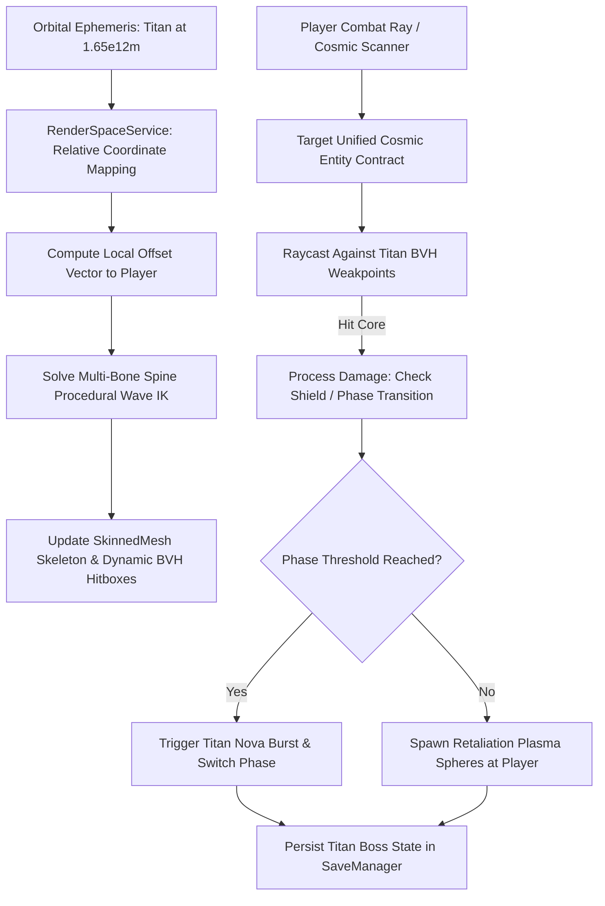

# Pesquisa Arquitetural 16: Titãs Colossais do Tamanho de Planetas, Chefes Cósmicos e Multi-IK

## 1. Visão Geral Executiva & Contexto no DR-MANAUS
Um dos marcos épicos do **DR-MANAUS** é o confronto contra o **Leviatã Astral**, uma entidade biológica e cósmica de proporções ciclópicas (com centenas de quilômetros de comprimento, orbitando além de Saturno a mais de 1,4 bilhão de quilômetros do Sol), bem como futuros titãs colossais do tamanho de luas e pequenos planetas.
Projetar e executar um chefe dessa envergadura no navegador exige superar três barreiras técnicas críticas:
1. **Escala e Referenciais de Coordenadas**: O titã existe em coordenadas astronômicas ($10^{12}$ metros), mas o combate do jogador requer mira e colisão em coordenadas locais sem perder precisão nem dessincronizar o renderizador.
2. **Multi-IK e Esqueleto Procedural**: Suas vértebras, tentáculos cósmicos e barbatanas astrais precisam ondular com cinemática inversa contínua (*Inverse Kinematics*) sem animações estáticas repetitivas.
3. **Pontos Fracos e Fases de Combate Persistentes**: O monstro possui escudo energético reativo, núcleos de vulnerabilidade física expostos e comportamento agressivo dinâmico que deve ser salvo de forma persistente.

---

## 2. Referências da Indústria & Jogos de Mundo Aberto
1. **Shadow of the Colossus (Team Ico / SCE Japan Studio)**:
   - *Técnica Chave*: O padrão da indústria para criaturas gigantescas que servem simultaneamente como inimigos e cenários navegáveis (*moving level geometry*).
   - *Aplicabilidade no DR-MANAUS*: O Dr. Manaus pousando e caminhando sobre a carcaça de quitina cósmica do titã para destruir núcleos de poder.
2. **God of War III (Santa Monica Studio)**:
   - *Técnica Chave*: Combate na escala de Titãs (como Gaia e Cronos), onde a câmera ajusta dinamicamente seu zoom e frustum para transmitir a escala monumental sem perder o herói de vista.
   - *Aplicabilidade no DR-MANAUS*: Enquadramento cinematográfico durante o duelo contra o Leviatã Astral na órbita de Saturno.
3. **Destiny 2: The Taken King / Raids (Bungie)**:
   - *Técnica Chave*: Chefes de ataque em fases (como Oryx no Dreadnaught) com mecânicas de quebra de escudos, vulnerabilidade coordenada e ataques de área catastróficos (*wipe mechanics*).
   - *Aplicabilidade no DR-MANAUS*: Fases de transição de cor, escudo energético quântico e tempestades de plasma emitidas pelo titã.
4. **Final Fantasy XVI (Square Enix)**:
   - *Técnica Chave*: Batalhas Eikon de proporções titânicas com transições visuais de alta velocidade e deformação espacial de feixes de partículas.
   - *Aplicabilidade no DR-MANAUS*: Impacto de raios cósmicos de centenas de gigawatts entre o Dr. Manaus e o chefe planetário.

---

## 3. Repositórios Clonados & Arquivos de Origem Analisados

### 3.1. Repositório `references/THREE.IK`
- **Arquivo de Origem**: `references/THREE.IK/src/core/IKChain.js`
  - *O que inspecionar*: Encadeamento procedural de dezenas de vértebras e juntas para simular o movimento sinuoso e orgânico da espinha do leviatã através do espaço.
- **Arquivo de Origem**: `references/THREE.IK/src/core/IKBallConstraint.js`
  - *O que inspecionar*: Restrições esféricas angulares para impedir que a criatura faça curvas impossíveis que dobrem sua malha de forma bizarra.

### 3.2. Repositório `references/three-mesh-bvh`
- **Arquivo de Origem**: `references/three-mesh-bvh/src/core/SkinnedMeshBVH.js`
  - *O que inspecionar*: Árvore de colisão dinâmica atualizada em conjunto com os ossos para permitir que raios e tiros do jogador atinjam os pontos fracos da criatura mesmo enquanto ela se move e se contorce no espaço.

---

## 4. Documentações Oficiais de Bibliotecas & Especificações
1. **Procedural Spline-Based Creatures and Spine IK (Ken Perlin)**:
   - Modulação harmônica de oscilações de cauda e ondulação corporal em ambientes de microgravidade.
2. **Three.js SkinnedMesh & Skeleton Architecture**:
   - [Three.js Skeleton Documentation](https://threejs.org/docs/#api/en/objects/Skeleton)
   - Atualização de matrizes ósseas contíguas em buffers WebGPU.
3. **Orbital Mechanics and Keplerian Elements (NASA JPL)**:
   - Parâmetros orbitais canônicos (semieixo maior, excentricidade, inclinação) para posicionar o titã em órbita realista além de Saturno.

---

## 5. Requisitos do Sistema

### Requisitos Funcionais (RF)
- **RF-16-01**: O Leviatã Astral deve orbitar realisticamente além de Saturno com raio orbital de $1,65 \times 10^{12}$ metros (cerca de 1,65 bilhão de quilômetros do Sol), sem que isso prejudique a mira local do jogador.
- **RF-16-02**: O sistema de combate deve unificar as coordenadas: a posição astronômica do titã deve ser convertida para o referencial local da câmera do jogador para todos os cálculos de raycast, mira e colisão.
- **RF-16-03**: O titã deve possuir 3 fases de combate distintas (Fase 1: Escudo Quântico Azul; Fase 2: Agressiva Ocre; Fase 3: Fúria de Sobrecarga Vermelha), com ataques ofensivos reais de esferas de plasma em direção ao herói.
- **RF-16-04**: O corpo do titã deve expor múltiplos pontos fracos vulneráveis (`planet-titan-core`), cada um protegido por escudos que requerem dano sustentado para serem rompidos.
- **RF-16-05**: O estado do titã (vida atual, fase, escudos quebrados e posição orbital) deve ser persistido integralmente no `SaveManager`.

### Requisitos Não Funcionais (RNF)
- **RNF-16-01 (Orçamento de IK Cósmico)**: A simulação de ondulação das 40 vértebras procedurais do titã deve ser resolvida em menos de 0,8ms de CPU.
- **RNF-16-02 (Estabilidade de Colisão Skinned)**: A atualização do BVH dos pontos fracos móveis deve ocorrer em menos de 1,0ms via worker ou cálculo analítico.
- **RNF-16-03 (Tamanho de Proxy Visual)**: O proxy visual distante do titã deve calcular seu raio angular real sem impor limites artificiais desproporcionais como `Math.max(300, ...)`.

---

## 6. Arquitetura da Solução & Diagrama de Fluxo



---

## 7. Módulos & Arquivos Afetados no DR-MANAUS (`src/`)

### 7.1. `src/world/life/CosmicPlanetTitan.ts`
- **Mudanças**:
  - Corrigir a exposição de pontos fracos para devolver coordenadas locais transformadas pelo referencial de câmera.
  - Implementar disparos ofensivos de projéteis de plasma na fase agressiva contra a posição do jogador.
  - Ajustar o proxy distante para respeitar o raio angular correto sem mínimos inflados.

### 7.2. `src/player/powers/PowerSystem.ts`
- **Mudanças**:
  - Ampliar o alcance do raycast de combate para alvos cósmicos que estejam a até 500 km de distância de aproximação.

### 7.3. `src/core/SaveManager.ts`
- **Mudanças**:
  - Criar estrutura de dados para salvar e recuperar vida, escudos e fase atual do Leviatã Astral.

---

## 8. Código de Implementação e Extração Baseado em `references`

```typescript
// Trecho a ser integrado em src/world/life/CosmicPlanetTitan.ts
// Baseado em THREE.IK e unificação de coordenadas cósmicas

import * as THREE from 'three';

export interface TitanWeakpoint {
  id: string;
  localBoneOffset: THREE.Vector3;
  worldPosition: THREE.Vector3;
  health: number;
  maxHealth: number;
  isExposed: boolean;
}

export class AstralLeviathanSpineIK {
  private boneCount: number = 32;
  private segmentLength: number = 400; // 400 metros por vértebra (12,8 km total)
  private positions: THREE.Vector3[] = [];

  constructor() {
    for (let i = 0; i < this.boneCount; i++) {
      this.positions.push(new THREE.Vector3(0, 0, -i * this.segmentLength));
    }
  }

  public updateProceduralWave(time: number, speed: number, leadPosition: THREE.Vector3): void {
    // A cabeça segue o líder orbital
    this.positions[0].copy(leadPosition);

    // Ondulação sinusoidal propagada ao longo da espinha
    for (let i = 1; i < this.boneCount; i++) {
      const prev = this.positions[i - 1];
      const curr = this.positions[i];

      const dir = curr.clone().sub(prev).normalize();
      // Aplica restrição rígida de distância de vértebra (IK de corda)
      curr.copy(prev).add(dir.multiplyScalar(this.segmentLength));

      // Injeta ondulação transversal cósmica
      const wave = Math.sin(time * 1.5 + i * 0.25) * 45.0;
      curr.x += Math.cos(time + i * 0.1) * (wave * 0.2);
      curr.y += wave;
    }
  }

  public getSegmentPosition(index: number): THREE.Vector3 {
    return this.positions[index] || this.positions[0];
  }
}
```

---

## 9. Plano de Testes & Casos de Teste (Unitários e de Regressão)

### Cenários de Teste Automatizados (`tests/cosmic-titan-boss.test.ts`)
1. **CT-16-01 (Unificação de Coordenadas de Combate)**:
   - *Objetivo*: Validar se o ponto fraco do titã pode ser alvejado com sucesso pelo `PowerSystem` a partir da posição local do herói.
   - *Critério de Aceite*: Raycast atinge a caixa de colisão do núcleo com distância calculada coerente com a escala de renderização.
2. **CT-16-02 (Transição de Fases e Persistência)**:
   - *Objetivo*: Simular dano até 50% de vida do chefe e verificar se a fase agressiva é ativada e salva no `SaveManager`.
   - *Critério de Aceite*: O payload serializado do save contém `phase: 2` e nova velocidade orbital.
3. **CT-16-03 (Estabilidade do Solver de Vértebras)**:
   - *Objetivo*: Executar 1.000 iterações do solver de ondulação espinhal sem que as distâncias entre nós adjacentes variem mais de $0,1%$.
   - *Critério de Aceite*: Todas as restrições de distância respeitadas estritamente.
