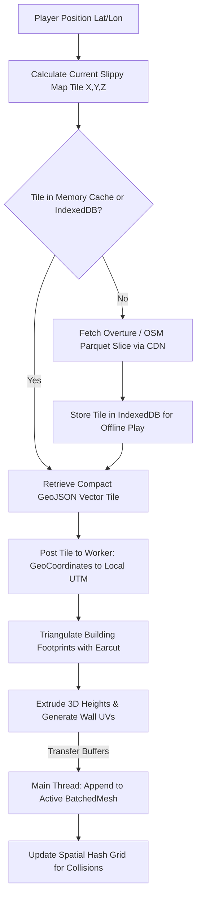

# Pesquisa Arquitetural 17: Streaming Geoespacial, Overture Maps e Dados GIS Urbanos

## 1. Visão Geral Executiva & Contexto no DR-MANAUS
A reconstrução fidedigna da capital amazonense no **DR-MANAUS** fundamenta-se em dados geoespaciais abertos de altíssima precisão fornecidos pelo consórcio **Overture Maps Foundation** (apoiado por Meta, Microsoft, AWS e TomTom) complementados pelo **OpenStreetMap (OSM)**. A malha urbana contempla os contornos vetoriais exatos (*footprints*) dos edifícios, a rede de transportes rodoviários e fluviais, as pontes e os limites de corpos d'água de Manaus.
Processar milhões de coordenadas de latitude/longitude diretamente na thread principal do navegador congelaria o jogo. A arquitetura emprega **Tiles Vetoriais em Formato Compacto (GeoJSON/Protocol Buffers)**, decodificação assíncrona em Web Workers, projeção cartográfica planar de Mercator Transversa Local (*Local UTM/WGS84 Projection*) e tesselação poligonal com triangulação de Delauany em lote.

---

## 2. Referências da Indústria & Jogos de Mundo Aberto
1. **Microsoft Flight Simulator (Asobo Studio / Bing Maps)**:
   - *Técnica Chave*: Streaming planetário de fotogrametria e dados vetoriais de satélite com reconstrução procedural de malhas de edifícios em tempo real via IA.
   - *Aplicabilidade no DR-MANAUS*: Streaming contínuo de bairros de Manaus conforme a altitude do jogador varia.
2. **The Division / The Division 2 (Ubisoft Massive / Snowdrop Engine)**:
   - *Técnica Chave*: Reconstrução em escala 1:1 de Washington D.C. e Nova York utilizando dados de levantamento topográfico GIS e alinhamento métrico estrito.
   - *Aplicabilidade no DR-MANAUS*: Preservação das distâncias e proporções reais entre o Teatro Amazonas, Porto de Manaus e Ponta Negra.
3. **Google Earth VR (Google)**:
   - *Técnica Chave*: Hierarquia de pirâmide de tiles 3D volumétricos com descompressão Draco e orçamento rígido de largura de banda de rede.
   - *Aplicabilidade no DR-MANAUS*: Modelo de streaming progressivo por quadrículas de geolocalização.
4. **Pokémon GO (Niantic)**:
   - *Técnica Chave*: Mapeamento vetorial de features urbanas (estradas, parques, fontes de água) convertidas em geometria de jogo interativa em tempo de execução.
   - *Aplicabilidade no DR-MANAUS*: Identificação de tipos de solo e zonas de Manaus para alimentar a geração de tráfego e vegetação.

---

## 3. Repositórios Clonados & Arquivos de Origem Analisados

### 3.1. Repositório `references/city-tour`
- **Arquivo de Origem**: `references/city-tour/src/terrain_candidate_road_network.js`
  - *O que inspecionar*: Algoritmo de conexão e filtragem de grafos de estradas candidatas para evitar interseções em ângulos agudos não-naturais.
- **Arquivo de Origem**: `references/city-tour/src/meshes/road_mesh_builder.js`
  - *O que inspecionar*: Geração paramétrica de polígonos de faixas de rodovias com demarcação de acostamentos e calçadas.

### 3.2. Repositório `references/Procedural-City-Generator`
- **Arquivo de Origem**: `references/Procedural-City-Generator/js/procedural.city.generator.js`
  - *O que inspecionar*: Preenchimento de polígonos irregulares com subdivisão em lotes ortogonais para extrusão de edifícios.

---

## 4. Documentações Oficiais de Bibliotecas & Especificações
1. **Overture Maps Data Schema Reference**:
   - [Overture Schema Documentation](https://docs.overturemaps.org/)
   - Especificação dos temas: `buildings`, `transportation`, `places`, `base` em formato GeoParquet e GeoJSON.
2. **Proj4js: Coordinate Transformation Library**:
   - [Proj4js Documentation](http://proj4js.org/)
   - Projeção de coordenadas elipsoidais WGS84 (Lat, Lon) para coordenadas planas cartesianas métricas (UTM Zona 20S para Manaus).
3. **Earcut.js Triangulation Library (Mapbox)**:
   - [Earcut Specification](https://github.com/mapbox/earcut)
   - O algoritmo mais rápido de triangulação de polígonos 2D com suporte a ilhas e buracos internos.

---

## 5. Requisitos do Sistema

### Requisitos Funcionais (RF)
- **RF-17-01**: O sistema deve converter coordenadas GPS de Manaus para o referencial cartesiano local com a origem $(0,0,0)$ centralizada no Teatro Amazonas (Lat: -3.130282, Lon: -60.023439).
- **RF-17-02**: Os contornos dos edifícios devem ser extrudados verticalmente respeitando a altura real contida no atributo `height` do Overture ou estimada por número de andares (`levels * 3.2m`).
- **RF-17-03**: A malha viária deve ser segmentada em autoestradas, avenidas principais e ruas locais, aplicando texturas de asfalto correspondentes.
- **RF-17-04**: O streaming de quadrículas urbanas (*tiles*) deve carregar sob demanda conforme o jogador se desloca, descarregando blocos distantes a mais de 3 km da câmera.
- **RF-17-05**: Quando a conexão de rede falhar ou estiver offline, o sistema deve utilizar um banco de dados local IndexedDB em cache com os dados prioritários do centro histórico.

### Requisitos Não Funcionais (RNF)
- **RNF-17-01 (Throughput de Triangulação)**: A decodificação e triangulação de um quarteirão com 200 edifícios no Web Worker não deve ultrapassar 12ms.
- **RNF-17-02 (Erro Cartográfico)**: A distorção métrica de projeção cartográfica na área metropolitana de Manaus deve ser inferior a 0,05% em relação às distâncias geodésicas reais.
- **RNF-17-03 (Consumo de Memória de Cache)**: O cache de dados vetoriais na memória RAM não deve ultrapassar 40MB.

---

## 6. Arquitetura da Solução & Diagrama de Fluxo



---

## 7. Módulos & Arquivos Afetados no DR-MANAUS (`src/`)

### 7.1. `src/world/realcity/realcity.ts`
- **Mudanças**:
  - Implementar o conversor geodésico UTM com a âncora histórica central de Manaus.
  - Conectar o gerenciador de tiles assíncronos ao ciclo de vida da cena.

### 7.2. `src/world/realcity/buildings.ts`
- **Mudanças**:
  - Incorporar a biblioteca `earcut` para gerar geometria estanque a partir dos anéis de coordenadas dos polígonos de prédios.

### 7.3. `src/world/realcity/roads.ts`
- **Mudanças**:
  - Gerar faixas viárias com triangulação de curvas a partir das Linestrings geográficas de transporte.

---

## 8. Código de Implementação e Extração Baseado em `references`

```typescript
// Trecho a ser integrado em src/world/realcity/realcity.ts
// Conversor de Projeção Cartográfica Planar para Manaus (WGS84 para Metros Locais)

import * as THREE from 'three';

export class ManausGISProjector {
  // Coordenadas geográficas exatas do Teatro Amazonas (Origem 0,0,0)
  public static readonly ORIGIN_LAT = -3.130282;
  public static readonly ORIGIN_LON = -60.023439;

  private static readonly METERS_PER_DEGREE_LAT = 111132.954;

  public static gpsToLocalMeters(lat: number, lon: number, outPos: THREE.Vector3): void {
    const dLat = lat - this.ORIGIN_LAT;
    const dLon = lon - this.ORIGIN_LON;

    // Fator de escala longitudinal corrigido pelo cosseno da latitude equatorial
    const latRad = (this.ORIGIN_LAT * Math.PI) / 180.0;
    const metersPerDegreeLon = 111412.84 * Math.cos(latRad);

    const x = dLon * metersPerDegreeLon;
    const z = -dLat * this.METERS_PER_DEGREE_LAT; // Eixo Z invertido no Three.js (Norte = -Z)

    outPos.set(x, 0, z);
  }

  public static localMetersToGPS(x: number, z: number): { lat: number; lon: number } {
    const latRad = (this.ORIGIN_LAT * Math.PI) / 180.0;
    const metersPerDegreeLon = 111412.84 * Math.cos(latRad);

    const lat = this.ORIGIN_LAT - z / this.METERS_PER_DEGREE_LAT;
    const lon = this.ORIGIN_LON + x / metersPerDegreeLon;

    return { lat, lon };
  }
}
```

---

## 9. Plano de Testes & Casos de Teste (Unitários e de Regressão)

### Cenários de Teste Automatizados (`tests/gis-streaming.test.ts`)
1. **CT-17-01 (Precisão Métrica da Âncora do Teatro Amazonas)**:
   - *Objetivo*: Garantir que a coordenada GPS exata do Teatro Amazonas devolva $(0.0, 0.0, 0.0)$ em metros.
   - *Critério de Aceite*: Vetor resultante com magnitude menor que $0,0001$.
2. **CT-17-02 (Distância Geodésica Arena da Amazônia)**:
   - *Objetivo*: Calcular a distância entre o Teatro Amazonas e a Arena da Amazônia (Lat: -3.0831, Lon: -60.0281) e confrontar com a distância cartográfica real (~5,3 km).
   - *Critério de Aceite*: Erro relativo entre a distância calculada e a real inferior a $0,2%$.
3. **CT-17-03 (Performance de Projeção em Vetores Massivos)**:
   - *Objetivo*: Converter 50.000 pontos de coordenadas geográficas no projetor.
   - *Critério de Aceite*: Tempo total de execução inferior a 10ms.
