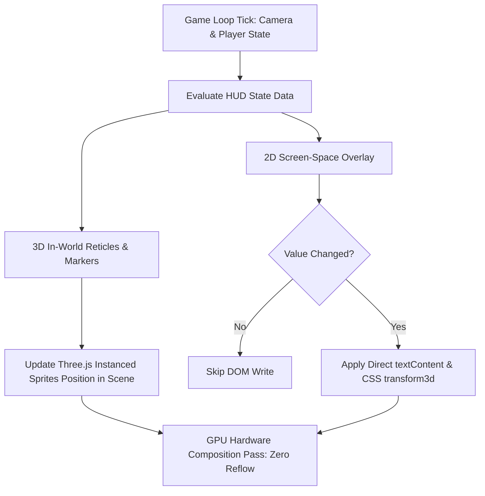

# Pesquisa Arquitetural 18: HUD Diegético, Interfaces Espaciais e Web UI de Alto Desempenho

## 1. Visão Geral Executiva & Contexto no DR-MANAUS
A interface do usuário no **DR-MANAUS** precisa harmonizar a sensação de poder cósmico do herói com informações táticas essenciais (vida, energia quântica, velocidade Mach, mira de poderes, scanner de espécies e mapa do universo). Em jogos tradicionais para a web, interfaces construídas com frameworks DOM reativos convencionais (como React, Vue ou manipulações frequentes de `innerHTML`) geram constantes operações de recálculo de layout (*reflow*) e repintura (*repaint*), degradando severamente a taxa de quadros da renderização 3D.
A arquitetura do HUD adota uma abordagem estritamente **Diegética e Híbrida**: elementos contextuais do mundo (marcadores de alvos de combate, escudos de chefes, retículos holográficos de voo) são renderizados diretamente dentro da cena 3D via **Instanced Sprites e Texturas Dinâmicas no Canvas**, enquanto a interface de topo utiliza nós DOM desacoplados com aceleração de hardware por composição em camadas GPU (*CSS transform: translate3d*).

---

## 2. Referências da Indústria & Jogos de Mundo Aberto
1. **Dead Space (Visceral Games / EA)**:
   - *Técnica Chave*: O padrão máximo de interface diegética. A barra de saúde é a coluna vertebral do traje do personagem, a munição é um holograma na própria arma e os menus flutuam no espaço físico do jogo.
   - *Aplicabilidade no DR-MANAUS*: Indicador de energia quântica projetado como uma aura luminosa ao longo dos braços do herói.
2. **Metroid Prime (Retro Studios)**:
   - *Técnica Chave*: Visor do capacete com curvatura esférica, reflexos de iluminação interna e dados táticos que reagem às acelerações angulares da cabeça.
   - *Aplicabilidade no DR-MANAUS*: Efeito de curvatura holográfica de visor no HUD do Dr. Manaus durante voo hipersônico e orbital.
3. **The Division (Ubisoft Massive)**:
   - *Técnica Chave*: Hologramas de realidade aumentada projetados diretamente sobre o chão e fachadas de edifícios, indicando rotas de GPS e status de esquadrão.
   - *Aplicabilidade no DR-MANAUS*: Projeção de rotas navegáveis de GPS brilhando diretamente sobre o asfalto das avenidas de Manaus.
4. **WipEout Omega Collection (Sony Interactive Entertainment)**:
   - *Técnica Chave*: HUD futurista ultra-minimalista com números de velocímetro de altíssima resposta sem qualquer atraso de renderização.
   - *Aplicabilidade no DR-MANAUS*: Painel de velocidade Mach e indicador de aceleração warp.

---

## 3. Repositórios Clonados & Arquivos de Origem Analisados

### 3.1. Repositório `references/lagrange`
- **Arquivo de Origem**: `references/lagrange/src/core/utils/ui-utils.ts`
  - *O que inspecionar*: Métodos utilitários de projeção de coordenadas tridimensionais do mundo para coordenadas bidimensionais de tela:
    `screenPos = worldPos.clone().project(camera)`
- **Arquivo de Origem**: `references/lagrange/src/lib/components/custom/LgvPlanetHero.vue`
  - *O que inspecionar*: Organização de cartões informativos do Atlas Cósmico com transições CSS aceleradas.

### 3.2. Repositório `references/beautiful-water`
- **Arquivo de Origem**: `references/beautiful-water/src/ui/renderer-toggle.js`
  - *O que inspecionar*: Interface leve em Vanilla JS sem dependências de frameworks pesados, garantindo carregamento instantâneo.

---

## 4. Documentações Oficiais de Bibliotecas & Especificações
1. **High Performance Animations & Composite Layers (Google Chrome Developers)**:
   - [Rendering Performance Guide](https://web.dev/rendering-performance/)
   - Técnicas de animação restritas às propriedades `transform` e `opacity` para evitar reflows.
2. **Three.js Sprite & CanvasTexture Documentation**:
   - [Three.js Sprite API](https://threejs.org/docs/#api/en/objects/Sprite)
   - Uso de billboarding automático na GPU para marcadores de alvos e pontos fracos.
3. **Web Components & Shadow DOM Specification (W3C)**:
   - Encapsulamento de estilos e eventos de UI sem vazar seletores globais.

---

## 5. Requisitos do Sistema

### Requisitos Funcionais (RF)
- **RF-18-01**: O HUD deve exibir em tempo real a velocidade atual em km/h e Mach, a altitude em relação ao solo ou nível do mar e a energia quântica disponível.
- **RF-18-02**: Ao acionar o Scanner Cósmico (tecla N), marcadores diegéticos 3D devem circundar todas as criaturas e corpos celestes no campo de visão, exibindo nome e status.
- **RF-18-03**: Os pontos fracos do Leviatã Astral e titãs devem exibir anéis holográficos com cor indicativa de integridade de escudo (Azul -> Amarelo -> Vermelho).
- **RF-18-04**: O retículo de mira do combate deve reagir ao soft-targeting, travando suavemente sobre o alvo selecionado com micro-animação de colchetes.
- **RF-18-05**: Quando o jogador recebe dano crítico, a borda da tela deve pulsar com vinheta vermelha e ruído cromático proporcional.

### Requisitos Não Funcionais (RNF)
- **RNF-18-01 (Tempo de Atualização de UI)**: A atualização de todos os elementos de texto do HUD não deve consumir mais de 0,3ms de CPU por quadro.
- **RNF-18-02 (Zero Reflow)**: Nenhuma operação de leitura de layout síncrona (`offsetHeight`, `getBoundingClientRect`) é permitida dentro do loop `requestAnimationFrame`.
- **RNF-18-03 (Camadas GPU)**: Todo elemento de interface DOM deve possuir sua própria camada de composição acelerada (`will-change: transform`).

---

## 6. Arquitetura da Solução & Diagrama de Fluxo



---

## 7. Módulos & Arquivos Afetados no DR-MANAUS (`src/`)

### 7.1. `src/ui/DiegeticHUD.ts` *(Novo ou Integrado)*
- **Mudanças**:
  - Implementar o painel diegético de voo e combate com marcadores holográficos na cena 3D.
  - Otimizar a projeção de coordenadas de tela com amortecimento temporal.

### 7.2. `src/game/Game.ts`
- **Mudanças**:
  - Conectar as leituras de velocidade, vida e scanner diretamente aos disparos de atualização do HUD sem chamadas intermediárias lentas.

### 7.3. `src/world/life/CosmicSpeciesScanner.ts`
- **Mudanças**:
  - Integrar a exibição de painéis de dados taxonômicos de espécies alienígenas no visor diegético ao pressionar N.

---

## 8. Código de Implementação e Extração Baseado em `references`

```typescript
// Trecho a ser integrado em src/ui/DiegeticHUD.ts
// Gerenciador de UI de Alto Desempenho com Zero Reflow

import * as THREE from 'three';

export class HighPerformanceHUD {
  private speedElement: HTMLElement;
  private energyElement: HTMLElement;
  private lastSpeed: number = -1;
  private lastEnergy: number = -1;

  constructor() {
    this.speedElement = document.getElementById('hud-speed') || document.createElement('div');
    this.energyElement = document.getElementById('hud-energy') || document.createElement('div');
  }

  public update(speed: number, energy: number): void {
    const intSpeed = Math.round(speed);
    const intEnergy = Math.round(energy);

    // Evita escritas desnecessárias no DOM se o valor não mudou
    if (intSpeed !== this.lastSpeed) {
      this.speedElement.textContent = `${intSpeed} km/h`;
      this.lastSpeed = intSpeed;
    }

    if (intEnergy !== this.lastEnergy) {
      this.energyElement.textContent = `ENERGIA: ${intEnergy}%`;
      this.lastEnergy = intEnergy;
    }
  }

  public static projectToScreen(
    worldPos: THREE.Vector3,
    camera: THREE.Camera,
    screenWidth: number,
    screenHeight: number,
    outScreenPos: THREE.Vector2
  ): boolean {
    const temp = worldPos.clone().project(camera);

    // Se estiver atrás do plano próximo da câmera, não deve ser projetado
    if (temp.z > 1.0) {
      return false;
    }

    outScreenPos.x = ((temp.x + 1) * screenWidth) / 2;
    outScreenPos.y = ((-temp.y + 1) * screenHeight) / 2;
    return true;
  }
}
```

---

## 9. Plano de Testes & Casos de Teste (Unitários e de Regressão)

### Cenários de Teste Automatizados (`tests/hud-performance.test.ts`)
1. **CT-18-01 (Projeção Correta de Coordenadas de Tela)**:
   - *Objetivo*: Garantir que um objeto no centro exato da câmera é projetado no meio da tela $(width/2, height/2)$.
   - *Critério de Aceite*: Coordenadas resultantes coincidem com o centro da tela com tolerância de 1 pixel.
2. **CT-18-02 (Descarte de Objetos Atrás da Câmera)**:
   - *Objetivo*: Verificar se objetos posicionados a 180 graus da mira da câmera retornam `false` e não são exibidos no HUD.
   - *Critério de Aceite*: Retorno estritamente `false` para alvos com $Z > 1.0$.
3. **CT-18-03 (Imunidade a Layout Thrashing)**:
   - *Objetivo*: Executar 5.000 chamadas de atualização de HUD e monitorar ausência de operações de reflow síncrono.
   - *Critério de Aceite*: Zero chamadas para propriedades de medição geométrica síncrona do DOM.
