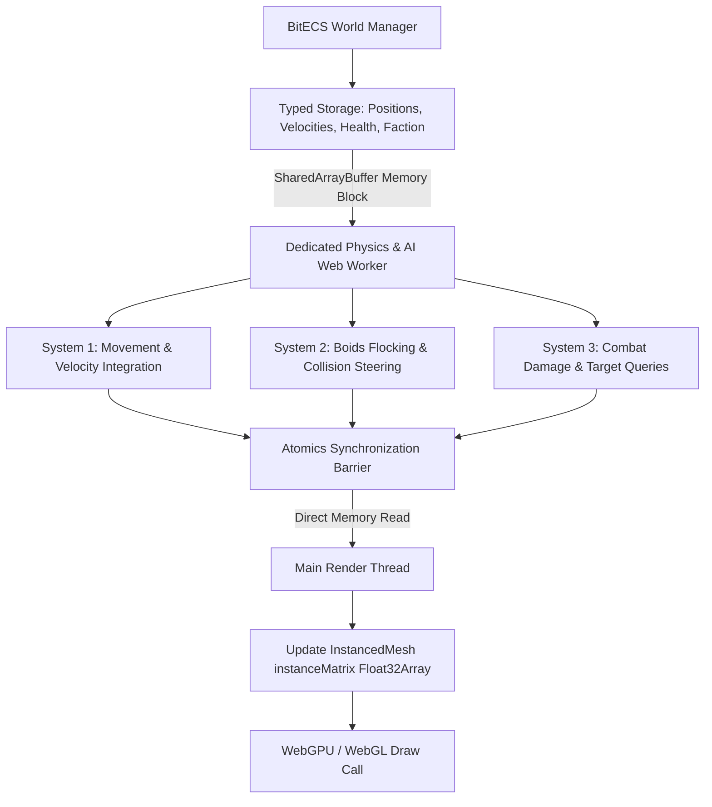

# Pesquisa Arquitetural 19: Data-Oriented ECS, Estrutura de Arrays (SoA) e Web Workers

## 1. Visão Geral Executiva & Contexto no DR-MANAUS
A ambição de manter uma metrópole amazônica viva (com centenas de barcos, milhares de veículos, pedestres e fauna) somada a um Sistema Solar repleto de corpos celestes em órbita, esquadrilhas de combate e titãs colossais exige uma quebra de paradigma na arquitetura de código. A Programação Orientada a Objetos clássica (OOP) no JavaScript — onde cada entidade é uma instância de classe alocada na memória Heap contendo métodos e propriedades esparsas — é devastadora para o desempenho em escala devido à dispersão de ponteiros, falhas de cache de CPU (*cache misses*) e pausas imprevisíveis do Garbage Collector.
O **DR-MANAUS** adota uma arquitetura orientada a dados: **Entity Component System (ECS) baseado em Estrutura de Arrays (Structure of Arrays - SoA)**. Em vez de objetos independentes, todos os dados de componentes (posição, velocidade, vida, facção) residem em buffers de tipagem contígua (`Float32Array` e `Int32Array`). Essa estrutura permite concorrência real através de **Web Workers** compartilhando memória via `SharedArrayBuffer`, processando física, IA de boids e navegação fora do thread principal de renderização.

---

## 2. Referências da Indústria & Jogos de Mundo Aberto
1. **Unity DOTS (Data-Oriented Technology Stack / Unity Engine)**:
   - *Técnica Chave*: Transformação radical do motor Unity para ECS (Entities, C# Job System e Burst Compiler), permitindo simular dezenas de milhares de agentes com consumo mínimo de energia e cache line efficiency.
   - *Aplicabilidade no DR-MANAUS*: Estrutura para os loops de atualização de IA urbana e tráfego fluvial.
2. **Overwatch (Blizzard Entertainment)**:
   - *Técnica Chave*: Arquitetura ECS personalizada e determinística focada em predição de rede, rollback de combate e gerenciamento de estado desacoplado de renderização.
   - *Aplicabilidade no DR-MANAUS*: Separação absoluta entre o estado lógico das entidades e suas malhas visuais de Three.js.
3. **Cities: Skylines II (Colossal Order / Unity DOTS)**:
   - *Técnica Chave*: Simulação massiva de centenas de milhares de cidadãos, eletricidade, água e tráfego utilizando computação multithread orientada a dados.
   - *Aplicabilidade no DR-MANAUS*: Simulação de fluxos energéticos e facções do universo cósmico.
4. **Vampire Survivors (poncle)**:
   - *Técnica Chave*: Gerenciamento extremo de dezenas de milhares de projéteis e inimigos na tela com pooling estrito e sem alocação em tempo de execução.
   - *Aplicabilidade no DR-MANAUS*: Projéteis quânticos e tempestades de plasma emitidas por chefes titânicos.

---

## 3. Repositórios Clonados & Arquivos de Origem Analisados

### 3.1. Repositório `references/bitECS`
- **Arquivo de Origem**: `references/bitECS/src/core/World.ts`
  - *O que inspecionar*: O gerenciador de mundo que administra o ciclo de vida de IDs de entidades através de máscaras de bits compactas e reciclagem de índices livres.
- **Arquivo de Origem**: `references/bitECS/src/core/utils/soa.ts`
  - *O que inspecionar*: Implementação canônica de SoA. Em vez de `[{x, y, z}, {x, y, z}]`, a memória é particionada em:
    `Vector3 = { x: new Float32Array(MAX), y: new Float32Array(MAX), z: new Float32Array(MAX) }`
- **Arquivo de Origem**: `references/bitECS/src/core/Query.ts`
  - *O que inspecionar*: Consultas ultra-eficientes baseadas em operações binárias de bitwise (`AND`, `NOT`) sobre assinaturas de arquétipos de componentes.
- **Arquivo de Origem**: `references/bitECS/src/utils/threading/SpatialGrid/SpatialGrid.ts`
  - *O que inspecionar*: Particionamento espacial contíguo em buffer thread-safe para execução paralela em múltiplos Workers.

### 3.2. Repositório `references/boids-js`
- **Arquivo de Origem**: `references/boids-js/common/BoidsWorker.js`
  - *O que inspecionar*: Padrão de troca de dados contínuos de simulação entre thread principal e workers.

---

## 4. Documentações Oficiais de Bibliotecas & Especificações
1. **bitECS Specification & Benchmarks (Nate The Great)**:
   - [bitECS Official Documentation](https://github.com/NateTheGreatt/bitECS)
   - O framework ECS em JavaScript mais rápido do mundo, superando 100 milhões de iterações por segundo.
2. **SharedArrayBuffer & Atomics (MDN Web Docs)**:
   - [SharedArrayBuffer Specification](https://developer.mozilla.org/en-US/docs/Web/JavaScript/Reference/Global_Objects/SharedArrayBuffer)
   - Primitivas de sincronização e concorrência livre de condições de corrida (*race conditions*).
3. **Data-Oriented Design (Richard Fabian)**:
   - Princípios de projeto de software orientado ao fluxo de hardware, localidade de referência e alinhamento de cache.

---

## 5. Requisitos do Sistema

### Requisitos Funcionais (RF)
- **RF-19-01**: Todas as entidades do jogo (jogadores, veículos, pedestres, inimigos, projéteis e corpos celestes) devem ser identificadas exclusivamente por um índice numérico inteiro (`entityId: number`).
- **RF-19-02**: Os dados das entidades devem residir em buffers SoA tipados contíguos na memória.
- **RF-19-03**: A simulação de física, cinemática de tráfego e lógica de inteligência artificial de bandos deve rodar de forma assíncrona dentro de Web Workers dedicados.
- **RF-19-04**: O thread principal de renderização deve apenas consumir os buffers atualizados para sincronizar as transformações das instâncias visuais do Three.js.
- **RF-19-05**: O sistema deve permitir criar e destruir 10.000 entidades por segundo sem acionar coletas de lixo do Garbage Collector.

### Requisitos Não Funcionais (RNF)
- **RNF-19-01 (Throughput de Simulação)**: O pipeline ECS deve ser capaz de iterar e integrar 20.000 entidades completas em menos de 1,2ms por quadro.
- **RNF-19-02 (Zero GC Pressure)**: A taxa de alocação de objetos no Heap do JavaScript durante o loop contínuo de simulação deve ser estritamente 0 bytes/frame.
- **RNF-19-03 (Sobrecarga de Worker)**: A sincronização de dados entre Web Worker e o thread principal não deve bloquear a CPU por mais de 0,4ms.

---

## 6. Arquitetura da Solução & Diagrama de Fluxo



---

## 7. Módulos & Arquivos Afetados no DR-MANAUS (`src/`)

### 7.1. `src/core/CosmicStateStore.ts` *(Novo Arquivo)*
- **Mudanças**:
  - Implementar armazenamento central SoA com buffers tipados para todas as variáveis cósmicas e urbanas.
  - Exportar esquemas de componentes: `Position`, `Velocity`, `Health`, `Faction`, `OrbitalData`.

### 7.2. `src/world/traffic/TrafficSystem.ts`
- **Mudanças**:
  - Migrar as classes de carros e barcos para queries ECS puras.

### 7.3. `src/entities/PopulationManager.ts`
- **Mudanças**:
  - Substituir arrays de objetos de NPCs por índices de entidades bitECS.

---

## 8. Código de Implementação e Extração Baseado em `references`

```typescript
// Trecho a ser integrado em src/core/CosmicStateStore.ts
// Baseado em references/bitECS/src/core/World.ts e soa.ts

export const MAX_ENTITIES = 50000;

// Componentes em Estrutura de Arrays (SoA) contíguos na memória
export const PositionComponent = {
  x: new Float32Array(MAX_ENTITIES),
  y: new Float32Array(MAX_ENTITIES),
  z: new Float32Array(MAX_ENTITIES)
};

export const VelocityComponent = {
  x: new Float32Array(MAX_ENTITIES),
  y: new Float32Array(MAX_ENTITIES),
  z: new Float32Array(MAX_ENTITIES)
};

export const HealthComponent = {
  current: new Float32Array(MAX_ENTITIES),
  max: new Float32Array(MAX_ENTITIES),
  shield: new Float32Array(MAX_ENTITIES)
};

export class MovementSystem {
  public static update(activeEntities: Int32Array, activeCount: number, dt: number): void {
    const px = PositionComponent.x;
    const py = PositionComponent.y;
    const pz = PositionComponent.z;

    const vx = VelocityComponent.x;
    const vy = VelocityComponent.y;
    const vz = VelocityComponent.z;

    // Loop contíguo em linha de cache da CPU: Zero alocação de objetos
    for (let i = 0; i < activeCount; i++) {
      const eid = activeEntities[i];
      px[eid] += vx[eid] * dt;
      py[eid] += vy[eid] * dt;
      pz[eid] += vz[eid] * dt;
    }
  }
}
```

---

## 9. Plano de Testes & Casos de Teste (Unitários e de Regressão)

### Cenários de Teste Automatizados (`tests/ecs-performance.test.ts`)
1. **CT-19-01 (Integração Cinemática Contígua)**:
   - *Objetivo*: Garantir que a posição de uma entidade é incrementada rigorosamente conforme a velocidade e o tempo decorrido $\Delta t$.
   - *Critério de Aceite*: Nova posição igual a $P_0 + V \cdot \Delta t$ com tolerância de ponto flutuante $10^{-6}$.
2. **CT-19-02 (Reciclagem Segura de IDs de Entidades)**:
   - *Objetivo*: Criar 5.000 entidades, remover 2.000 e criar novas 2.000 entidades.
   - *Critério de Aceite*: Nenhuma entidade excede o teto de `MAX_ENTITIES` e os índices liberados são reutilizados sem vazamento.
3. **CT-19-03 (Teste de Estresse de Performance com 50.000 Entidades)**:
   - *Objetivo*: Executar 100 frames completos de física para 50.000 entidades ativas em SoA.
   - *Critério de Aceite*: Tempo médio por frame inferior a 1,5ms na CPU.
