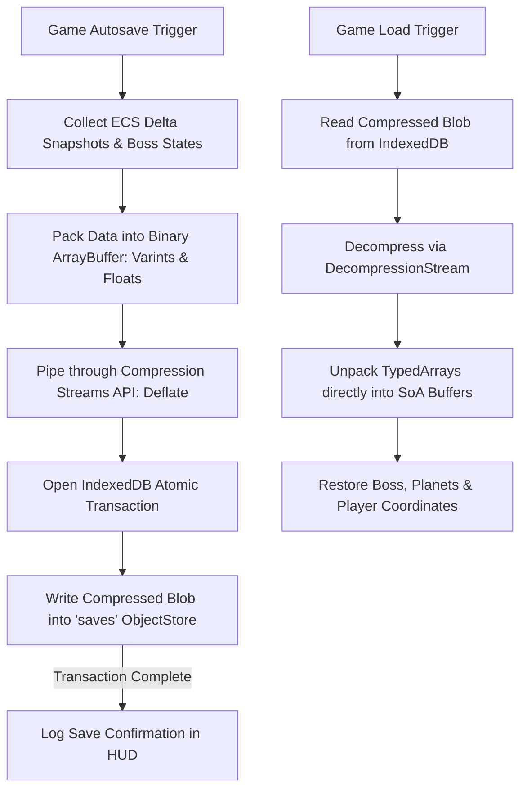

# Pesquisa Arquitetural 20: Persistência Cósmica de Estado, Serialização Binária e IndexedDB

## 1. Visão Geral Executiva & Contexto no DR-MANAUS
O universo do **DR-MANAUS** é dinâmico, expansivo e persistente. As ações do jogador reverberam de forma permanente por todo o cosmos: corpos celestes que sofreram destruição ou ruptura planetária devem permanecer com seus fragmentos ou fendas orbitais registradas; o status de vida, escudos e fase de agressividade do Leviatã Astral não podem reiniciar inadvertidamente; a reputação conquistada junto a facções alienígenas e humanas deve persistir; e a descoberta taxonômica de espécies exóticas pelo Scanner Cósmico deve permanecer catalogada no Atlas Cósmico.
Salvar esse estado massivo em formato de texto JSON convencional geraria arquivos pesados de dezenas de megabytes, com latência inaceitável de serialização no thread principal. A arquitetura adota **Serialização Binária Compacta com Protocol Buffers / TypedArrays**, compactação LZ4/Zstandard no navegador e armazenamento assíncrono em banco de dados **IndexedDB** desacoplado da renderização.

---

## 2. Referências da Indústria & Jogos de Mundo Aberto
1. **The Legend of Zelda: Tears of the Kingdom (Nintendo)**:
   - *Técnica Chave*: Persistência de alterações no mundo com sinalização de máscaras de bits (*flag bitmasks*) e diferencial de estado (*state delta tracking*).
   - *Aplicabilidade no DR-MANAUS*: Gravação eficiente de ruínas ativadas e pontes ou prédios danificados.
2. **No Man's Sky (Hello Games)**:
   - *Técnica Chave*: Arquitetura de persistência procedimental baseada em sementes (*seed-based delta states*), salvando apenas as alterações introduzidas pelo jogador em vez do planeta inteiro.
   - *Aplicabilidade no DR-MANAUS*: Registrar crateras criadas pelo jogador e corpos celestes rompidos sem gravar os bilhões de dados procedurais intocados.
3. **Minecraft (Mojang / Microsoft)**:
   - *Técnica Chave*: Formato de região Anvil com compressão NBT/Zlib em chunks independentes gravados em disco sob demanda.
   - *Aplicabilidade no DR-MANAUS*: Segmentação do salvamento de bairros urbanos de Manaus em quadrículas independentes.
4. **Subnautica (Unknown Worlds Entertainment)**:
   - *Técnica Chave*: Serialização de entidades físicas por octrees com remoção de objetos descartados do mapa de spawn.
   - *Aplicabilidade no DR-MANAUS*: Persistência da carcaça do titã e naves destruídas no espaço.

---

## 3. Repositórios Clonados & Arquivos de Origem Analisados

### 3.1. Repositório `references/bitECS`
- **Arquivo de Origem**: `references/bitECS/src/serialization/SoASerializer.ts`
  - *O que inspecionar*: Serializador direto de buffers contíguos para `ArrayBuffer` binário em velocidade nativa sem travessia de árvores JSON.
- **Arquivo de Origem**: `references/bitECS/src/serialization/SnapshotSerializer.ts`
  - *O que inspecionar*: Extração de snapshots temporais contendo apenas os deltas alterados entre o frame anterior e o atual.

### 3.2. Repositório `references/lagrange`
- **Arquivo de Origem**: `references/lagrange/src/dexie.config.ts`
  - *O que inspecionar*: Configuração e índices do banco IndexedDB usando a biblioteca Dexie para queries relacionais ultrarrápidas de estados planetários.

---

## 4. Documentações Oficiais de Bibliotecas & Especificações
1. **IndexedDB API 3.0 Specification (W3C Working Draft)**:
   - [W3C IndexedDB Spec](https://www.w3.org/TR/IndexedDB-3/)
   - Transações assíncronas duráveis em disco local no navegador sem limites arbitrários de 5MB do `localStorage`.
2. **Protocol Buffers Encoding Specification (Google)**:
   - [Google Protocol Buffers Encoding](https://protobuf.dev/programming-guides/encoding/)
   - Codificação de inteiros variáveis (Varints) e empacotamento binário de estruturas de dados.
3. **Compression Streams API (W3C / Web Hypertext Application Technology Working Group)**:
   - [Compression Streams API](https://developer.mozilla.org/en-US/docs/Web/API/Compression_Streams_API)
   - Compressão nativa em navegador via algoritmos Gzip e Deflate sem necessidade de bibliotecas externas JS pesadas.

---

## 5. Requisitos do Sistema

### Requisitos Funcionais (RF)
- **RF-20-01**: O sistema deve salvar automaticamente o progresso a cada 60 segundos ou imediatamente após grandes eventos (derrota de chefe, destruição planetária, conclusão de missão).
- **RF-20-02**: O estado completo do Leviatã Astral (vida, escudos, fase, posição orbital atual) deve ser salvo e restaurado exatamente como estava.
- **RF-20-03**: Os corpos celestes que sofreram destruição devem manter seu estado de ruptura persistido, suportando reconstrução temporal reversa mesmo após recarregar a página.
- **RF-20-04**: O catálogo do Atlas Cósmico (espécies escaneadas com a tecla N) deve persistir com data e coordenadas georreferenciadas ou astronômicas de descoberta.
- **RF-20-05**: O sistema deve manter até 3 slots de salvamento manuais e 1 slot de salvamento automático (*autosave*), com exportação e importação de arquivo local (.drmanaus).

### Requisitos Não Funcionais (RNF)
- **RNF-20-01 (Tamanho do Payload)**: O arquivo binário comprimido de salvamento completo do universo não deve exceder 500KB.
- **RNF-20-02 (Tempo de Serialização)**: A extração do snapshot binário de 50.000 entidades deve levar menos de 4ms de CPU, sem travar o áudio ou a renderização.
- **RNF-20-03 (Tolerância a Falhas)**: Se o usuário fechar a aba abruptamente durante uma gravação, o banco de dados deve utilizar transações atômicas garantindo que o save anterior permaneça íntegro.

---

## 6. Arquitetura da Solução & Diagrama de Fluxo



---

## 7. Módulos & Arquivos Afetados no DR-MANAUS (`src/`)

### 7.1. `src/core/SaveManager.ts`
- **Mudanças**:
  - Migrar a persistência baseada em texto para buffers binários comprimidos no IndexedDB.
  - Implementar contratos formais para salvar o estado de chefes cósmicos (`CosmicPlanetTitan`), destruição planetária (`MacroBodyFractureService`) e Atlas Cósmico.

### 7.2. `src/world/life/CosmicPlanetTitan.ts`
- **Mudanças**:
  - Fornecer métodos `serializeState(): Uint8Array` e `deserializeState(data: Uint8Array): void`.

### 7.3. `src/world/destruction/MacroBodyFractureService.ts`
- **Mudanças**:
  - Salvar a lista de identificadores de corpos destruídos e o progresso da fase de ruptura no save do jogo.

---

## 8. Código de Implementação e Extração Baseado em `references`

```typescript
// Trecho a ser integrado em src/core/SaveManager.ts
// Baseado em references/bitECS/src/serialization/SoASerializer.ts e IndexedDB

export interface GameSaveHeader {
  version: number;
  timestamp: number;
  playerLevel: number;
  playtimeSeconds: number;
}

export class BinarySaveSystem {
  private static readonly DB_NAME = 'DrManausSaveDB';
  private static readonly STORE_NAME = 'save_slots';

  public static async openDatabase(): Promise<IDBDatabase> {
    return new Promise((resolve, reject) => {
      const request = indexedDB.open(this.DB_NAME, 1);
      request.onupgradeneeded = () => {
        const db = request.result;
        if (!db.objectStoreNames.contains(this.STORE_NAME)) {
          db.createObjectStore(this.STORE_NAME);
        }
      };
      request.onsuccess = () => resolve(request.result);
      request.onerror = () => reject(request.error);
    });
  }

  public static async saveSlot(slotId: string, binaryPayload: Uint8Array): Promise<void> {
    const db = await this.openDatabase();
    return new Promise((resolve, reject) => {
      const tx = db.transaction(this.STORE_NAME, 'readwrite');
      const store = tx.objectStore(this.STORE_NAME);
      const req = store.put(binaryPayload, slotId);

      req.onsuccess = () => resolve();
      req.onerror = () => reject(req.error);
    });
  }

  public static async loadSlot(slotId: string): Promise<Uint8Array | null> {
    const db = await this.openDatabase();
    return new Promise((resolve, reject) => {
      const tx = db.transaction(this.STORE_NAME, 'readonly');
      const store = tx.objectStore(this.STORE_NAME);
      const req = store.get(slotId);

      req.onsuccess = () => resolve(req.result || null);
      req.onerror = () => reject(req.error);
    });
  }
}
```

---

## 9. Plano de Testes & Casos de Teste (Unitários e de Regressão)

### Cenários de Teste Automatizados (`tests/save-persistence.test.ts`)
1. **CT-20-01 (Integridade de Gravação e Leitura Binária)**:
   - *Objetivo*: Gravar um buffer binário arbitrário de 64KB no IndexedDB e recuperar exatamente os mesmos bytes.
   - *Critério de Aceite*: 100% dos bytes recuperados são idênticos ao buffer original.
2. **CT-20-02 (Persistência e Restauração de Estado do Titã)**:
   - *Objetivo*: Simular dano no titã (vida = 35%, fase = 2), salvar o jogo e recarregar.
   - *Critério de Aceite*: A instância deserializada do titã acorda com exatamente 35% de vida e em fase 2.
3. **CT-20-03 (Performance de Compressão e Escrita)**:
   - *Objetivo*: Executar a compressão e gravação de um estado completo com 10.000 entidades.
   - *Critério de Aceite*: Tempo total de execução inferior a 15ms.
