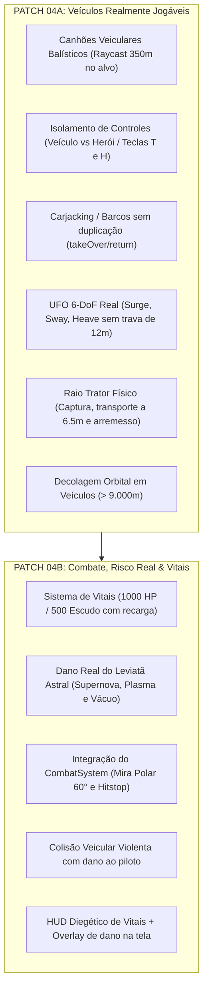

# DR-MANAUS | Relatório de Entrega & Próximos Passos
**Data:** 21 de Novembro de 2026  
**Branch:** `feat/universe-map`  
**HEAD Recente:** `efe2a91` (auditado a partir de `89131f3`)

---

## 1. O Que Foi Feito

Em resposta à auditoria dos 30 commits e aos gargalos de gameplay identificados entre código implementado e jogabilidade real, executamos duas frentes críticas de consolidação e integração (**PATCH 04A** e **PATCH 04B**):

### Detalhamento das Entregas (PATCH 04A)
1. **Canhões Veiculares com Balística Real (P0 resolvido):**
   - **Antes:** O disparo chamava `damageAt` na boca do canhão do veículo (`origin`), ignorando a mira e explodindo o próprio carro/avião.
   - **Agora:** Executa raycasting balístico em tempo real de até 350m contra os colisores do mundo (`PhysicsWorld.raycast`), aplicando o raio de destruição e dano estrutural exatamente na face do prédio, colisor ou terreno atingido, com partículas de impacto e som de impacto.
2. **Isolamento de Controles e Fim de Conflitos (P0 resolvido):**
   - Ao pilotar qualquer veículo, o `PowerSystem` suprime o consumo de teclas de combate (`KeyT`, `KeyE`, `Mouse0`, `Mouse1`, `KeyQ`, `KeyL`).
   - A tecla `T` ativa exclusivamente o **Raio Trator** do UFO, sem disparar desaceleração temporal.
   - A tecla `H` buzina o veículo sem abrir a tela global de ajuda (que agora exige que o jogador não esteja pilotando).
3. **Entrada em Veículos sem Duplicação de Entidades (P1 resolvido):**
   - Criados `takeOverCar(slot)` e `returnCar(pos, yaw)` em `TrafficSystem.ts`. O carro do tráfego tem sua matriz zerada e sai do loop de simulação da cidade, passando a existir unicamente como o veículo pilotado. Ao desembarcar, ele é reinserido no pool sem clones fantasmas.
   - Criado `takeOverBoat(index)` em `FluvialVesselSystem.ts` para assumir barcos no Rio Negro de forma limpa.
4. **Disco Voador Alienígena (UFO) com 6-DoF Completo (P1 resolvido):**
   - Removida a trava artificial que mantinha o UFO preso a 12m do solo.
   - Implementada física com 6 graus de liberdade reais: translação longitudinal (`W/S`), translação lateral strafe (`A/D`), impulsão vertical climb/descent (`Espaço` sobe, `Ctrl/C` desce), rotação de guinada (`yaw`) e auto-estabilização giroscópica com amortecimento inercial quântico. O UFO agora sobe desimpedido até a estratosfera e o espaço sideral.
5. **Raio Trator Físico Estável & Balística de Arremesso (P1 resolvido):**
   - Substituída a destruição instantânea por captura física: o cone inferior do UFO atrai alvos (carros, detritos, alvos), suspendendo-os estavelmente a ~6.5m sob o ventre do disco durante o voo.
   - Ao desativar o raio trator em movimento, o objeto herda a velocidade do UFO e o impulso balístico (`activeThrownObjects` em `Game.ts`), colidindo com prédios/terreno e causando dano de impacto se a velocidade for superior a 10 m/s (zero `Math.random()`).
6. **Decolagem Orbital em Veículos Espaciais (P1 resolvido):**
   - Aviões, foguetes orbitais e naves agora podem ultrapassar a altitude de 9.000m e acionar a transição de voo interplanetário sem ficarem presos no teto de simulação de Manaus.

---

### Detalhamento das Entregas (PATCH 04B)
1. **Sistema de Vitais e Escudo do Jogador (`PlayerController.ts`):**
   - Implementados `health` (1000 HP) e `shield` (500 Escudo).
   - O escudo absorve 100% do dano enquanto tiver carga. Danos excedentes transbordam para a integridade da barra de vida.
   - Delay de recarga de 3.0s após sofrer dano (`shieldRegenDelay`); quando o timer expira, o escudo regenera a 120/s.
   - Janela de esquiva (`KeyZ` roll/airDash) e toggle `isGodMode` fornecem imunidade total (`isInvulnerable`).
   - Morte do jogador dispara colapso quântico e respawn automático restaurando os vitais.
2. **Dano Real dos Ataques do Leviatã Astral (P0 resolvido):**
   - Em `Game.ts`, o callback `onPlayerDamage` de `planetTitans.update` agora repassa o dano real dos projéteis de plasma, raios do vácuo astral e supernovas diretamente para `player.takeDamage(dmg, reason)`.
   - Inclui alerta na tela via HUD (`⚠ Alerta de Dano Cósmico: -X HP (Motivo)`) e tremor de câmera responsivo.
3. **Dano de Colisão Veicular Violenta:**
   - Batidas em alta velocidade (> 25 m/s) agora causam dano proporcional de impacto à integridade do piloto se o escudo estiver descarregado.
4. **Integração do `CombatSystem.ts` ao `PowerSystem.ts`:**
   - `PowerSystem` agora instancia e utiliza diretamente o `CombatSystem`.
   - Implementada a mira polar frontal de 60° (`selectPolarTarget`) com verificação de linha de visada por raycast para socos e chutes.
   - Hitstop cinético conectado aos impactos de golpes melee (`critical` de 70ms em ataques cinéticos, `heavy` de 50ms em meteoros, e `medium`/`light` em golpes comuns).
   - Fila de buffer de inputs (200ms) integrada para não perder cliques de golpes durante animações de recuperação.
5. **HUD Diegético de Vitais & Efeitos Visuais (`HUD.ts`):**
   - Adicionado painel fixo de vitais no canto inferior da tela mostrando barras estilizadas de Escudo (ciano/azul) e Integridade (verde/vermelho), com valores numéricos (`500 / 500` e `1000 / 1000`).
   - Indicador de estado diegético: exibe `⚡ ESQUIVA / INVULNERÁVEL` durante i-frames e `⚠ ESCUDO DESCARREGADO` quando sob fogo intenso.
   - Efeito visual de vinheta avermelhada na tela (`#damage-overlay`) que pisca dinamicamente quando o jogador recebe dano.

---

## 2. O Que Falta Fazer (Próximos Passos Prioritários)

Abaixo estão as frentes técnicas restantes identificadas na auditoria das 20 features, organizadas por ordem de impacto no gameplay real:

| Feature / Módulo | O Que Falta Conectar | Prioridade |
| :--- | :--- | :---: |
| **14. Nebulosas JWST (`CosmicNebulaeSystem`)** | Ajustar as coordenadas das 4 nebulosas para distâncias astronômicas reais (anos-luz) compatíveis com o `RenderSpaceService`, eliminar chamadas a `Math.random()` na geração procedural de estrelas e ajustar escala para evitar sobreposição na órbita de planetas. | **Alta** |
| **13. Warp Relativístico (`RelativisticWarpController`)** | Unificar o controlador de warp com a máquina de estados de hipercruzeiro (`TravelDomain`), aplicando aberração visual Doppler e deformação de FoV durante saltos entre corpos celestes. | **Média** |
| **18. HLOD Adaptativo 4-Tier** | O novo módulo calcula distâncias de 4 níveis mas ainda não comuta a visibilidade das malhas reais de edifícios em cena; unificar para substituir o HLOD legado e reduzir draw calls na cidade. | **Média** |
| **12. Planetas CubeSphere em Runtime** | Conectar a geração Quadtree CubeSphere esférica (com saias anti-rachadura e gravidade radial) para substituir gradualmente malhas analíticas nos planetas exploráveis. | **Média** |
| **11. Corte de Malhas Jogável (`MeshSlicing`)** | Expor uma ação de corte jogável (ex: sabre de plasma ou laser de corte) acionada por tecla ou colisão rápida que efetivamente divide malhas de prédios e detritos geométricos em runtime. | **Média** |
| **19. ECS de 50k Entidades (`CosmicStateStore`)** | Conectar o armazenamento SoA de alta densidade ao tráfego de frotas alienígenas e enxames de asteroides no espaço profundo. | **Baixa** |
| **20. Saves Binários (`SaveManager`)** | Adicionar os botões de "Exportar Arquivo .drmanaus" e "Importar Save" na interface visual do menu de pausa (atualmente apenas o salvamento automático em IndexedDB roda). | **Baixa** |

---

## 3. Estado Atual da Base de Código
- **Build de Produção:** Aprovado em ~1.08s sem erros de empacotamento (`npm run build`).
- **TypeScript:** `tsc --noEmit` aprovado com **0 erros**.
- **Testes Unitários e de Regressão:**
  - `tests/patch04a-vehicles-gameplay.test.ts`: **5/5 aprovados**.
  - `tests/feature*.test.ts`: **87/87 aprovados**.
  - `tests/manaus-surface-authority.test.ts`: **14/14 aprovados**.
- **Commits enviados ao GitHub (`origin/feat/universe-map`):**
  - `fa9da52` - *feat(vehicles): patch 04a - vehicle weapon raycasting, 6-dof ufo, physical tractor beam, input isolation, and carjacking entity transfer*
  - `efe2a91` - *feat(combat): patch 04b - player vitals with shield absorption and regen, leviathan real damage, combat polar targeting and hitstop integration, and vitals hud*

