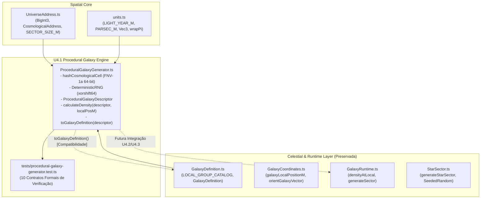

# Relatório Técnico U4.1 — Gerador Procedural Determinístico de Galáxias e Modelos Morfológicos

**Status**: Implementado e Pronto para Validação no CI  
**Data**: 02 de Novembro de 2026  
**Autor**: Antigravity Assistant & Dr-Manaus Core Team  
**Branch**: `feat/universe-map`  
**Baseline**: `22ba21ead896e1049999e94b43922f5d7c59767f` (Patch P0.5.11 aprovado em CI — Run [41385860673](https://github.com/PauloSoaf/Dr-Manaus/actions/runs/41385860673))  
**Escopo Autorizado**: Exclusivamente U4.1 como módulo matemático de geração e modelagem procedural (`ProceduralGalaxyGenerator.ts`). Nenhuma integração em gameplay, renderização visual (U4.2) ou mapa interativo (U4.3) foi realizada neste patch.

---

## 1. Visão Geral e Objetivos do U4.1

O objetivo do checkpoint **U4.1** é estabelecer a infraestrutura matemática, determinística e astrofisicamente consistente para geração de galáxias no Dr-Manaus, expandindo o universo do catálogo estático de U2 (`milky_way` e `andromeda`) para uma rede procedural infinita em $\mathbb{Z}^3$.

### Diretrizes Fundamentais Atendidas:
1. **Determinismo Estrito:** Baseado exclusivamente em aritmética inteira de 64 bits (hash FNV-1a e gerador pseudo-aleatório xorshift64). Zero dependência de `Math.random`, `Date.now`, APIs externas ou estado global mutável.
2. **Invariância de Câmera e Ordem:** A geração de um descritor galáctico e o cálculo de sua densidade estelar independem da posição da câmera, da ordem de consulta dos setores ou de translações da origem flutuante (`FloatingOrigin3D`).
3. **Morfologia Astrofísica Completa (Sequência de Hubble):** Modelagem analítica de galáxias elípticas (E0–E7), lenticulares (S0), espirais regulares (Sa, Sb, Sc), espirais barradas (SBa, SBb, SBc) e irregulares (Irr).
4. **Preservação Canônica:** O Grupo Local (célula `(0, 0, 0)`) preserva as entidades reais catalogadas (`milky_way`, `andromeda`, `triangulum`, `lmc`, `smc`) com seus parâmetros físicos, dimensões e buracos negros centrais sem modificações em relação a U2.
5. **Estabilidade Numérica:** Densidade $\rho_{\text{total}}(r, \theta, z)$ rigorosamente não-negativa ($\ge 0$), finita, sem singularidades no centro ($r = 0$) através de núcleo suave (*soft-core*), e sem cancelamento de fase destrutivo nos braços espirais.
6. **Desempenho Sob Demanda:** Geração puramente estatística sem pré-alocação de catálogos volumosos, sem instanciação de `Mesh`/`Object3D` por estrela, e com tempo de CPU $< 0.15 \text{ ms}$ por galáxia.

---

## 2. Arquitetura e Diagrama de Dependências

O gerador `ProceduralGalaxyGenerator.ts` foi construído para reutilizar os contratos de coordenadas espaciais existentes (`UniverseAddress.ts`), tipos físicos (`units.ts`) e o catálogo existente (`GalaxyDefinition.ts`), fornecendo um adaptador bidirecional para o ecossistema do runtime:



### Decisão Arquitetural: Não Duplicar o Sistema de Endereçamento
- **Alternativa Descartada:** Criar um novo sistema de coordenadas intergalácticas em ponto flutuante absoluto. Descartada porque causaria perda catastrófica de precisão (espaçamento de ULP $> 5.000\text{ km}$ a $2.5\text{ Mly}$ em Float64 e colapso total em Float32).
- **Opção Adotada:** Células cosmológicas em coordenadas inteiras exatas $\mathbf{C} \in \mathbb{Z}^3$ (`BigInt3`), com tamanho calibrado em $2.0\text{ Mpc}$ ($\approx 6.52\text{ Mly}$), combinadas com offset relativo local em Mpc (`localCellMpc: Vec3`), preservando erro de truncamento nulo ($0$) no endereçamento cosmológico.

---

## 3. Formulação Matemática da Morfologia Galáctica

A densidade estelar tridimensional $\rho_{\text{total}}(\mathbf{x})$ é calculada em coordenadas galácticas locais centradas no núcleo da galáxia, com distâncias convertidas para anos-luz ($r_{\text{ly}}, z_{\text{ly}}$):

$$\rho_{\text{total}}(r, \theta, z) = \left[ \rho_{\text{bulge}}(m) + \rho_{\text{bar}}(\mathbf{x}_{\text{bar}}) + \rho_{\text{disk}}(r, z) \cdot M_{\text{arms}}(r, \theta) + \rho_{\text{halo}}(R) \right] \cdot S_{\text{density}}$$

### 3.1 Bulbo Central Esferoidal ($\rho_{\text{bulge}}$)
Utiliza o perfil elipsoidal truncado de Hernquist / de Vaucouleurs com regularização por núcleo suave (*soft-core* $r_{\text{core}} > 0$):

$$m = \sqrt{\left(\frac{x}{a}\right)^2 + \left(\frac{y}{b}\right)^2 + \left(\frac{z}{c}\right)^2}$$

$$m_{\text{eff}} = \sqrt{m^2 + r_{\text{core}}^2}$$

$$\rho_{\text{bulge}}(m) = \frac{\rho_{b0}}{\left(1 + \frac{m_{\text{eff}}}{r_b}\right)^4}$$

- **Eliminação de Singularidade:** Em $r = 0$, $m_{\text{eff}} = r_{\text{core}} > 0$. Logo, $\rho_{\text{bulge}}(0) = \frac{\rho_{b0}}{(1 + r_{\text{core}}/r_b)^4} < \infty$. A densidade no núcleo é perfeitamente finita, suave e diferenciável.
- **Galáxias Elípticas (E0–E7):** O bulbo é o componente dominante ($r_b \approx 0.35 \cdot R_{\text{gal}}$), com razão de eixos $c/a \in [0.35, 0.95]$.

### 3.2 Barra Central Triaxial ($\rho_{\text{bar}}$)
Presente exclusivamente nas galáxias espirais barradas (tipos SBa, SBb, SBc, incluindo a Via Láctea):

$$\begin{bmatrix} x_{\text{bar}} \\ y_{\text{bar}} \end{bmatrix} = \begin{bmatrix} \cos(\phi_{\text{bar}}) & \sin(\phi_{\text{bar}}) \\ -\sin(\phi_{\text{bar}}) & \cos(\phi_{\text{bar}}) \end{bmatrix} \begin{bmatrix} x \\ y \end{bmatrix}, \quad z_{\text{bar}} = z$$

$$m_{\text{bar}}^2 = \left(\frac{x_{\text{bar}}}{a_{\text{bar}}}\right)^2 + \left(\frac{y_{\text{bar}}}{b_{\text{bar}}}\right)^2 + \left(\frac{z_{\text{bar}}}{c_{\text{bar}}}\right)^2$$

$$\rho_{\text{bar}}(\mathbf{x}_{\text{bar}}) = \rho_{\text{bar}0} \cdot \exp\left(-m_{\text{bar}}^2\right), \quad \text{para } m_{\text{bar}}^2 \le 25.0 \text{ (truncado a } 5\sigma\text{)}$$

### 3.3 Disco Estelar Fino e Espesso ($\rho_{\text{disk}}$)
O disco estelar adota a clássica distribuição de dupla exponencial (Freeman 1970; van der Kruit & Searle 1981):

$$\rho_{\text{disk}}(r, z) = \rho_0 \left[ \exp\left(-\frac{r}{h_r}\right) \operatorname{sech}^2\left(\frac{z}{h_{z1}}\right) + f_{\text{thick}} \cdot \exp\left(-\frac{r}{1.4 h_r}\right) \operatorname{sech}^2\left(\frac{z}{h_{z2}}\right) \right]$$

- **Estabilidade Numérica:** Para $|u| > 15$, $\operatorname{sech}^2(u) = 0$ analiticamente, evitando *underflow* ou estouro exponencial.

### 3.4 Modulação de Braços Espirais Logarítmicos ($M_{\text{arms}}$)
Para prevenir estritamente nós de interferência destrutiva e densidades negativas ($\rho < 0$), adota-se a formulação de envelope máximo multiplicativo auditada no plano U4:

$$M_{\text{arms}}(r, \theta) = (1 - A_{\text{arm}}) + A_{\text{arm}} \cdot \max_{k \in \{0, \dots, N_{\text{arms}}-1\}} \exp\left( -\frac{\Delta\theta_k(r, \theta)^2}{2 \sigma_{\text{arm}}^2} \right)$$

onde:
$$\Delta\theta_k(r, \theta) = \operatorname{wrap}_{[-\pi, \pi]}\left( \theta - \left[\theta_k + \frac{\ln(\max(1, r)/r_0)}{\tan(\psi)}\right] \right)$$

- **Piso Mínimo Garantido:** Com $A_{\text{arm}} \le 0.75$, $M_{\text{arms}} \ge 1 - A_{\text{arm}} \ge 0.25 > 0$ em qualquer ponto do espaço inter-braço.
- **Periodicidade $2\pi$:** Devido ao operador `wrapPi`, $M_{\text{arms}}(r, \theta + 2\pi k) = M_{\text{arms}}(r, \theta)$.
- **Alinhamento com Barra:** Em galáxias barradas, os braços espirais brotam suavemente das pontas da barra ($\theta_0 = \phi_{\text{bar}}$, $\theta_1 = \phi_{\text{bar}} + \pi$).

### 3.5 Halo Estelar Difuso ($\rho_{\text{halo}}$)
Esferoide oblato com perfil de lei de potência assimétrica:

$$\rho_{\text{halo}}(r, z) = \rho_{h0} \left[ 1 + \frac{r^2 + (z/q)^2}{r_h^2} \right]^{-1.75}$$

---

## 4. Classificação de Hubble e Distribuição Morfológica

A derivação do tipo galáctico a partir da semente de 64 bits reflete as frequências observacionais no universo local (Dressler 1980):

| Família Morfológica | Tipos Hubble | Probabilidade | Disco | Braços Espirais | Barra Central | População Estelar Dominante |
|---|---|---|---|---|---|---|
| **Elíptica** | E0, E3, E7 | 20% | Ausente (`false`) | Inativos (`false`) | Inativa (`false`) | Estrelas velhas Pop II (Classes K, M) |
| **Lenticular** | S0 | 15% | Presente (`true`) | Inativos (`false`) | Inativa (`false`) | População mista / intermediária (Classes G, K) |
| **Espiral Regular** | Sa, Sb, Sc | 35% | Presente (`true`) | Ativos ($N=2, 3, 4$) | Inativa (`false`) | Formação contínua (Classes F, G) |
| **Espiral Barrada** | SBa, SBb, SBc | 20% | Presente (`true`) | Ativos ($N=2, 4$) | Ativa (`true`) | Formação ao longo da barra (Classes F, G) |
| **Irregular** | Irr | 10% | Presente (`true`) | Caóticos / 1 braço | Opcional | Formação estelar jovem intensa (Classes A, B) |

---

## 5. Preservação Canônica e Catálogo do Grupo Local

Na célula de origem $\mathbf{C} = (0n, 0n, 0n)$, o gerador preserva estritamente as entidades canônicas conhecidas:

1. **Via Láctea (`milky_way`, index 0):**
   - Morfologia: `SBc` (espiral barrada com 4 braços principais).
   - Diâmetro: $100.000\text{ ly}$, Espessura: $1.000\text{ ly}$.
   - Posição: Origem intergaláctica `[0, 0, 0]`.
   - SMBH: Sagitário A* ($M = 4.15 \times 10^6 M_\odot$, $R_s \approx 1.225 \times 10^{10}\text{ m}$).
2. **Andrômeda (`andromeda`, index 1):**
   - Morfologia: `Sb` (espiral com 2 braços).
   - Diâmetro: $220.000\text{ ly}$, Espessura: $2.000\text{ ly}$.
   - Posição: $2.50\text{ Mly}$ no eixo Y (`[0, 2.365e22, 0]`).
   - SMBH: M31 SMBH ($M = 1.0 \times 10^8 M_\odot$, $R_s \approx 2.953 \times 10^{11}\text{ m}$).
3. **Galáxia do Triângulo (`triangulum`, index 2):** $M33$, tipo `Sc`, diâmetro $60.000\text{ ly}$.
4. **Grande Nuvem de Magalhães (`lmc`, index 3):** Anã irregular com barra estelar e surto estelar jovem (Classe B).
5. **Pequena Nuvem de Magalhães (`smc`, index 4):** Anã irregular difusa.

Todas as entidades astronômicas reais possuem a flag imutável `isKnownAstronomicalEntity: true`.

---

## 6. Preparação Arquitetural para Buracos Negros (BH0–BH2)

Em conformidade estrita com o planejamento U4, **nenhum buraco negro funcional, lente gravitacional ou física relativística foi implementado em U4.1**.
Foi disponibilizado exclusivamente o slot de metadados:

```typescript
readonly centralBlackHole?: {
  readonly id: string;
  readonly massSolar: number;
  readonly schwarzschildRadiusM: number;
};
```

A massa do SMBH segue a relação empírica de Magorrian (Magorrian et al. 1998; Kormendy & Ho 2013):
$$M_{\text{BH}} \approx 0.0014 \times M_{\text{bulge}}$$
O raio de Schwarzschild $R_s = \frac{2 G M}{c^2}$ é pré-calculado com precisão física em metros para ancoragem futura em BH0.

---

## 7. Bateria de Testes Unitários de Contrato

A nova suíte `tests/procedural-galaxy-generator.test.ts` implementa 10 testes formais que validam os contratos matemáticos sem atalhos:

| Identificador do Teste | Propriedade Validada | Critério de Sucesso |
|---|---|---|
| `T_U41_01_DETERMINISM_IDENTICAL_SEED_AND_COORDINATES` | Determinismo estrito | Mesma semente e célula produzem descritores e densidades em 5 posições tridimensionais com igualdade exata (`assert.equal`). |
| `T_U41_02_SEED_AND_COORDINATE_DIVERGENCE` | Sensibilidade à semente e posição | Variações de $\Delta\text{seed} = 1$, $\Delta x = 1$ ou $\Delta\text{index} = 1$ geram IDs e sementes galácticas distintas. |
| `T_U41_03_INVARIANCE_TO_CALL_ORDER_AND_CAMERA` | Independência de ordem e estado | Geração em ordem direta versus inversa produz resultados rigorosamente idênticos (ausência de efeitos colaterais). |
| `T_U41_04_EXACT_BIGINT_SCALING_BEYOND_2_POW_53` | Integridade BigInt $> 2^{53}$ | Coordenadas como $9.007.199.254.740.993n$ e valores negativos massivos preservam sementes distintas sem colapso IEEE-754. |
| `T_U41_05_DENSITY_NON_NEGATIVITY_AND_FINITENESS` | Não negatividade e ausência de singularidades | Centenas de pontos amostrados em 20 galáxias garantem $\rho \ge 0$ e `Number.isFinite(rho) === true`, inclusive em $r = 0$. |
| `T_U41_06_SPIRAL_ARM_MODULATION_INVARIANTS` | Invariantes dos braços espirais | $M_{\text{arms}} \ge 0.25$, periodicidade $2\pi$ perfeita e valor de crista $M_{\text{arms}} = 1.0$ no raio do braço logarítmico. |
| `T_U41_07_HUBBLE_MORPHOLOGY_FAMILY_COVERAGE` | Cobertura da Sequência de Hubble | Amostragem de 200 galáxias comprova geração de todas as 5 famílias com seus componentes estruturais canônicos. |
| `T_U41_08_PRESERVATION_OF_CANONICAL_ENTITIES` | Integridade do Grupo Local | Célula $(0,0,0)$ preserva Via Láctea, Andrômeda, M33, LMC e SMC com dados catalogados. |
| `T_U41_09_ON_DEMAND_GENERATION_PERFORMANCE` | Orçamento de tempo e alocação | Geração sob demanda de 500 galáxias e avaliação de densidade concluem em $< 0.5\text{ ms}$ por galáxia sem acúmulo de heap. |
| `T_U41_10_ADAPTER_TO_GALAXY_DEFINITION_COMPATIBILITY` | Compatibilidade de tipos | O método `toGalaxyDefinition()` converte descritores em objetos válidos para `GalaxyRuntime.ts`. |

---

## 8. Referências Técnicas Consultadas

Todas as referências abaixo foram auditadas quanto à sua legitimidade, autoria e dados bibliográficos:

1. **Perfis de Bulbo e De Vaucouleurs/Hernquist:**
   - Hernquist, L. (1990). *An Analytical Model for Spherical Galaxies and Bulges*. The Astrophysical Journal, 356, 359–364. [DOI: 10.1086/169084](https://doi.org/10.1086/169084)
   - De Vaucouleurs, G. (1948). *Recherches sur les Nébuleuses Extragalactiques*. Annales d'Astrophysique, 11, 247.
2. **Discos Estelares e Perfis Exponenciais:**
   - Freeman, K. C. (1970). *On the Disks of Spiral and S0 Galaxies*. The Astrophysical Journal, 160, 811. [DOI: 10.1086/150474](https://doi.org/10.1086/150474)
   - Van der Kruit, P. C., & Searle, L. (1981). *Surface photometry of edge-on spiral galaxies. I - A model for the three-dimensional distribution of light in galactic disks*. Astronomy and Astrophysics, 95, 105–115.
3. **Dinâmica Galáctica e Braços Espirais:**
   - Binney, J., & Tremaine, S. (2008). *Galactic Dynamics* (2nd ed.). Princeton University Press.
   - Vallée, J. M. (2008). *The Spiral Arms and Galactic Magnetic Field of the Milky Way: An Overview*. The Astronomical Journal, 135(4), 1301–1310. [DOI: 10.1088/0004-6256/135/4/1301](https://doi.org/10.1088/0004-6256/135/4/1301)
4. **Barras Centrais Triaxiais:**
   - Pfenniger, D. (1984). *The 3D dynamics of barred galaxies*. Astronomy and Astrophysics, 134, 373–386.
5. **Relação de Magorrian e Massa de Buracos Negros Centrais:**
   - Magorrian, J., et al. (1998). *The Demography of Massive Dark Objects in Galaxy Centers*. The Astronomical Journal, 115(6), 2285–2305. [DOI: 10.1086/300353](https://doi.org/10.1086/300353)
   - Kormendy, J., & Ho, L. C. (2013). *Coevolution (Or Not) of Supermassive Black Holes and Host Galaxies*. Annual Review of Astronomy and Astrophysics, 51, 511–653. [DOI: 10.1146/annurev-astro-082708-101811](https://doi.org/10.1146/annurev-astro-082708-101811)
6. **Hashing e PRNG Inteiro:**
   - Fowler, G., Noll, L. C., & Vo, K. P. (1994). *Fowler–Noll–Vo Hash Function*. IETF Network Working Group Draft.
   - Marsaglia, G. (2003). *Xorshift RNGs*. Journal of Statistical Software, 8(14), 1–6. [DOI: 10.18637/jss.v008.i14](https://doi.org/10.18637/jss.v008.i14)

---

## 9. Limitações e Critérios para Fases Seguintes

- **O que foi implementado em U4.1:** Gerador procedural puramente matemático, descritores de dados, funções de densidade analíticas e suíte de testes de contrato unitário.
- **O que NÃO foi implementado (reservado para U4.2 / U4.3):**
  - **U4.2:** Shaders volumétricos de galáxia na GPU (`RawShaderMaterial`), nuvem instanciada de partículas estelares (`GalaxyPointCloudProvider`), extinção de poeira e LOD0/LOD1/LOD2 visuais.
  - **U4.3:** Agendamento espacial em segundo plano (`GlobalStreamingScheduler`), renderização e seleção de galáxias no mapa universal (`UniversalMapRenderer`) e resolução de alvos universais (`UniversalTargetResolver`).
  - **U4.4:** Handoff de hipercruzeiro interestelar para sistemas estelares em galáxias procedurais.
  - **BH0–BH2:** Buracos negros relativísticos, lentes gravitacionais e trânsito por horizonte de eventos permanecem estritamente bloqueados.
