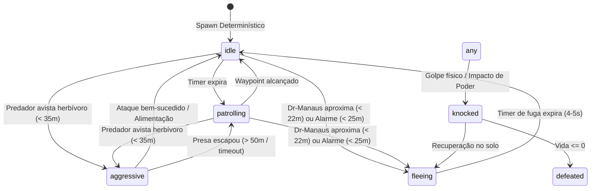

# DR-MANAUS | ESPECIFICAÇÃO TÉCNICA
## VIVO-07: IA Ecológica Avançada, Predação, Manadas (Flocking) e Rotinas de Vida

---

### 1. OBJETIVO E VISÃO GERAL

O subsistema VIVO-07 introduz uma simulação ecológica viva para a fauna alienígena do Dr-Manaus:
1. **Pirâmide Trófica Determinística**: Em mundos de biosfera avançada (`fauna` com alta habitabilidade ou `civilized`), as criaturas são geradas com papéis ecológicos distintos:
   - **Herbívoros** ($\sim 75\%$ da biomassa): `chitinous-quadrupeds`, `amphibious-crawlers`, `serpentine-burrowers`.
   - **Carnívoros / Predadores** ($\sim 25\%$): `bipedal-predators`, `avian-gliders`.
   - **Predadores Apex**: Indivíduos dominantes com maior porte, vida ampliada e mordida devastadora.
2. **Ciclo de Predação e Perseguição**: Predadores escaneiam herbívoros próximos ($< 35\text{ m}$), entram em estado `'aggressive'`, perseguem com velocidade multiplicada ($1.5\times$) e atacam a curta distância ($< 2.8\text{ m}$), alimentando-se e entrando em repouso.
3. **Comportamento de Manada (Flocking Tangencial)**: Algoritmo boids simplificado no plano tangente ao relevo com coesão de grupo e separação mínima ($3.5\text{ m}$) para evitar sobreposição de geometrias.
4. **Propagação de Alarme em Manada**: Quando uma criatura é atacada pelo Dr-Manaus ou predador, um raio de alarme acústico/sísmico ($25\text{–}30\text{ m}$) alerta todos os herbívoros próximos, disparando debandada (`'fleeing'`) na direção oposta à ameaça.
5. **Determinismo Estrito**: Todo comportamento de patrulha e decisão é governado pela função `hashFauna(seed, index, tick)` sem uso de `Math.random()`.

---

### 2. ARQUITETURA E MÁQUINA DE ESTADOS DA FAUNA

---

### 3. FORMULAÇÃO MATEMÁTICA E REGRAS ECOLÓGICAS

#### 3.1 Separação e Coesão de Manada
Para cada herbívoro $i$ com vizinhos $j$ da mesma morfologia a distância $d_{ij} < R_{\text{flock}} = 18\text{ m}$:
- **Separação**:
  $$\mathbf{F}_{\text{sep}} = \sum_{j} -\frac{\mathbf{p}_j - \mathbf{p}_i}{d_{ij}} (R_{\text{min}} - d_{ij}) \quad \text{para } d_{ij} < R_{\text{min}} = 3.5\text{ m}$$
- **Coesão**:
  $$\mathbf{p}_{\text{target}} \leftarrow 0.7 \cdot \mathbf{p}_{\text{target}} + 0.3 \cdot \frac{1}{N} \sum_{j=1}^N \mathbf{p}_j$$

#### 3.2 Dano de Mordida Predatória
- Predador comum: $40\text{ HP}$ de dano com impulso de elevação $4\text{ m/s}$.
- Predador Apex: $65\text{ HP}$ de dano com impulso de elevação $4\text{ m/s}$.

---

### 4. COBERTURA DE TESTES AUTOMATIZADOS

O subsistema é validado por `tests/alien-fauna-ecological-ai.test.ts`:
- `T_VIVO07_01_ECOLOGICAL_ROLES_AND_PYRAMID`: Proporção trófica herbívoros vs carnívoros vs apex.
- `T_VIVO07_02_PREDATION_HUNTING_AND_STRIKE`: Detecção de presa, perseguição e mordida.
- `T_VIVO07_03_HERD_ALARM_PROPAGATION`: Dispersão e debandada de manada após ataque.
- `T_VIVO07_04_HERD_FLOCKING_SEPARATION_AND_COHESION`: Força de repulsão $< 3.5\text{ m}$.
- `T_VIVO07_05_DETERMINISTIC_AI_WANDER`: Reprodutibilidade exata de trajetórias por seed.

