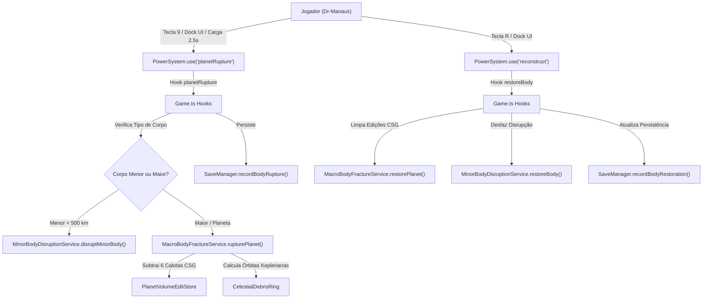

# DR-MANAUS | ESPECIFICAÇÃO TÉCNICA
## VIVO-12 / VIVO-13 / VIVO-14: Ruptura Planetária Catastrófica, Cinturão de Destroços e Reconstrução Cósmica

---

### 1. OBJETIVO E VISÃO GERAL

O subsistema de Ruptura Planetária Catastrófica (`planetRupture`) e Reconstrução Cósmica (`reconstruct`) expande a capacidade destrutiva e restauradora do Dr-Manaus da escala urbana/geomecânica para a escala cósmica planetária:

1. **Ruptura Planetária Global (VIVO-12)**: Permite ao jogador descarregar energia cósmica extrema ($\sim 10^{28}\text{ J}$) contra o corpo celeste ativo dominante, fragmentando o manto e crosta através de cavidades de fissura ortogonais e antípodas.
2. **Cinturão de Destroços Keplerianos (VIVO-13)**: A matéria ejetada da crosta é convertida em um anel persistente de fragmentos orbitais keplerianos calculados analiticamente entre $1.05\,R_{\text{planeta}}$ e $2.50\,R_{\text{planeta}}$.
3. **Reconstrução Cósmica e Limpeza Volumétrica (VIVO-14)**: A habilidade de reconstrução (`reconstruct`, tecla `R`), quando invocada em órbita ou corpo celeste danificado, restaura o corpo celeste integralmente, expurgando todas as edições CSG subtrativas do `PlanetVolumeEditStore`.
4. **Persistência de Estado no `SaveManager`**: O estado de corpos celestes rompidos é registrado em `save.data.rupturedBodies` e reconstruído deterministicamente no reinício de sessões.

---

### 2. ARQUITETURA E FLUXO DE EXECUÇÃO

---

### 3. MECÂNICA DE CARGA E ACIONAMENTO NO `PowerSystem`

- **Cooldown**: 5,0 segundos.
- **Teclas e Controles**:
  - `Digit9` ou clique no botão correspondente do HUD Dock: seleciona ou dispara a habilidade.
  - Manter `Digit9` ou segurar `Mouse0` com `'planetRupture'` selecionado acumula carga durante 2,5 segundos, intensificando screen shake procedural.
  - Ao completar a carga, a onda de choque de raio $250\sqrt{\text{size}}\text{ m}$ e a ruptura cósmica são executadas.

---

### 4. GEOMETRIA E DETRITOS CSG

Ao romper um planeta de raio $R_0$:
- **Calotas de Ruptura**:
  - Calota primária com raio de corte $0.45\,R_0$ e profundidade $0.25\,R_0$.
  - 5 cavidades antípodas e equatoriais ortogonais dispostas em $[\pm R_0, 0, 0]$, $[0, \pm R_0, 0]$ e $[0, 0, \pm R_0]$.
- **Anel Orbital de Fragmentos**:
  - Gerado com 16 fragmentos discretos ponderados por lei de potência.
  - Elementos orbitais com semi-eixo maior, excentricidade elíptica ($e < 1.0$) e inclinação média consistente com o momento angular transmitido.

---

### 5. GARANTIAS E TESTES AUTOMATIZADOS

O subsistema possui cobertura completa em `tests/planet-rupture-power.test.ts`:
- `T_RUPTURE_01_POWER_HOOK_TRIGGER`: Execução e cooldown do hook no `PowerSystem`.
- `T_RUPTURE_02_MACRO_PLANET_RUPTURE`: Criação do plano com estado `'RUPTURED'`, anel kepleriano e calotas CSG no `PlanetVolumeEditStore`.
- `T_RUPTURE_03_SAVE_PERSISTENCE`: Idempotência e persistência via `SaveManager`.
- `T_RUPTURE_04_PLANETARY_RECONSTRUCTION`: Limpeza integral de edições CSG volumétricas e restauração via poder `reconstruct`.
- `T_RUPTURE_05_MINOR_BODY_DISRUPTION_AND_RESTORATION`: Ciclo de vida completo para corpos celestes menores.
